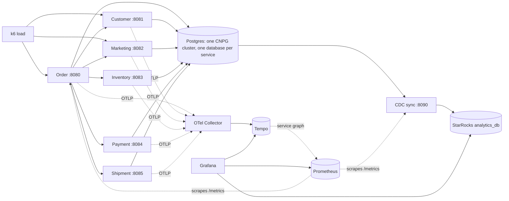

# CLAUDE.md

This file guides AI assistants working on DataStack.

## Project Summary

DataStack is a demo for the Data Engineering Things Summit. It runs a small e-commerce business as six Go microservices on a local Kubernetes (kind) cluster, drives it with k6 traffic, streams every database change into StarRocks, and makes the whole system observable:

1. **Operational layer:** six Go REST microservices (Order, Customer, Marketing, Inventory, Payment, Shipment). Each one owns its own Postgres database and talks to the others over synchronous HTTP JSON.
2. **Load:** k6 runs inside the cluster and simulates customer journeys (sign up, ad click, checkout) at a configurable rate.
3. **Analytical layer:** a Go CDC sync daemon polls every table by `(updated_at, id)` and loads micro-batches into StarRocks over Stream Load.
4. **Observability layer:** every service emits OpenTelemetry traces (Collector → Tempo) and Prometheus metrics. Grafana shows traces, the service map, service and pipeline metrics, and business dashboards that query StarRocks directly.

The architecture spec, and the source of truth for conventions, is [docs/microservices/README.md](docs/microservices/README.md). **Read its §3 "Shared Conventions" before writing or changing any service.**

## Architecture



The Order Service is the only one that calls other services. It orchestrates checkout: validate customer → reserve stock (which prices the order) → charge → record conversion → request shipment. The others are leaf nodes.

## Repository Layout

```
pkgs/                 shared Go packages: cli, database (GORM, base Model, AutoMigrate), migrate,
                      httpserver (gin router, errors, metrics), httpclient (service-to-service),
                      logging, telemetry, pgtest (testcontainers Postgres)
services/<name>/      one binary per service: main.go, serve.go, internal/<domain>/
services/cdc-sync/    the Postgres → StarRocks sync daemon
deploy/charts/go-service/  ONE generic Helm chart for every Go service
deploy/values/        per-service values for that chart
deploy/infra/         CNPG Postgres cluster, StarRocks
deploy/observability/ Collector, Tempo, Prometheus and Grafana values, plus dashboards/*.json
deploy/k6/            the load script and its Deployment
deploy/kind/          kind cluster config
docs/microservices/   architecture README + one doc per service + cdc-sync.md
docker-compose.yml    a local Postgres only, for `go run` development
```

One Go module at the repo root (`github.com/poph2/datastack`), Go 1.26, one shared `Dockerfile` (`--build-arg SERVICE=<name>`).

## Running It

```sh
make kind-up            # create the kind cluster
make infra              # CloudNativePG operator + Postgres
make analytics          # StarRocks (~3 GB of memory)
make observability      # OTel Collector, Tempo, Prometheus, Grafana + dashboards
make deploy-all         # build, kind load and helm install every service + CDC
make load RATE=10       # k6 journeys per second (make load-stop to stop)
make grafana            # Grafana on http://localhost:3000
make forward-order      # any service on its own port: forward-<name>
make status             # pods and databases
```

Local development without kind: `make up` (Postgres in Docker Compose), then `make run-<service>`.

## Rules for Assistants

- **Always target the kind cluster explicitly.** The user's kubeconfig also contains production clusters. Use the Makefile targets, or pass `--context kind-datastack` to kubectl and `--kube-context kind-datastack` to helm. Never rely on the current context.
- **Follow the conventions in docs/microservices/README.md §3.** In short:
  - **Schema:** the GORM model is the schema (`AutoMigrate`, named CHECKs, partial unique indexes on `deleted_at IS NULL`). Embed `database.Model`. Postgres is the only clock for `created_at`/`updated_at`. Soft deletes only.
  - **Concurrency:** use guarded SQL (`UPDATE ... WHERE <guard> RETURNING`), not locks or read-then-write. That covers stock, state transitions and conversions.
  - **Money:** `shopspring/decimal`, serialised as fixed two-decimal strings. Never `float64`.
  - **HTTP:** `400` means bad input, `404` an unknown entity, `409` a conflict with current state. Errors use the shared `{"error": CODE, "message"}` body. Business failures are data (4xx), not 5xx.
  - **Calls between services:** use `pkgs/httpclient` with a per-peer timeout. Never retry anything that isn't idempotent.
  - **Background workers:** run them beside the HTTP server under `errgroup`, and make them safe with several replicas.
  - **Configuration:** cobra + viper. Every flag is also an env var (`--tier-weights` ↔ `TIER_WEIGHTS`).
- **Go style:** follow [.github/skills/go-clean-code/SKILL.md](.github/skills/go-clean-code/SKILL.md). Run `make lint` (gofmt, vet, helm lint) and `make test` before calling Go work done.
- **Tests:** handler tests go through the real `httpserver.NewRouter` with a fake store. Repository tests run the service's real `Migrate` against Postgres via `pkgs/pgtest` (needs Docker; `make test-unit` skips them). Race-sensitive SQL gets a concurrency test.
- **Resources:** every workload declares CPU/memory requests and limits. See [.github/skills/local-resources/SKILL.md](.github/skills/local-resources/SKILL.md).
- **New service checklist:** `services/<name>/` modelled on an existing service, `deploy/values/<name>.yaml`, an entry in the Makefile's `SERVICE_TABLE`, a `docs/microservices/<name>-service.md` in the "built" format, and the ecosystem README updated.
- **Rolling out a changed chart default** to a running release needs `helm upgrade --reset-then-reuse-values`. Plain `--reuse-values` silently ignores new defaults. `make deploy-<name>` passes the values file, so it's unaffected.
- **Dashboards** are JSON in `deploy/observability/dashboards/` and reference datasources by UID (`prometheus`, `tempo`, `starrocks`). Validate SQL against StarRocks and PromQL against Prometheus before committing, then run `make dashboards`.
- Don't commit unless asked.

## Documentation

- [docs/microservices/README.md](docs/microservices/README.md): topology, call graph, the checkout journey, shared conventions (§3), telemetry, analytics pipeline, deployment, design decisions.
- `docs/microservices/<service>-service.md`: each service's data model, API contract, configuration, metrics, and analytics impact.
- [docs/microservices/cdc-sync.md](docs/microservices/cdc-sync.md): the CDC daemon (stateless cursors, schema reflection, Stream Load semantics).

## Not in Scope

The earlier plans for an Ollama data agent, Metabase, and a Next.js operator UI were dropped with the microservices redesign. `apps/web` is a leftover from that design: it targets the old single backend and the old compose Prometheus, and isn't wired into the kind stack.
