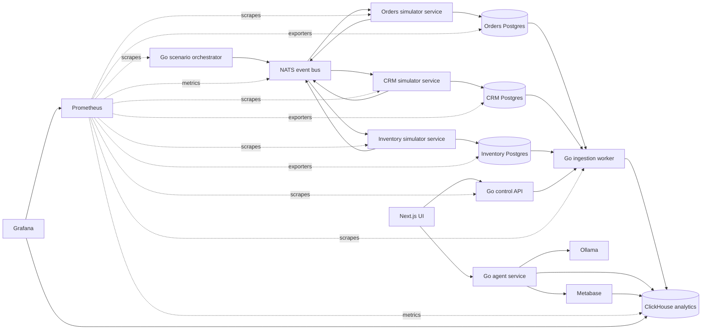

# CLAUDE.md

This file guides AI assistants working on DataStack.

## Project Summary

DataStack is a demo project for the Data Engineering Things Summit. It demonstrates a modern data ingestion and analytics workflow:

1. Multiple operational Postgres databases produce source data.
2. Go simulator applications continuously write realistic traffic into those Postgres databases.
3. Custom Go applications ingest that data into an analytical database.
4. ClickHouse is the first analytical database target.
5. Ollama powers a reasoning agent that can answer questions over the analytical data.
6. The agent can run read-oriented SQL against ClickHouse and create Metabase assets.
7. Prometheus and Grafana expose operational and analytical observability across services, databases, and pipelines.
8. A Next.js UI presents the system as a polished founder-demo style product.

## Current Product Direction

- Project name: DataStack.
- First analytical database: ClickHouse.
- Source systems to simulate first: Orders, CRM, and Inventory Postgres databases.
- Source traffic: Go simulator services continuously generate users, customers, orders, inventory events, sales, and related operational records.
- Simulator coordination model: use a Go scenario orchestrator plus a lightweight event broker. Do not make simulators directly share databases or build tangled point-to-point dependencies.
- First message broker choice: NATS, because it is lightweight in Docker Compose and easy to explain during a demo.
- Ingestion mode for the first version: polling by `updated_at` watermarks.
- Local runtime: Docker Compose first.
- Go layout: one Go workspace with multiple services.
- First backend shape: one Go backend binary initially, with clear internal boundaries for ingestion control and agent behavior.
- API style: REST JSON.
- Next.js app location: `apps/web`.
- Next.js package manager: npm.
- Metabase setup: fully automated through Compose and setup code where practical.
- Local Ollama model: `qwen2.5-coder`.
- Ollama model startup: document the manual model pull instead of pulling automatically in Compose.
- First analytical emphasis: revenue and fulfillment.
- First UI screen: live command center.
- Observability stack: Prometheus for metrics collection and Grafana for dashboards.
- Metrics coverage: Go microservices, Postgres databases, NATS, ClickHouse, ingestion progress, agent activity, and demo business throughput.
- Primary implementation languages:
  - Go for backend applications and pipeline services.
  - Next.js for the UI.
- Agent capabilities:
  - Generate SQL from natural-language questions.
  - Execute safe analytical queries against ClickHouse.
  - Create Metabase cards or dashboards from user intent.
- UI direction: polished founder demo, but still useful as an operator console.

## Intended Architecture

## Microservice Communication Model

Use a scenario orchestrator and event bus instead of making the simulators randomly talk to each other.

Recommended approach:

- Add a Go `scenario-orchestrator` service.
- Add NATS as the first lightweight message broker in Docker Compose.
- The orchestrator starts realistic business scenarios, such as creating a customer, opening an account, placing an order, checking inventory, reserving stock, recording payment, shipping items, and updating fulfillment state.
- Simulators own their own Postgres databases and should only write to their own database.
- Simulators communicate through commands and events, not by querying each other's databases.
- The orchestrator can publish commands such as `crm.customer.create`, `orders.order.create`, and `inventory.stock.reserve`.
- Simulators publish events such as `crm.customer.created`, `orders.order.created`, `inventory.stock.reserved`, `inventory.stock.low`, `orders.payment.captured`, and `orders.order.shipped`.
- Other simulators can react to events when it makes the demo more realistic, but the orchestrator remains responsible for keeping the scenario understandable.

Why this shape:

- It keeps the microservices independent while still showing they communicate.
- It avoids one simulator becoming a hidden central database client for all domains.
- It gives the live demo a clear story: one orchestrated business flow produces many operational writes across multiple Postgres databases.
- It makes the source databases grow continuously with related data, not disconnected random rows.

Do not start with full distributed-systems complexity. NATS subjects and JSON payloads are enough for the first version.

## Observability Model

Use Prometheus and Grafana as a first-class part of the demo. This should show what is happening inside the microservices, the operational databases, the ingestion pipeline, and the analytical database.

Recommended approach:

- Add Prometheus to Docker Compose.
- Add Grafana to Docker Compose with provisioned datasources and starter dashboards.
- Every Go service should expose a `/metrics` endpoint using Prometheus-compatible metrics.
- Use Postgres exporters for Orders, CRM, and Inventory Postgres databases.
- Use ClickHouse metrics or a ClickHouse exporter so Prometheus can observe analytical database health and query activity.
- Use NATS metrics where available so message flow is visible.
- Grafana should use Prometheus for infrastructure and service metrics.
- Grafana may also use ClickHouse directly as a datasource for business analytics dashboards when useful.

Important metrics to expose from Go services:

- Scenario commands published by domain and outcome.
- Domain events consumed and published by service.
- Rows written by simulator, table, and source domain.
- Ingestion rows loaded by source table.
- Ingestion lag by source table and watermark.
- ClickHouse insert duration and failures.
- Agent questions asked, SQL generation failures, query duration, and dashboard creation attempts.
- HTTP request counts, latency, and errors for REST APIs.

Important database dashboards:

- Orders Postgres growth: rows inserted per minute, table sizes, connections, and write latency.
- CRM Postgres growth: new customers, account updates, table sizes, connections, and write latency.
- Inventory Postgres growth: stock movements, low-stock events, table sizes, connections, and write latency.
- ClickHouse analytics: inserted rows, query duration, storage size, failed queries, and ingestion freshness.
- End-to-end pipeline freshness: latest Postgres `updated_at` compared with latest ClickHouse watermark.

Grafana should answer operational questions such as:

- Are all microservices running and producing traffic?
- Are the three Postgres databases growing?
- Is NATS moving commands and events?
- Is ClickHouse receiving fresh analytical data?
- Which source table is lagging behind?
- How many natural-language questions and dashboard requests has the agent handled?

## Applications To Build

### Go Scenario Orchestrator

Responsible for driving realistic cross-service business activity.

Expected first-version behavior:

- Run as a Go service in Docker Compose.
- Publish scenario commands to NATS.
- Coordinate flows across CRM, Orders, and Inventory without writing directly to their databases.
- Control traffic intensity with configuration such as events per second, burst mode, and quiet mode.
- Generate repeatable demo scenarios with a seed value when needed.
- Emit structured logs showing the current scenario and command flow.
- Expose Prometheus metrics for scenario rate, command count, command failures, and active scenario type.

Example scenarios:

- New customer signs up, receives a CRM account, places an order, inventory is reserved, payment is captured, and fulfillment begins.
- Existing customer places a large order that causes low stock in one warehouse.
- Inventory replenishment arrives and reduces fulfillment risk.
- A payment fails, causing order status and revenue reporting to change.

### Go Source Simulators

Responsible for making the three operational Postgres databases look alive during the demo.

Expected first-version behavior:

- Run as Go services in Docker Compose.
- Continuously generate realistic source-system traffic while the demo is running.
- Write directly into the Orders, CRM, and Inventory Postgres databases.
- Subscribe to NATS commands for their own domain.
- Publish domain events after successful writes.
- Do not write to another service's database.
- Do not depend on another service's internal tables.
- Generate customers, users, accounts, orders, order items, payments, products, stock movements, inventory adjustments, warehouse activity, sales events, and fulfillment state.
- Keep inserting and updating rows so the source databases visibly grow over time.
- Use configurable generation rates so the demo can run quietly or with high visible activity.
- Emit structured logs showing what was generated.
- Expose Prometheus metrics for generated records, consumed commands, published events, write latency, and write failures.
- Preserve referential integrity across related records where practical.
- Prefer deterministic demo-friendly randomness: realistic enough to query, predictable enough to present.

Suggested service shape:

- `orders-simulator`: writes orders, order items, payments, order status changes, and sales activity.
- `crm-simulator`: writes customers, users, accounts, segments, regions, and account lifecycle changes.
- `inventory-simulator`: writes products, warehouses, stock levels, stock movements, replenishment events, and fulfillment risk signals.

### Go Ingestion Worker

Responsible for moving data from Postgres sources into ClickHouse.

Expected first-version behavior:

- Read configured Postgres sources and tables.
- Poll incrementally using an `updated_at` column.
- Track watermarks per source table.
- Write into ClickHouse tables designed for analytics.
- Emit structured logs useful during a live demo.
- Expose Prometheus metrics for rows ingested, ingestion lag, batch duration, ClickHouse insert failures, and source read failures.
- Prefer simple, reliable behavior before adding CDC.

### Go Backend API

Responsible for exposing pipeline and agent behavior to the UI. Start as one Go binary with clear internal packages. Split into separate binaries later only when the working demo needs it.

Expected first-version behavior:

- Report source connectivity.
- Report target ClickHouse connectivity.
- Report table-level ingestion state, including latest watermark and rows loaded.
- Expose a simple endpoint to trigger or observe ingestion runs if the worker supports it.
- Expose REST JSON endpoints for the Next.js UI.
- Expose Prometheus metrics for HTTP traffic, service health checks, and agent/control operations.

### Go Agent Package

Responsible for natural-language data interaction inside the Go backend API.

Expected first-version behavior:

- Talk to Ollama for reasoning and SQL generation.
- Restrict generated SQL to safe analytical queries by default.
- Execute ClickHouse queries and return tabular results.
- Create Metabase dashboard assets when explicitly requested by the UI or API caller.
- Return generated SQL alongside answers so the demo is transparent.
- Expose Prometheus metrics for questions asked, SQL generated, query duration, query failures, and Metabase asset creation.

### Next.js UI

Responsible for the presentation and operator experience.

Expected first-version views:

- Live command center as the first screen.
- Architecture overview of the running stack.
- Pipeline status for Orders, CRM, and Inventory sources.
- Chat interface for asking questions about the data.
- Query result viewer that shows generated SQL and returned rows.
- Dashboard builder flow for creating Metabase assets.
- Observability links or embedded views for Prometheus/Grafana status where helpful.

Design direction:

- Founder-demo polish: clear, confident, and presentation-ready.
- Avoid a marketing landing page as the default screen.
- The first screen should be the working product experience.
- Make operational state easy to scan during a live talk.

## Data Model Direction

Use realistic but compact demo datasets.

Suggested source domains:

- Orders: orders, order items, payments, order status.
- CRM: customers, accounts, segments, regions.
- Inventory: products, warehouses, stock movements, reorder state.

ClickHouse tables should be shaped for analytical questions such as:

- Revenue by customer segment.
- Revenue by region and order status.
- Fast-moving products by warehouse.
- Orders at risk because inventory is low.
- Customer accounts with high revenue and open fulfillment risk.
- Fulfillment exposure by warehouse, product, and customer segment.

## Engineering Preferences

- Keep the first version runnable with `docker compose up`.
- Prefer boring, explicit service boundaries over clever abstractions.
- Prefer existing packages and frameworks instead of custom infrastructure.
- Keep Go services small and independently understandable.
- Keep the UI in Next.js and avoid introducing a second frontend framework.
- Do not add Kubernetes, CDC, or multi-warehouse abstractions until the basic demo works end to end.
- Favor code and working commands over prose-only documentation.

## Safety And Guardrails

- The data agent must default to read-only SQL execution.
- Any SQL generation should be constrained to known analytical schemas.
- Do not allow destructive SQL from natural-language prompts.
- Metabase asset creation is allowed, but it should be explicit and visible to the user.
- Return generated SQL to the UI/API caller for transparency.

## Open Questions

These decisions are not final yet:

- The exact visual identity of the Next.js UI.
- Exact ClickHouse schema shape for revenue and fulfillment analytics.
- Exact API contract between the Next.js UI and Go services.
- Exact boundaries between Go internal packages in the first backend binary.

## Recommended Next Step

Start by creating a minimal Docker Compose stack with:

- Orders Postgres.
- CRM Postgres.
- Inventory Postgres.
- ClickHouse.
- Ollama.
- Metabase.
- Prometheus.
- Grafana.
- Go ingestion worker.
- Go backend API with ingestion control and agent packages.
- Next.js UI in `apps/web`.

Then seed the Postgres databases with a small dataset and prove one end-to-end path: source row to ClickHouse row to agent answer to Metabase dashboard.
