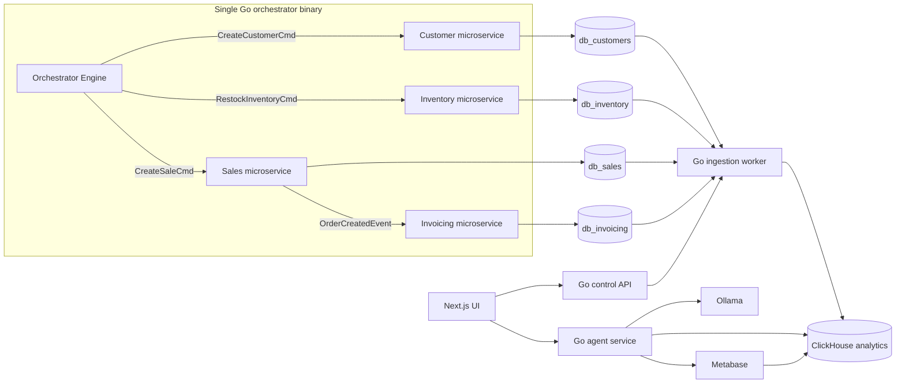

# CLAUDE.md

This file guides AI assistants working on DataStack.

## Project Summary

DataStack is a demo project for the Data Engineering Things Summit. It demonstrates a modern data ingestion and analytics workflow:

1. Multiple operational Postgres databases produce source data.
2. A single Go orchestrator binary simulates a realistic e-commerce business: an Orchestrator Engine drives four in-process domain microservices (Customer, Inventory, Sales, Invoicing) over in-memory Go channels, and each microservice writes directly into its own Postgres database.
3. Custom Go applications ingest that data into an analytical database.
4. ClickHouse is the first analytical database target.
5. Ollama powers a reasoning agent that can answer questions over the analytical data.
6. The agent can run read-oriented SQL against ClickHouse and create Metabase assets.
7. Prometheus and Grafana expose operational and analytical observability across services, databases, and pipelines.
8. A Next.js UI presents the system as a polished founder-demo style product.

## Current Product Direction

- Project name: DataStack.
- First analytical database: ClickHouse.
- Source systems to simulate first: Customer, Inventory, Sales, and Invoicing Postgres databases (see [docs/MICROSERVICES-AND-ORCHESTRATOR-ARCHITECTURE.md](docs/MICROSERVICES-AND-ORCHESTRATOR-ARCHITECTURE.md) for the full spec).
- Source traffic: a single Go binary ("orchestrated data engine") running an Orchestrator Engine plus four domain microservices as goroutines, communicating exclusively over in-memory Go channels — no message broker, no network hop between them.
- Simulator coordination model: in-process command/event channels only. Each domain microservice owns its own Postgres database and connection pool; the Orchestrator never touches schema or writes to a database directly.
- No message broker for this subsystem: NATS was the original plan but is dropped in favor of zero-overhead in-memory channels within the single binary. (NATS may return later if a domain ever needs to run as an independent process.)
- Go ORM: GORM, with each microservice running its own `AutoMigrate` independently at boot (decentralized, self-managed migrations).
- Historical backfill: on startup the Orchestrator fast-forwards simulated time from January 1st of the current year to now at 1 simulated day per real-time second, then switches to a 250ms real-time tick.
- Ingestion mode for the first version: polling by `updated_at` watermarks.
- Local runtime: Docker Compose first.
- Go layout: one Go workspace with multiple services.
- First backend shape: one Go backend binary initially, with clear internal boundaries for ingestion control and agent behavior.
- API style: REST JSON.
- Next.js app location: `apps/web`.
- Next.js package manager: npm.
- Metabase setup: fully automated through Compose and setup code where practical.
- Local Ollama model: `qwen2.5-coder`.
- Ollama model startup: document the manual model pull instead of pulling automatically in Compose.
- First analytical emphasis: revenue and fulfillment.
- First UI screen: live command center.
- Observability stack: Prometheus for metrics collection and Grafana for dashboards.
- Metrics coverage: Go microservices, Postgres databases, the orchestrator's simulated clock and state cache, ClickHouse, ingestion progress, agent activity, and demo business throughput.
- Primary implementation languages:
  - Go for backend applications and pipeline services.
  - Next.js for the UI.
- Agent capabilities:
  - Generate SQL from natural-language questions.
  - Execute safe analytical queries against ClickHouse.
  - Create Metabase cards or dashboards from user intent.
- UI direction: polished founder demo, but still useful as an operator console.

## Intended Architecture

## Microservice Communication Model

The Orchestrator and all four domain microservices run inside **one Go binary**, as goroutines communicating over **strongly-typed, in-memory Go channels** — no message broker, no HTTP hop between them. See [docs/MICROSERVICES-AND-ORCHESTRATOR-ARCHITECTURE.md](docs/MICROSERVICES-AND-ORCHESTRATOR-ARCHITECTURE.md) for the full spec (domain lifecycle, schemas, backfill algorithm, message payloads, telemetry).

Why this shape:

- Zero network overhead: channel sends/receives are essentially free compared to a broker round-trip.
- Still keeps domains independent: each microservice owns its own Postgres database, connection pool, and GORM `AutoMigrate` lifecycle; the Orchestrator never touches schema or writes to a database directly.
- Gives the live demo a clear story: one orchestrated business flow produces many operational writes across four Postgres databases.
- Avoids one simulator becoming a hidden central database client for all domains.

Do not reintroduce NATS or a separate simulator-per-container model for this subsystem unless a domain later needs to run as an independent process outside the binary.

## Observability Model

Use Prometheus and Grafana as a first-class part of the demo. This should show what is happening inside the microservices, the operational databases, the ingestion pipeline, and the analytical database.

Recommended approach:

- Add Prometheus to Docker Compose.
- Add Grafana to Docker Compose with provisioned datasources and starter dashboards.
- Every Go service should expose a `/metrics` endpoint using Prometheus-compatible metrics.
- Use Postgres exporters for the Customer, Inventory, Sales, and Invoicing Postgres databases.
- Use ClickHouse metrics or a ClickHouse exporter so Prometheus can observe analytical database health and query activity.
- Grafana should use Prometheus for infrastructure and service metrics.
- Grafana may also use ClickHouse directly as a datasource for business analytics dashboards when useful.

Important metrics to expose from Go services:

- Scenario commands dispatched by target microservice and command type.
- Domain events/commands processed by service and outcome.
- Rows written by microservice, table, and source domain.
- Ingestion rows loaded by source table.
- Ingestion lag by source table and watermark.
- ClickHouse insert duration and failures.
- Agent questions asked, SQL generation failures, query duration, and dashboard creation attempts.
- HTTP request counts, latency, and errors for REST APIs.

Important database dashboards:

- Customer Postgres growth: new accounts, table sizes, connections, and write latency.
- Inventory Postgres growth: stock movements, low-stock events, table sizes, connections, and write latency.
- Sales Postgres growth: orders inserted per minute, table sizes, connections, and write latency.
- Invoicing Postgres growth: invoices generated, payment status mix, table sizes, connections, and write latency.
- ClickHouse analytics: inserted rows, query duration, storage size, failed queries, and ingestion freshness.
- End-to-end pipeline freshness: latest Postgres `updated_at` compared with latest ClickHouse watermark.

Grafana should answer operational questions such as:

- Is the orchestrator binary running and producing traffic?
- Are all four Postgres databases growing?
- How far has the simulated clock progressed through the historical backfill?
- Is ClickHouse receiving fresh analytical data?
- Which source table is lagging behind?
- How many natural-language questions and dashboard requests has the agent handled?

## Applications To Build

### Go Orchestrated Data Engine (single binary)

Responsible for driving realistic cross-domain business activity. See [docs/MICROSERVICES-AND-ORCHESTRATOR-ARCHITECTURE.md](docs/MICROSERVICES-AND-ORCHESTRATOR-ARCHITECTURE.md) for the full spec (domain lifecycle, schemas, backfill algorithm, message payloads, telemetry, connection pooling).

Expected first-version behavior:

- Run as a single Go binary in Docker Compose (no NATS, no per-domain containers).
- Orchestrator Engine dispatches commands to the Customer, Inventory, Sales, and Invoicing microservices over in-memory Go channels; Sales emits `OrderCreatedEvent` to Invoicing the same way.
- Each microservice owns its own Postgres database, connection pool, and GORM `AutoMigrate` lifecycle; the Orchestrator never touches schema.
- On boot: wait for all microservices to finish migrating, calibrate the simulated clock to January 1st of the current year, fast-forward at 1 simulated day per real-time second until caught up to now, then switch to a 250ms real-time tick.
- Maintain a thread-safe in-memory state cache of valid Customer IDs and Inventory SKUs so Sales commands never reference missing master data.
- Expose Prometheus metrics for ticks, simulated time, commands dispatched, events processed, processing latency, bytes written, and state cache size.

Example scenarios:

- New customer signs up, receives a CRM account, places an order, inventory is reserved, payment is captured, and fulfillment begins.
- Existing customer places a large order that causes low stock in one warehouse.
- Inventory replenishment arrives and reduces fulfillment risk.
- A payment fails, causing order status and revenue reporting to change.

### Go Ingestion Worker

Responsible for moving data from Postgres sources into ClickHouse.

Expected first-version behavior:

- Read configured Postgres sources and tables.
- Poll incrementally using an `updated_at` column.
- Track watermarks per source table.
- Write into ClickHouse tables designed for analytics.
- Emit structured logs useful during a live demo.
- Expose Prometheus metrics for rows ingested, ingestion lag, batch duration, ClickHouse insert failures, and source read failures.
- Prefer simple, reliable behavior before adding CDC.

### Go Backend API

Responsible for exposing pipeline and agent behavior to the UI. Start as one Go binary with clear internal packages. Split into separate binaries later only when the working demo needs it.

Expected first-version behavior:

- Report source connectivity.
- Report target ClickHouse connectivity.
- Report table-level ingestion state, including latest watermark and rows loaded.
- Expose a simple endpoint to trigger or observe ingestion runs if the worker supports it.
- Expose REST JSON endpoints for the Next.js UI.
- Expose Prometheus metrics for HTTP traffic, service health checks, and agent/control operations.

### Go Agent Package

Responsible for natural-language data interaction inside the Go backend API.

Expected first-version behavior:

- Talk to Ollama for reasoning and SQL generation.
- Restrict generated SQL to safe analytical queries by default.
- Execute ClickHouse queries and return tabular results.
- Create Metabase dashboard assets when explicitly requested by the UI or API caller.
- Return generated SQL alongside answers so the demo is transparent.
- Expose Prometheus metrics for questions asked, SQL generated, query duration, query failures, and Metabase asset creation.

### Next.js UI

Responsible for the presentation and operator experience.

Expected first-version views:

- Live command center as the first screen.
- Architecture overview of the running stack.
- Pipeline status for Orders, CRM, and Inventory sources.
- Chat interface for asking questions about the data.
- Query result viewer that shows generated SQL and returned rows.
- Dashboard builder flow for creating Metabase assets.
- Observability links or embedded views for Prometheus/Grafana status where helpful.

Design direction:

- Founder-demo polish: clear, confident, and presentation-ready.
- Avoid a marketing landing page as the default screen.
- The first screen should be the working product experience.
- Make operational state easy to scan during a live talk.

## Data Model Direction

Use realistic but compact demo datasets.

Suggested source domains:

- Customer: customer accounts (see [docs/MICROSERVICES-AND-ORCHESTRATOR-ARCHITECTURE.md](docs/MICROSERVICES-AND-ORCHESTRATOR-ARCHITECTURE.md) for the exact `customers` schema).
- Inventory: products/SKUs and stock levels (`products` table).
- Sales: orders (`orders` table).
- Invoicing: invoices generated from orders (`invoices` table).

ClickHouse tables should be shaped for analytical questions such as:

- Revenue by customer.
- Revenue by order status and time period.
- Fast-moving products (SKUs) by units sold.
- Orders at risk because inventory (SKU stock) is low.
- Customers with high revenue and unpaid or pending invoices.
- Fulfillment exposure by product and customer.

## Architecture Documents

- [docs/MICROSERVICES-AND-ORCHESTRATOR-ARCHITECTURE.md](docs/MICROSERVICES-AND-ORCHESTRATOR-ARCHITECTURE.md) — the detailed spec for the Go orchestrated data engine (domain lifecycle, per-database schemas, the fast-forward backfill algorithm, message payloads, Prometheus metric names, and operational optimizations). Read it before implementing the orchestrator, the Customer/Inventory/Sales/Invoicing microservices, or their schemas.
- Other subsystems (ingestion worker, backend API, agent, Next.js UI) will each get their own architecture document under `docs/` as they're designed in detail.

## Engineering Preferences

- Keep the first version runnable with `docker compose up`.
- Prefer boring, explicit service boundaries over clever abstractions.
- Prefer existing packages and frameworks instead of custom infrastructure.
- Keep Go services small and independently understandable.
- Keep the UI in Next.js and avoid introducing a second frontend framework.
- Do not add Kubernetes, CDC, or multi-warehouse abstractions until the basic demo works end to end.
- Favor code and working commands over prose-only documentation.

## Safety And Guardrails

- The data agent must default to read-only SQL execution.
- Any SQL generation should be constrained to known analytical schemas.
- Do not allow destructive SQL from natural-language prompts.
- Metabase asset creation is allowed, but it should be explicit and visible to the user.
- Return generated SQL to the UI/API caller for transparency.

## Open Questions

These decisions are not final yet:

- The exact visual identity of the Next.js UI.
- Exact ClickHouse schema shape for revenue and fulfillment analytics.
- Exact API contract between the Next.js UI and Go services.
- Exact boundaries between Go internal packages in the first backend binary.

## Recommended Next Step

Start by creating a minimal Docker Compose stack with:

- Customer Postgres (`db_customers`).
- Inventory Postgres (`db_inventory`).
- Sales Postgres (`db_sales`).
- Invoicing Postgres (`db_invoicing`).
- ClickHouse.
- Ollama.
- Metabase.
- Prometheus.
- Grafana.
- Go orchestrated data engine (single binary: Orchestrator Engine + four domain microservices).
- Go ingestion worker.
- Go backend API with ingestion control and agent packages.
- Next.js UI in `apps/web`.

Then seed the Postgres databases with a small dataset and prove one end-to-end path: source row to ClickHouse row to agent answer to Metabase dashboard.
