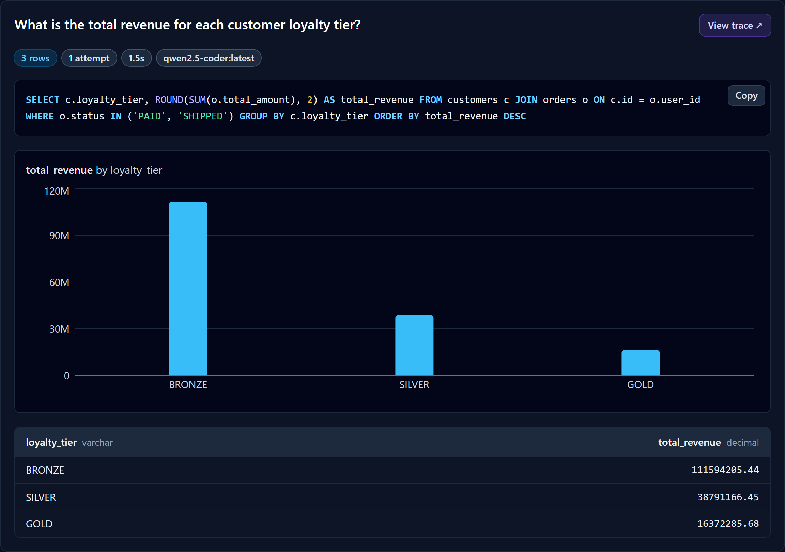
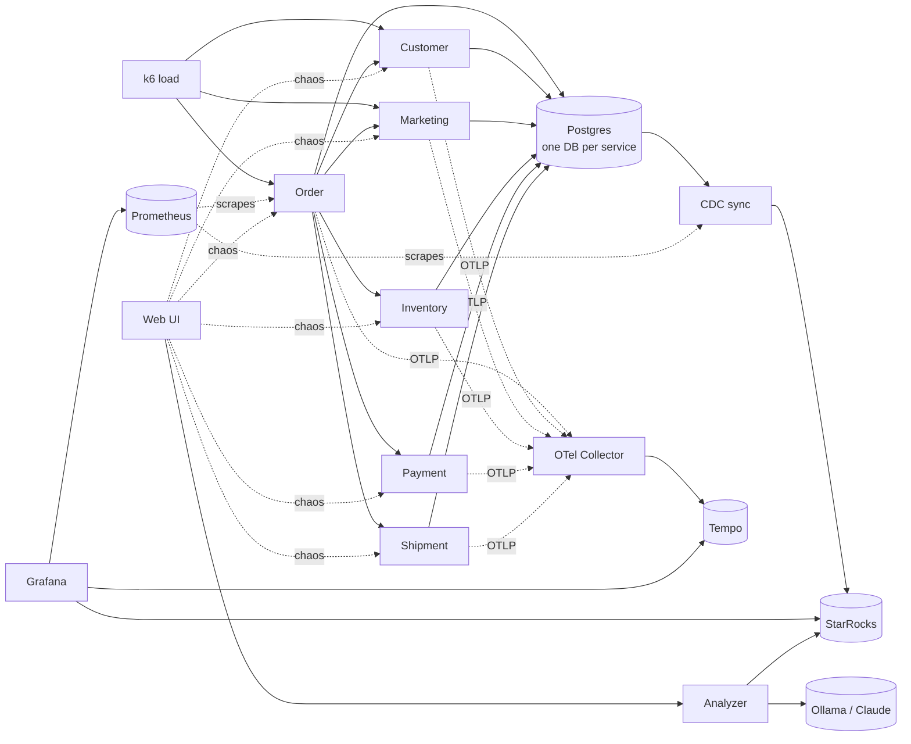
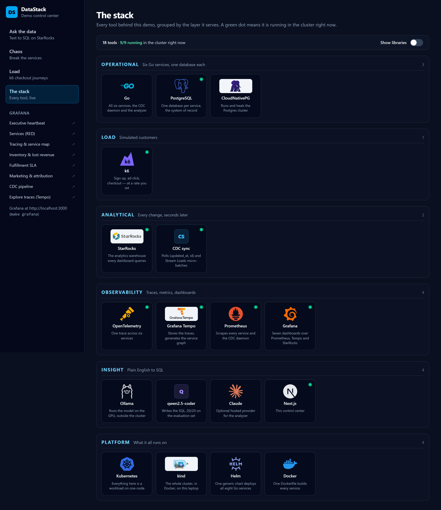
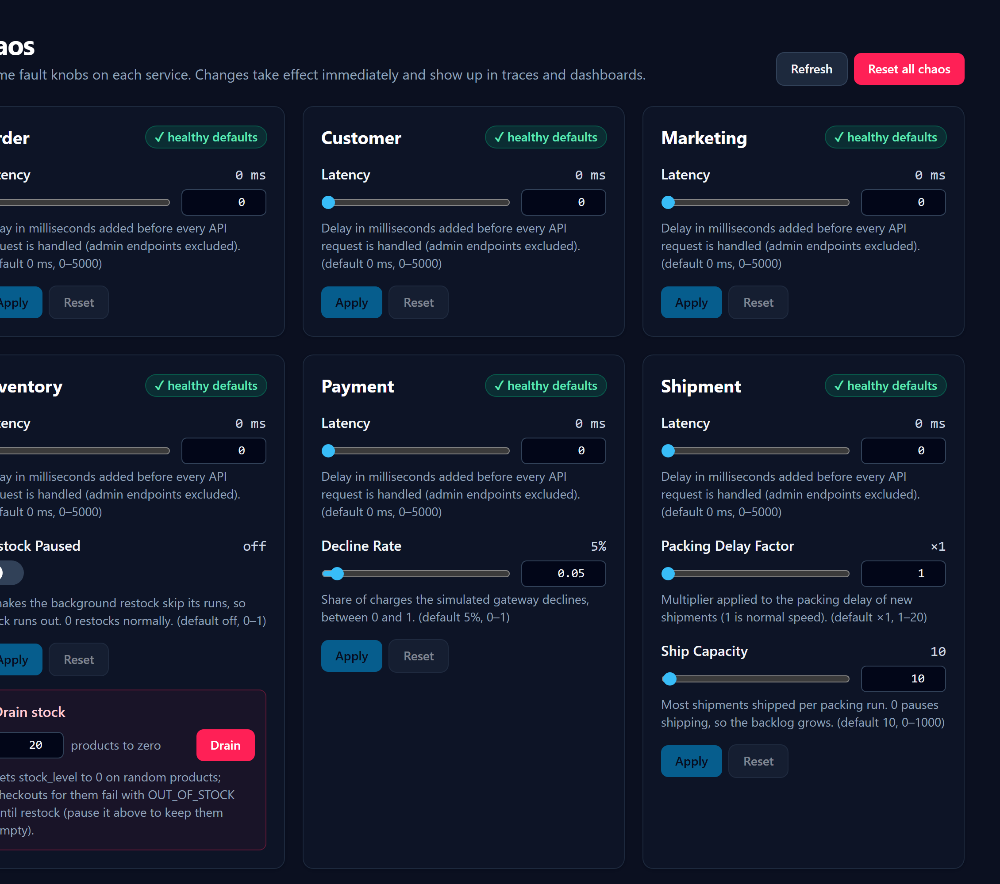
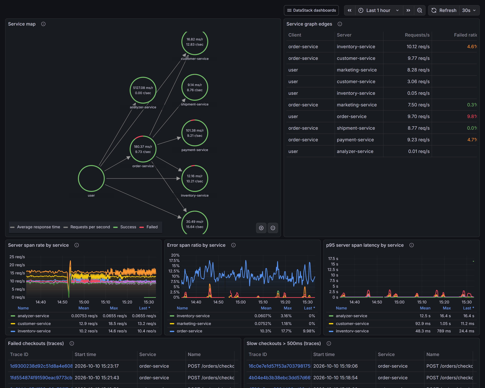
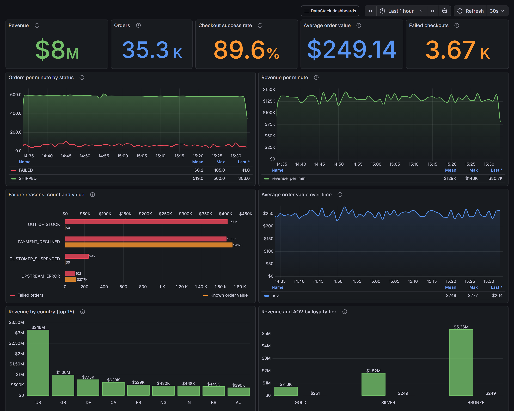

<div align="center">

# DataStack

### Text-to-SQL with no semantic layer. The schema documents itself.

[](https://github.com/poph2/datastack/actions/workflows/ci.yml)
[](https://go.dev)
[](https://kind.sigs.k8s.io)
[](LICENSE)

A complete e-commerce business — six Go microservices, change data capture, a real-time warehouse,
distributed tracing and a local LLM — running on one laptop, so you can ask it questions in English.

</div>



---

## The idea

Most text-to-SQL systems need a hand-written semantic layer: a YAML file, a dbt metrics spec, some
curated layer that tells the model what a "loyalty tier" is or how revenue is defined. Somebody has
to write it, and the day it drifts from the database it starts producing confident wrong answers.

**DataStack doesn't have one.** The schema *is* the semantic layer.

Every column in every service carries a `comment:` tag in its GORM model, written for a reader who
has never seen the system — meaning, units, enum values, what NULL means, and a `[ref: table.column]`
marker on anything that points elsewhere:

```go
Status Status `gorm:"size:20;not null;index;
    check:chk_orders_status,status IN ('PENDING','PAID','FAILED','SHIPPED');
    comment:Lifecycle state: PENDING (checkout in progress), PAID (charged, shipment not yet
    requested), SHIPPED (charged and handed to fulfillment, see shipments.shipped_at for when the
    box left) or FAILED (see failure_reason). An order that was charged has status IN ('PAID',
    'SHIPPED'): use that pair for revenue and for average order value..."`
```

Those comments travel the whole way on their own. `AutoMigrate` writes them into Postgres, the CDC
daemon copies them into StarRocks, and the analyzer reads them back out of `information_schema` to
build its prompt — including deriving the **join graph** from the `[ref:]` markers. Nobody writes a
semantic layer, and it cannot drift, because changing the comment *is* changing the schema.

The result, measured on the evaluation set in this repo:

| Model | Score | |
|---|---|---|
| `qwen2.5-coder` (7B, local, on a consumer GPU) | **20 / 20** | |
| `qwen3.5:9b` | 15 / 20 | |

When a question fails, the fix is usually a better column comment — not prompt engineering. Going
from 18/20 to 20/20 took exactly two edits to column comments (defining what a *paid* campaign is,
and which order statuses count as *successful*) plus one genuine SQL dialect rule. The full
write-up, including what the weaker model got wrong, is in
[analyzer-service.md](docs/microservices/analyzer-service.md#eval-results).

## What's actually running

This isn't a notebook with a toy table. It is a small business that never stops trading:

- **Six Go microservices** — Order, Customer, Marketing, Inventory, Payment, Shipment — each owning
  its own Postgres database, talking over HTTP. Order orchestrates checkout across the other five.
- **k6** drives continuous customer journeys: sign up, click an ad, check out.
- **A CDC daemon** polls every table by `(updated_at, id)` and Stream Loads micro-batches into
  **StarRocks**, a couple of seconds behind.
- **OpenTelemetry → Tempo** gives one trace across all six services; **Prometheus** scrapes
  everything; **Grafana** has seven dashboards built on all three datasources.
- **The analyzer** turns a question into one read-only StarRocks query, guards it, `EXPLAIN`s it,
  and runs it as a user that only holds `SELECT`.



## See it

### Every tool in the stack, and which are alive right now

The control center's landscape page groups the stack by the layer it serves. The green dots are
real: they come from the Kubernetes API, so the picture is a live system, not a slide.



### Break it on purpose

Every service exposes runtime chaos knobs — latency, payment decline rate, warehouse capacity,
paused restocking. Turn one up and watch the dashboards and traces notice.



### Watch it notice

One trace spans six services, and the service map is generated from the spans themselves.



Business metrics come from StarRocks, seconds behind the operational databases.



## Run it

You need Docker (12 GB and 6 CPUs), [kind](https://kind.sigs.k8s.io), kubectl, Helm, Go 1.26 and
make. For the analyzer you also need [Ollama](https://ollama.com) — ideally on a machine with a GPU,
where a question takes a second or two instead of minutes.

```sh
ollama pull qwen2.5-coder

make up             # the whole stack, in order. About 20 minutes from nothing
```

That is: create the kind cluster, install CloudNativePG and Postgres, StarRocks, the observability
stack, build and deploy the eight Go workloads and the web UI, and start the traffic. Every step is
idempotent, so a bring-up interrupted half way can just be run again. If Ollama isn't reachable at
`host.docker.internal`, pass its address: `make up OLLAMA_URL=http://10.0.0.5:11434`.

Then, in two more terminals, because port-forwards block:

```sh
make forward-web    # the control center on http://localhost:3001
make grafana        # Grafana on http://localhost:3000
```

Open <http://localhost:3001> and ask it something. `make eval` scores the analyzer against the
20 reference questions; `make down` deletes the cluster and everything in it.

Full bring-up, the pre-flight checklist and a complete demo script are in the
**[demo runbook](docs/demo-runbook.md)**.

## Ideas worth stealing

Even if you never run it, a few things here might be useful:

- **Documentation as the product.** Column comments written for a machine reader are also the best
  documentation a human ever gets. [`make catalog`](tools/catalog) turns them into a
  [data catalog](docs/microservices/data-catalog.md) and fails the build if any column is
  undocumented or a `[ref:]` marker points somewhere that doesn't exist.
- **A read-only path you can prove.** Generated SQL is parsed and guarded, planned with `EXPLAIN`
  before it runs, capped by row count and a server-side timeout, and executed as a user holding only
  `SELECT`. An `INSERT` fails with *"Access denied"* even if everything above it is wrong.
- **Chaos as a first-class knob, not a restart flag.** Fault injection lives with the domain type
  that owns the behaviour, is read live on the hot path, and shows up as span attributes and events
  so the trace explains the slowdown.
- **One Helm chart for every service.** Eight Go workloads, one generic chart, one values file each.
- **Guarded SQL instead of locks.** Stock reservation, state transitions and conversions are all
  single `UPDATE ... WHERE <guard> RETURNING` statements, with concurrency tests to prove it.
- **CDC without a connector.** No Debezium, no Kafka: a few hundred lines of Go polling
  `(updated_at, id)` cursors, which is enough to keep a warehouse seconds behind.

## Documentation

| Document | What's in it |
|---|---|
| [Architecture](docs/microservices/README.md) | Topology, the checkout journey, and the shared conventions every service follows |
| [Data catalog](docs/microservices/data-catalog.md) | Every table and column, the join graph, and exactly what the analyzer sees |
| [Analyzer service](docs/microservices/analyzer-service.md) | The prompt, the SQL guard, the providers, and the eval results |
| [CDC sync](docs/microservices/cdc-sync.md) | Stateless cursors, schema reflection, Stream Load semantics |
| [Demo runbook](docs/demo-runbook.md) | Bring-up, pre-flight checks, and the demo script |
| [Web UI](apps/web/README.md) | The control center |

## Repository layout

```
pkgs/                shared Go packages: database, httpserver, httpclient, telemetry, chaos, pgtest
services/<name>/     one binary per service
services/cdc-sync/   the Postgres → StarRocks daemon
services/analyzer/   text-to-SQL: schema prompt, LLM providers, SQL guard, eval harness
apps/web/            the Next.js control center
tools/catalog/       generates the data catalog from the models
deploy/              one generic Helm chart, per-service values, infra and observability manifests
docs/                architecture, per-service docs, the runbook
```

## Talk

Built for a talk at the Data Engineering Things Summit.

<!-- TODO: add the talk recording / slides link here once it's published. -->

## Contributing

Issues and pull requests are welcome — see [CONTRIBUTING.md](CONTRIBUTING.md). The conventions the
code follows are written down in [docs/microservices/README.md §3](docs/microservices/README.md) and
are worth a read before changing a service.

## License

[Apache 2.0](LICENSE) © Adeniyi Bello.

Third-party logos under `apps/web/public/logos/` belong to their respective owners and are used only
to identify the tools this project builds on; see
[the notes there](apps/web/public/logos/README.md).
