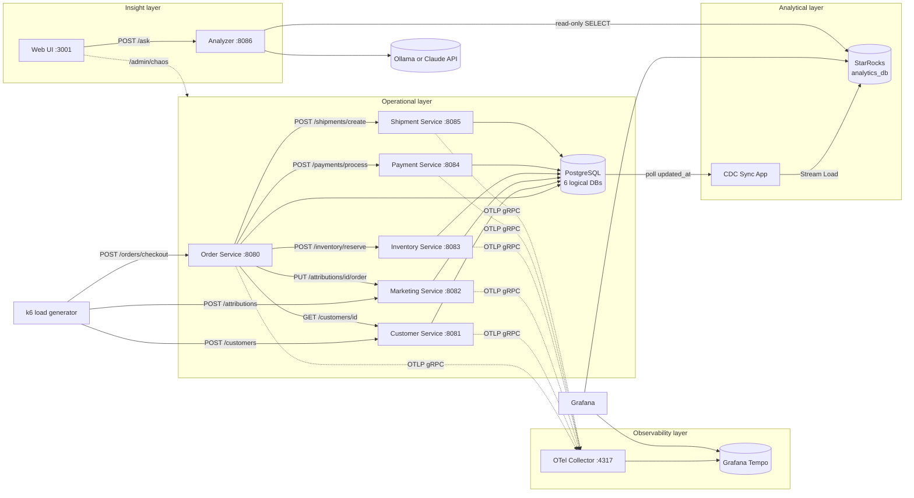
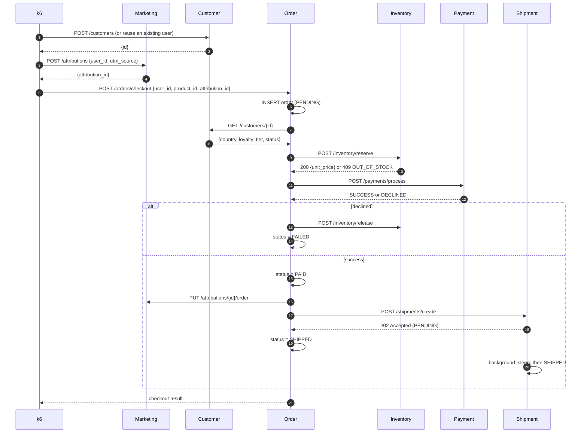

# DataStack Microservice Ecosystem

This is the architecture of DataStack's e-commerce microservice ecosystem. It replaces the earlier single-binary orchestrator design (Customer/Inventory/Sales/Invoicing over in-memory Go channels).

The ecosystem has six Go HTTP microservices, a Go CDC sync daemon and a Go analyzer that answers plain-English questions with SQL over StarRocks. It runs on a local Kubernetes (kind) cluster. k6 generates the traffic, OpenTelemetry emits distributed traces, the sync daemon streams operational data into StarRocks for real-time Grafana dashboards, and a Next.js web UI drives the demo: asking questions, injecting chaos and setting the load.

> **Status:** all six microservices, the CDC sync daemon, the analyzer, the web UI and the k6 load generator are built. The Customer Service ([`services/customer`](../../services/customer)) is the reference implementation for the conventions in §3.

## Service Index

| Service | Port | Database | Tables | Role | Doc |
|---|---|---|---|---|---|
| Order Service | 8080 | `orders` | `orders` | Edge API and checkout orchestrator | [order-service.md](order-service.md) |
| Customer Service | 8081 | `customers` | `customers` | Identity, geography, loyalty tier, account state | [customer-service.md](customer-service.md) |
| Marketing Service | 8082 | `marketing` | `campaigns`, `attributions` | Top-of-funnel touchpoints and conversion attribution | [marketing-service.md](marketing-service.md) |
| Inventory Service | 8083 | `inventory` | `inventory` | Stock levels, reservations, product catalog | [inventory-service.md](inventory-service.md) |
| Payment Service | 8084 | `payments` | `payments` | Simulated card processing with injected failures | [payment-service.md](payment-service.md) |
| Shipment Service | 8085 | `shipments` | `shipments` | Simulated fulfillment with artificial packing delay | [shipment-service.md](shipment-service.md) |
| CDC Sync App | 8090 | reads all six | n/a | Watermark polling into StarRocks Stream Load | [cdc-sync.md](cdc-sync.md) |
| Analyzer Service | 8086 | none (reads StarRocks) | n/a | Plain-English questions → SQL over `analytics_db`, via a pluggable LLM (Ollama by default) | [analyzer-service.md](analyzer-service.md) |
| Web UI | 3001 | none | n/a | Demo control center: ask the data, chaos toggles, k6 load, the stack landscape, Grafana links | [apps/web/README.md](../../apps/web/README.md) |

## 1. System Topology

The ecosystem has four layers:

1. **Operational layer (Go + PostgreSQL).** Six independent HTTP REST microservices. Each one owns its own logical database inside a shared PostgreSQL instance. They talk to each other synchronously over HTTP JSON APIs. No service reads another service's database.
2. **Observability layer (OpenTelemetry + Tempo).** Every Go service is instrumented with OpenTelemetry. Spans go to an OTel Collector, are stored in Grafana Tempo, and are viewed in Grafana.
3. **Analytical layer (Go CDC + StarRocks).** A Go sync daemon polls the `updated_at` watermark of every operational table and pushes micro-batches into StarRocks over HTTP Stream Load. Grafana dashboards query StarRocks.
4. **Insight layer (Analyzer + Web UI).** The Analyzer turns a plain-English question into one read-only StarRocks query, using the table and column comments (§3.2) as its context. The web UI is the demo's single screen: questions, chaos toggles (§3.8), k6 load, and a landscape of every tool in the stack with a live dot on the ones currently running as pods.



### Call graph

The Order Service is the only service that calls other services. The other five are leaf nodes: they serve requests and write to their own database.

| Caller | Callee | Call | Critical path? |
|---|---|---|---|
| k6 | Customer | `POST /customers` | n/a |
| k6 | Marketing | `POST /attributions` | n/a |
| k6 | Order | `POST /orders/checkout` | n/a |
| Order | Customer | `GET /customers/{id}` | Yes: an invalid or suspended user rejects the checkout |
| Order | Inventory | `POST /inventory/reserve` | Yes: out of stock fails the checkout |
| Order | Payment | `POST /payments/process` | Yes: a decline fails the checkout and releases stock |
| Order | Inventory | `POST /inventory/release` | Compensation only |
| Order | Marketing | `PUT /attributions/{id}/order` | No: best-effort |
| Order | Shipment | `POST /shipments/create` | No: fire-and-forget (accepted immediately) |

## 2. End-to-End User Journey

One k6 iteration simulates one customer journey, from the ad click to the box leaving the warehouse.



See [order-service.md](order-service.md) for the exact orchestration and failure semantics.

## 3. Shared Conventions

These conventions were established while building the Customer Service ([`services/customer`](../../services/customer)), which is the reference implementation. Every later service follows them.

### 3.1 Universal columns and triggers

Every operational table starts with the same four columns. In Go, they come from embedding `database.Model` ([`pkgs/database/model.go`](../../pkgs/database/model.go)):

| Column | Definition | Purpose |
|---|---|---|
| `id` | `BIGSERIAL PRIMARY KEY` | Auto-incrementing key; tie-breaker in the CDC cursor |
| `created_at` | `TIMESTAMPTZ NOT NULL DEFAULT NOW()` | Row creation time; used for latency and cohort analytics |
| `updated_at` | `TIMESTAMPTZ NOT NULL DEFAULT NOW()` | CDC watermark; **refreshed on every UPDATE by a trigger** |
| `deleted_at` | `TIMESTAMPTZ` (nullable) | GORM soft delete. Hard deletes are invisible to watermark CDC, so services never `DELETE` rows |

Rules:

- **Postgres is the only clock.** `created_at` and `updated_at` are never written by the application: the model tags them `<-:false;default:now()`, and GORM reads them back with `RETURNING`. (GORM would otherwise set them itself, but from the pod's clock. If inserts used the pod's clock while the trigger used the database's, clock skew could move `updated_at` backwards and the sync daemon would skip rows. An integration test caught exactly this. The trigger also covers writes that bypass GORM, such as `db.Exec` or a manual psql edit.)
- **Soft delete moves the watermark.** GORM's soft delete is an `UPDATE ... SET deleted_at`, so the trigger moves `updated_at` and the sync daemon sees the delete.
- **Unique constraints are partial**, for example `UNIQUE (email) WHERE deleted_at IS NULL`, so a soft-deleted row doesn't block re-creating it.
- **Every table has a `(updated_at, id)` index** (`idx_<table>_cdc_cursor`, declared on `database.Model`) for the sync daemon's cursor query.
- **Enums are `VARCHAR` with a named `CHECK` constraint** (`check:chk_<table>_<column>,<expr>`), mirrored as typed string constants in Go. Name CHECKs explicitly: an unnamed expression that contains a comma is mis-parsed by GORM.
- **No `default:` on bool or numeric columns whose zero value is meaningful.** GORM omits zero-valued fields that have a default on insert, so `default:true` would silently turn `false` into `true`.
- `TIMESTAMPTZ` everywhere, so the session time zone can't affect watermarks.

The service docs that haven't been built yet still show the schemas from the original spec (`SERIAL`, `TIMESTAMP`, `is_deleted`). Each one moves to these conventions when its service is built.

`database.AutoMigrate` installs the trigger after GORM's `AutoMigrate`, because GORM can't create triggers. It's idempotent (`CREATE OR REPLACE`):

```sql
CREATE OR REPLACE FUNCTION set_updated_at() RETURNS TRIGGER AS $$
BEGIN
    NEW.updated_at = NOW();
    RETURN NEW;
END;
$$ LANGUAGE plpgsql;

-- for every migrated model:
CREATE OR REPLACE TRIGGER "<table>_set_updated_at"
    BEFORE UPDATE ON "<table>"
    FOR EACH ROW EXECUTE FUNCTION set_updated_at();
```

### 3.2 Schema documentation (semantic context)

Every table and column is documented **in the GORM model**, because the documentation is how a text-to-SQL analyzer understands the data:

- **Columns:** a `comment:` gorm tag giving the meaning, units (USD, UTC, milliseconds), every enum value with what it means, and what NULL means. The base `database.Model` columns (`id`, `created_at`, `updated_at`, `deleted_at`) are documented once there.
- **Tables:** a `TableComment() string` method (`database.TableCommenter`). It says what one row is, which service owns the table, how it joins, and how the key metrics are defined (for example "Revenue is the sum of total_amount over orders with status PAID or SHIPPED").
- **Joins:** a column that references another table ends its comment with `[ref: <table>.<column>]`, using the StarRocks table name, for example `[ref: customers.id]`. That gives a machine-parseable join graph across services that share no foreign keys.
- **Characters:** comment text must not contain `;` (the gorm tag separator) or a backtick.

The comments flow **model → Postgres** (`AutoMigrate`: `COMMENT ON COLUMN`, and `COMMENT ON TABLE` from `TableComment`) **→ StarRocks** (the CDC daemon creates and reconciles them; see [cdc-sync.md](cdc-sync.md)). The analyzer reads `information_schema` in `analytics_db`.

Enforcement:
- Each service's `TestSchemaIsFullyDocumented` fails if any table or column in its database lacks a comment (`database.Undocumented`).
- `make catalog` validates every comment and `[ref: …]` marker across all six databases (a marker must point at a real table and column), then regenerates [data-catalog.md](data-catalog.md), with an ER diagram built from the markers. `make catalog-check` fails if the committed catalog is stale.

### 3.3 Schema ownership and migrations

- Each service owns one logical database. In kind, its Helm release declares that database as a CloudNativePG `Database` resource.
- **The GORM model is the schema.** Columns, sizes, `NOT NULL`, named CHECKs, partial unique indexes (`uniqueIndex:,where:deleted_at IS NULL`) and composite indexes are all declared in struct tags. There are no migration files.
- Each domain package exports `Migrate(ctx, db) error`, which calls `database.AutoMigrate(ctx, db, &Model{}, ...)` plus any seed data. `<binary> migrate` runs it under a Postgres advisory lock (`database.WithMigrationLock`), so concurrent pods take turns. In Kubernetes it runs as an **initContainer** before `serve` starts.
- `AutoMigrate` only adds: new tables, columns, indexes and constraints. It never drops or renames anything. That's fine for a demo. To change a column's shape, recreate the database (drop it, then redeploy).
- Integration tests run `Migrate` twice to prove it's idempotent.

### 3.4 HTTP API conventions

- REST over JSON with **gin**. Requests are validated with gin binding tags (go-playground/validator), and invalid input gets `400 INVALID_REQUEST`.
- Error body: `{"error": "<MACHINE_CODE>", "message": "<human text>"}` (`httpserver.RespondError`). Machine codes such as `OUT_OF_STOCK` and `PAYMENT_DECLINED` are what the Order Service records as `failure_reason`. 500s never leak internals.
- Database models are never serialised directly. Handlers map them to response structs.
- **Status codes:** `400` only for malformed or invalid input, `404` for an unknown entity, and `409` when a valid request conflicts with current state (`EMAIL_EXISTS`, `OUT_OF_STOCK`). Callers branch on the `error` code, never on the status alone.
- **Money** is `shopspring/decimal` in Go and `DECIMAL(10,2)` in Postgres, never `float64`. In JSON it is a fixed two-decimal **string** (`"49.99"`, `"50.00"`, via `StringFixed(2)`), so JavaScript clients can't silently round it. Requests should accept the same form, since `decimal.Decimal` unmarshals both strings and numbers.
- Every service exposes `GET /healthz` (liveness), `GET /readyz` (readiness; pings the DB) and `GET /metrics`. These sit outside the tracing and logging middleware, so probes don't create noise.
- Every business service also exposes `GET`/`PUT`/`DELETE /admin/chaos` (§3.8). Admin routes are traced and logged but never delayed by the chaos latency.
- Service-to-service URLs come from environment variables populated by ConfigMaps (for example `PAYMENT_URL=http://payment-service:8084`).
- Outbound HTTP clients use explicit timeouts. No call waits forever.

### 3.5 Configuration

- **cobra** commands: `serve`, `migrate`.
- **viper** binds every flag to an environment variable of the same name: `--database-url` ↔ `DATABASE_URL`, `--tier-weights` ↔ `TIER_WEIGHTS`. Flag defaults are the documented defaults.
- In Kubernetes, plain settings go in the chart's ConfigMap. Database credentials come from CNPG's secret as `PGUSER`/`PGPASSWORD`, which pgx reads natively, so passwords never appear in URLs.

### 3.6 Go layout

One Go module at the repo root (`github.com/poph2/datastack`) and one shared `Dockerfile` (`--build-arg SERVICE=<name>`, distroless, non-root).

```
pkgs/                       # shared by every service
  cli/         root cobra command, flag <-> env binding
  database/    GORM open (pool, tracing plugin), base Model, AutoMigrate + updated_at trigger, migration lock
  migrate/     the `migrate` command (opens the DB, takes the lock, runs the domain's Migrate)
  httpserver/  gin router (otelgin, slog-gin, Prometheus, recovery, probes), error helpers, graceful shutdown
  logging/     slog JSON/text setup
  telemetry/   OTel tracer provider + W3C propagator
  httpclient/  service-to-service JSON client (otelhttp, per-peer timeout, *APIError with the peer's error code, client metrics)
  pgtest/      testcontainers Postgres for integration tests
  chaos/       runtime chaos knobs: store, /admin/chaos routes, latency middleware, chaos_knob_value gauge (§3.8)
tools/catalog/   generates and validates docs/microservices/data-catalog.md from the documented schemas
services/<name>/
  main.go      root command: serve + migrate
  serve.go     wiring: logger, tracing, DB, handler, router, run
  internal/<domain>/
    model.go       GORM model (its tags are the schema) + enum types + Migrate
    repository.go  GORM queries; maps driver errors to domain errors (ErrNotFound, ...)
    handler.go     gin handlers, request/response types, Store interface
    *_test.go      handler tests (fake Store) + repository tests (real Postgres)
deploy/
  charts/go-service/   one generic chart for every service
  values/<name>.yaml   per-service values
  infra/               CNPG Postgres cluster, StarRocks
  web/                 the web UI's Deployment, Service and k6-only RBAC
  kind/                cluster config
apps/web/              the web UI (Next.js), its own Dockerfile
```

A service adds a service layer between handler and repository only when it has real business logic. The Order Service's orchestration will have one; the Customer Service doesn't need one.

More patterns, established by the Order Service:

- **Calling another service** goes through `pkgs/httpclient`, wrapped in a small typed client per peer (`clients.go`) that turns the peer's error codes into sentinel errors. Requests are built from the inbound context (one trace per checkout), every peer has its own timeout, and nothing retries automatically: a retry is only safe when the peer makes the operation idempotent (shipment create, attribution conversion).
- **State machines move through guarded transitions:** `UPDATE ... WHERE id = ? AND status = <from> RETURNING *`. A lost race returns `ErrStatusChanged` rather than overwriting.
- **Business failures are data, not errors.** A failed checkout is a FAILED row with a reason, and a 4xx with the shared error body plus the entity. Only infrastructure failures are 5xx.

More patterns, established by the Inventory Service:

- **Concurrency through SQL, not locks.** State changes that must be race-free are one conditional `UPDATE ... WHERE <guard> RETURNING` (GORM: `Model(&x).Clauses(clause.Returning{}).Where(...).Update(col, gorm.Expr(...))`). Under READ COMMITTED, Postgres re-checks the guard against the latest row version, so no explicit transaction or `SELECT ... FOR UPDATE` is needed. A test races many goroutines against it.
- **Background workers** (`restocker.go`) run beside the HTTP server under `errgroup` in `serve.go`, so they share one lifetime and the DB closes only after both stop. Each run is its own root span. A worker must be safe with several replicas running it (the guard-in-`WHERE` trick again), not depend on leader election.
- **Seed data is loaded by `Migrate`** (`seed.go`): deterministic, and inserted only when the table has never held rows (soft-deleted ones count), so it runs in the existing initContainer, never re-seeds, and every environment has the same IDs.
- **Domain metrics** live in the domain package's `metrics.go` (`<service>_<thing>_total`, low-cardinality labels such as `outcome`). The shared HTTP metrics count requests; domain metrics count what happened to the business.

### 3.7 Testing

- Handler tests go through the real shared router (`httpserver.NewRouter`) with a fake `Store`.
- Repository tests run the service's real `Migrate` against Postgres in testcontainers (`pkgs/pgtest`) and assert the schema behaviour: triggers, constraints, soft delete.
- `make test` runs everything (needs Docker). `make test-unit` (`go test -short`) skips the containers.

### 3.8 Chaos toggles

Every business service can be degraded at runtime, without a restart, so the demo can show a failure arriving in the dashboards, traces and analytics. `pkgs/chaos` provides it:

- A **knob** has a name, description, default, bounds and whether it is a whole number. Its value is stored atomically, so hot paths read it without a lock. The CLI flag it replaces becomes its default (`--failure-rate` is `decline_rate`'s default).
- Domain types own their knobs and expose them with `ChaosKnobs()` (`Gateway`, `Planner`, `Packer`, `Restocker`). `chaos.NewStore(service, logger, knobs...)` adds the shared `latency_ms` knob first.
- `Store.Routes(...)` wraps a service's `RegisterRoutes`: it adds `GET`/`PUT`/`DELETE /admin/chaos` (plus extra admin actions) and puts the API routes behind the latency middleware.
- `PUT` takes a partial object and is all-or-nothing: an unknown knob or an out-of-range value is a `400 INVALID_REQUEST` and nothing changes. `DELETE` restores every default. Every change is logged at INFO with the old and new value and exported as `chaos_knob_value{knob}`.
- State is **in memory, per pod**: it resets when the pod restarts and isn't shared between replicas. Every business service runs one replica.

| Service | Knob | Range | Default | Effect |
|---|---|---|---|---|
| all six | `latency_ms` | 0–5000, whole | 0 | Delay before each API request (not `/admin`, probes or `/metrics`). The span gets `chaos.latency_ms` and start/end events |
| payment | `decline_rate` | 0–1 | `--failure-rate` (0.05) | Share of charges declined, read per charge |
| shipment | `packing_delay_factor` | 1–20 | 1 | Multiplies the packing delay of new shipments |
| shipment | `ship_capacity` | 0–1000, whole | `--ship-capacity` (10) | Boxes shipped per packer run. 0 pauses shipping |
| inventory | `restock_paused` | 0 or 1 | 0 | 1 skips the background restock runs |
| inventory | `POST /admin/chaos/drain-stock` `{"products": 1..100}` | | | Sets `stock_level = 0` on N random in-stock products in one `UPDATE`; returns `{"drained", "product_ids"}` |

The web UI's Chaos page drives these. With curl: `curl -X PUT localhost:8084/admin/chaos -d '{"decline_rate":0.9}'` after `make forward-payment`.

## 4. Telemetry (OpenTelemetry)

The goal is one trace per checkout, spanning every service it touches. This depends on the W3C `traceparent` header being propagated.

| Concern | Implementation |
|---|---|
| SDK | `go.opentelemetry.io/otel`, `go.opentelemetry.io/otel/sdk/trace` |
| Propagation | `otel.SetTextMapPropagator(propagation.TraceContext{})`. **This is required:** without it, nothing injects `traceparent` |
| Inbound spans | `otelgin.Middleware("<service>")` on the API route group (`pkgs/httpserver`) |
| Outbound spans | HTTP clients use `otelhttp.NewTransport(http.DefaultTransport)`, and requests must be built with the inbound `ctx` (`http.NewRequestWithContext`) |
| DB spans | GORM OpenTelemetry plugin (`gorm.io/plugin/opentelemetry`), with query variables omitted |
| Exporter | OTLP gRPC to `http://otel-collector:4317`, configured by the standard `OTEL_*` env vars. The go-service chart sets `OTEL_EXPORTER_OTLP_ENDPOINT` and `OTEL_RESOURCE_ATTRIBUTES=deployment.environment=kind` for every service. If the endpoint is unset (for example with `go run`), spans are created (trace IDs still appear in logs) but not exported |
| Resource | `service.name=<name>-service`, `deployment.environment=kind` |

Request logs (slog JSON via `slog-gin`) include `trace_id` and `span_id`, so a log line links straight to its trace. Each service also exposes Prometheus metrics at `/metrics`: `http_server_requests_total{route,method,status}` and `http_server_request_duration_seconds`, plus Go runtime metrics.

### The observability stack on kind

Everything lives in `deploy/observability/` and is installed by `make observability`. Every chart version is pinned in the Makefile.

| Component | Chart (version) | Role |
|---|---|---|
| `otel-collector` (:4317 gRPC, :4318 HTTP) | `open-telemetry/opentelemetry-collector` 0.175.1, contrib image | One pipeline: OTLP → memory_limiter → batch → Tempo. Traces only |
| `tempo` (:4317 ingest, **:3200** query) | `grafana/tempo` 1.24.4 (Tempo 2.9) | Trace store, 24h retention. Its **metrics-generator** (service graphs and span metrics) remote-writes to Prometheus, which is what draws the service map |
| `prometheus` (:9090) | `prometheus-community/prometheus` 29.36.1 | Server only, 1d retention, remote-write receiver on. Scrapes every pod annotated `prometheus.io/scrape` (all Go services, the collector), plus CNPG (`cnpg_*`), StarRocks FE/BE and cAdvisor container metrics |
| `grafana` (:3000) | `grafana/grafana` 10.5.15 (Grafana 12.3) | Anonymous Admin, for the local demo only. Datasources with fixed UIDs: `prometheus`, `tempo`, `starrocks` (MySQL protocol to `starrocks:9030/analytics_db`) |

Pod labels become Prometheus labels, so service metrics carry `app_kubernetes_io_name="order-service"` and so on. Tempo's generated metrics are `traces_service_graph_request_*{client,server}` and `traces_spanmetrics_*{service,span_name,span_kind,status_code}`.

### Dashboards

`deploy/observability/dashboards/*.json`, provisioned into the Grafana folder **DataStack** through the `grafana-dashboards` ConfigMap. After editing a dashboard file, run `make dashboards`.

| Dashboard | Source | Answers |
|---|---|---|
| Executive | StarRocks | Orders and revenue over time, checkout success rate, failure reasons, revenue by country and loyalty tier |
| Marketing | StarRocks | Revenue by channel, ROAS and CAC per campaign, conversion rates |
| Fulfillment | StarRocks | Time to ship p50/p95, backlog, carrier and destination mix, VIP SLA by tier |
| Inventory | StarRocks | Out-of-stock failures, lost revenue, lowest stock, revenue by category, top sellers |
| Services | Prometheus | RED per service, the Order Service's downstream calls by peer, checkouts, declines, reservations, shipment backlog |
| Pipeline | Prometheus + StarRocks | CDC rows/s, lag and batch outcomes per table, freshness of each analytics table |
| Tracing | Tempo + Prometheus | Live service map, RED from span metrics, failed and slow checkout traces (TraceQL) |

The business dashboards query StarRocks directly, so they show the same rows that the CDC daemon loaded seconds earlier. In Tempo's service graph the Order Service appears as the hub, with edges to all five other services.

## 5. Analytics Pipeline

The CDC Sync App ([`services/cdc-sync`](../../services/cdc-sync)) runs one polling loop per table, every 5 seconds. Each loop reads rows past its `(updated_at, id)` cursor (oldest first, batches of up to 1000, soft-deleted rows included) and pushes the batch into StarRocks `analytics_db` with HTTP Stream Load, straight to the BE. When StarRocks confirms the load, the loop advances its cursor in memory. There is no watermark file: at startup the cursors are re-derived from `MAX(updated_at)` in StarRocks, and loads are idempotent Primary Key upserts. Target tables are created and extended by reflecting the Postgres schema. `GET :8090/status` shows each table's cursor and lag. Full details are in [cdc-sync.md](cdc-sync.md).

Tables synced (seven tables across six databases):

| Source DB | Table | StarRocks target |
|---|---|---|
| `customers` | `customers` | `analytics_db.customers` |
| `marketing` | `campaigns` | `analytics_db.campaigns` |
| `marketing` | `attributions` | `analytics_db.attributions` |
| `inventory` | `inventory` | `analytics_db.inventory` |
| `payments` | `payments` | `analytics_db.payments` |
| `shipments` | `shipments` | `analytics_db.shipments` |
| `orders` | `orders` | `analytics_db.orders` |

### Asking questions (Analyzer)

The Analyzer Service ([`services/analyzer`](../../services/analyzer), [analyzer-service.md](analyzer-service.md)) is the consumer the schema documentation (§3.2) was written for:

1. Every minute it reads `information_schema` in `analytics_db`: table comments, columns with their comments, and the `[ref: table.column]` join markers. It renders them into a compact system prompt with the global conventions, the metric definitions and a few worked examples.
2. `POST /ask` sends the question to the LLM (Ollama by default, or the Claude API with `LLM_PROVIDER=anthropic`; the model can be picked per request), extracts the SQL, checks it is a single `SELECT`, runs `EXPLAIN`, then executes it as a read-only StarRocks user with a row cap and a timeout. A failed query goes back to the model once for repair.
3. `make eval` scores generated SQL against reference answers for a fixed question set, run inside the analyzer pod against live data.

### Dashboards this enables

| Dashboard | Joins |
|---|---|
| Executive heartbeat: orders/min, revenue/hour, checkout success rate | `orders` |
| Revenue by country and loyalty tier, CLTV, cohorts | `orders` ⋈ `customers` |
| Campaign ROI, ROAS, CAC | `campaigns` ⋈ `attributions` ⋈ `payments` |
| Revenue leakage: declined payments by segment | `payments` ⋈ `orders` ⋈ `customers` |
| Stock depletion velocity and lost revenue | `inventory` ⋈ `orders` |
| Fulfillment SLA: time-to-ship, carrier mix, VIP SLA | `shipments` ⋈ `orders` ⋈ `customers` |

## 6. Deployment (kind Kubernetes)

| Component | Delivery |
|---|---|
| Six microservices, CDC Sync App, k6 runner | Images built locally and loaded with `kind load docker-image` |
| Service wiring | The generic `deploy/charts/go-service` chart, installed once per service as release `<name>-service`: Deployment (migrate initContainer, probes, preStop drain, non-root/read-only), ClusterIP Service, ConfigMap (peer URLs such as `PAYMENT_URL`, plus `OTEL_EXPORTER_OTLP_ENDPOINT`), and a CNPG `Database` |
| PostgreSQL | CloudNativePG operator (`cnpg/cloudnative-pg`) running one `Cluster` (`deploy/infra/postgres.yaml`). Each service's chart release declares its own logical database. Bitnami's chart was dropped because its free images were discontinued in 2025 |
| Traces and metrics | OTel Collector, Tempo, Prometheus (§4), installed by `make observability` |
| Dashboards | Grafana with provisioned datasources and the seven DataStack dashboards (§4). `make grafana` serves it on localhost:3000 |
| Analytics | StarRocks as one all-in-one pod (`starrocks/allin1-ubuntu`, FE and BE together, 3 GB limit), a StatefulSet plus Service `starrocks` in `deploy/infra/starrocks.yaml` (`make analytics`) |
| CDC Sync App | The go-service chart with no database of its own and no migrate step, single replica, `Recreate` strategy (`deploy/values/cdc-sync.yaml`). It's stateless, so no PVC |
| Load | k6 as a continuous Deployment (steady demo traffic), started and scaled by `make load` or the web UI |
| Analyzer | The go-service chart with no database (`deploy/values/analyzer.yaml`). Calls Ollama at `OLLAMA_URL` (default `host.docker.internal:11434`, which only resolves under Docker Desktop; pass `make deploy-analyzer OLLAMA_URL=...` elsewhere) or the Claude API (optional secret `analyzer-anthropic`) |
| Web UI | `apps/web` (Next.js standalone image) with plain manifests in `deploy/web/`. Its ServiceAccount may only `get`/`patch` the `k6` Deployment and `list` pods |

Make targets (every `kubectl`/`helm` call pins `--context kind-datastack`):

```sh
make up                      # the whole stack, in dependency order (the next five, then load)
make down                    # delete the cluster and everything in it
make kind-up                 # create the kind cluster
make infra                   # CNPG operator + Postgres cluster
make analytics               # StarRocks (one all-in-one pod, ~3 GB)
make observability           # OTel Collector, Tempo, Prometheus, Grafana + dashboards
make grafana                 # Grafana on http://localhost:3000
make deploy-all              # build, kind load and install every service, the CDC daemon, the analyzer and the web UI
make deploy-order            # ...or one service at a time
make deploy-analyzer OLLAMA_URL=http://<host>:11434   # point the analyzer at an Ollama server
make eval                    # score the analyzer's SQL against the reference answers (EVAL_ARGS="--eval-model qwen3.5:9b")
make web                     # deploy the web UI and serve it on http://localhost:3001
make load RATE=10            # continuous k6 journeys inside the cluster; make load-stop scales k6 to zero
make forward-order           # port-forward localhost:8080 (any service: forward-<name>)
make status                  # pods and CNPG databases
make compose-up && make run-customer # local alternative: Postgres via docker compose + go run
```

Internal DNS names: `order-service`, `customer-service`, `marketing-service`, `inventory-service`, `payment-service`, `shipment-service`, `cdc-sync-service`, `analyzer-service`, `web`, `starrocks`, `datastack-pg-rw`, `otel-collector`, `tempo`, `prometheus`, `grafana`.

### Load generator (k6)

[`deploy/k6/checkout-journey.js`](../../deploy/k6/checkout-journey.js) runs as a `k6` Deployment (`grafana/k6:1.3.0`, script mounted from a ConfigMap) at a constant arrival rate (`RATE` journeys per second). It runs for 24h, and Kubernetes restarts it, so the load is effectively endless. Each journey:

1. Registers a new customer (30%, with a weighted country), or reuses one this VU created earlier.
2. Clicks an ad (`POST /attributions`, weighted across the seeded paid campaigns), or arrives organically (15%) with no attribution.
3. Checks out a product picked with a **popularity skew** (low-numbered SKUs sell far more often, so stock-outs concentrate on them), quantity 1–3.
4. Occasionally upgrades a customer's tier or suspends them (1%), or triggers a manual restock burst (0.5%).

Setup reads the catalog (`GET /inventory`) and campaigns (`GET /campaigns`) from the services, so the script never hard-codes IDs. Checks treat `201` and `422` as expected outcomes. The threshold is a server-error rate below 1%.

## 7. Design Decisions

The gaps between the original spec and the per-service narratives, and how they were resolved:

1. **Account state:** `customers.status` (`ACTIVE`, `SUSPENDED`, `PENDING_DELETION`). The Order Service rejects anything not `ACTIVE`.
2. **Order line data:** `orders` has `product_id`, `quantity`, `unit_price`, `failure_reason`.
3. **Pricing source:** `POST /inventory/reserve` returns `unit_price`, and the Order Service computes `total_amount`.
4. **Inventory release:** `POST /inventory/release`, called when payment fails after a reservation.
5. **SHIPPED semantics:** an order becomes `SHIPPED` when the Shipment Service accepts the request. The box physically ships later (`shipments.shipped_at`), so time-to-ship analytics use `shipments`, not `orders`.
6. **Campaign join key:** `attributions` stores `utm_source` and `utm_campaign`, and only known campaigns are accepted, so ROAS joins work per campaign.
7. **Shipment destination:** `shipments.destination_country` is stored. The Order Service also passes `loyalty_tier`, so GOLD customers' boxes are packed faster (VIP SLA dashboards).
8. **Money:** `shopspring/decimal`, sent as fixed two-decimal strings (§3.4).
9. **Double charges:** a partial unique index lets an order have at most one successful payment (`409 ALREADY_PAID`).
10. **Shipment packing:** a database-driven worker (`FOR UPDATE SKIP LOCKED`, capacity per tick), not an in-memory queue, so it is safe with several replicas and survives restarts.
11. **CDC state:** no watermark file. Cursors are re-derived from StarRocks at startup, and loads are idempotent upserts (see [cdc-sync.md](cdc-sync.md)).
12. **Runtime target:** kind (not Docker Compose), synchronous HTTP between services (no message broker), StarRocks as the only analytical store, and OTel/Tempo plus Prometheus/Grafana for observability. Metabase was dropped.
13. **Text-to-SQL context lives in the schema.** The analyzer has no hand-written semantic layer: it reads the comments that the GORM models put on every table and column (§3.2), so documenting a new column is all it takes for the analyzer to use it.
14. **Pluggable LLM, local by default.** Ollama (`qwen2.5-coder` unless another model is picked) keeps the demo offline; the Claude API is one setting away. Ollama runs outside the cluster, on a machine with a GPU if possible: on a CPU, the first question after the model loads takes minutes.
15. **Chaos is in-memory and per pod** (§3.8): no extra table, nothing synced to StarRocks, and a restart is a full reset.
16. **Stranded orders:** the Order Service's reconciler also resolves orders stuck in `PENDING` (`--pending-after`, 2m). If the order was paid it moves to `PAID`; otherwise it releases any reserved stock and fails with `UPSTREAM_ERROR` (see [order-service.md](order-service.md)).
