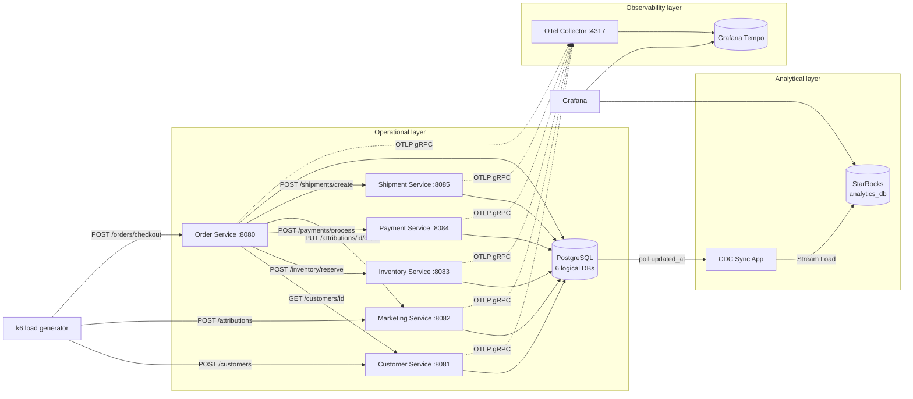
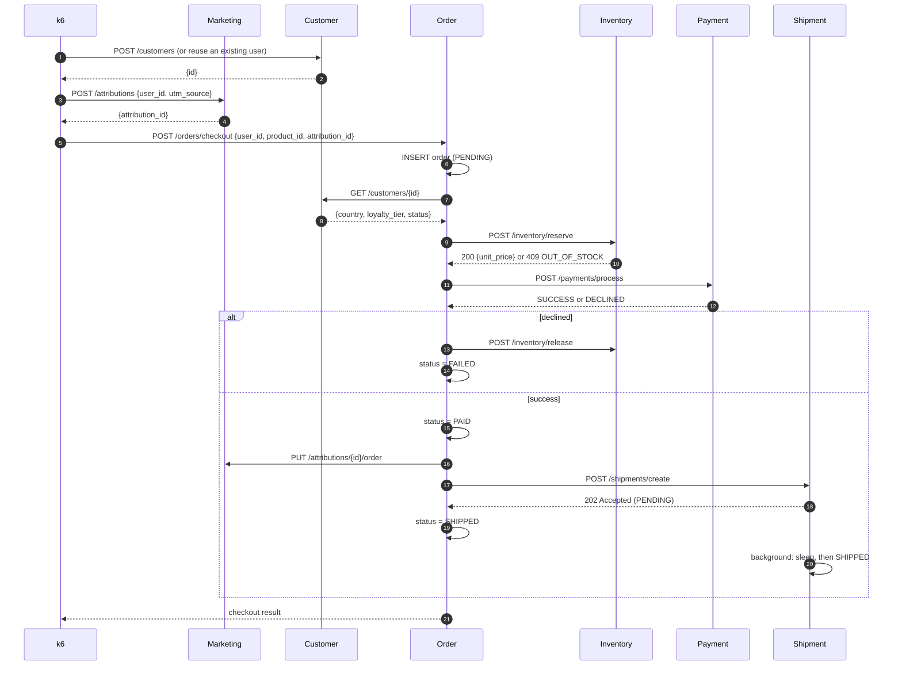

# DataStack Microservice Ecosystem

This is the architecture of DataStack's e-commerce microservice ecosystem. It replaces the earlier single-binary orchestrator design (Customer/Inventory/Sales/Invoicing over in-memory Go channels).

The ecosystem has six Go HTTP microservices and a Go CDC sync daemon. It runs on a local Kubernetes (kind) cluster. k6 generates the traffic, OpenTelemetry emits distributed traces, and the sync daemon streams operational data into StarRocks for real-time Grafana dashboards.

> **Status:** all six microservices, the CDC sync daemon and the k6 load generator are built. The Customer Service ([`services/customer`](../../services/customer)) is the reference implementation for the conventions in §3.

## Service Index

| Service | Port | Database | Tables | Role | Doc |
|---|---|---|---|---|---|
| Order Service | 8080 | `orders` | `orders` | Edge API and checkout orchestrator | [order-service.md](order-service.md) |
| Customer Service | 8081 | `customers` | `customers` | Identity, geography, loyalty tier, account state | [customer-service.md](customer-service.md) |
| Marketing Service | 8082 | `marketing` | `campaigns`, `attributions` | Top-of-funnel touchpoints and conversion attribution | [marketing-service.md](marketing-service.md) |
| Inventory Service | 8083 | `inventory` | `inventory` | Stock levels, reservations, product catalog | [inventory-service.md](inventory-service.md) |
| Payment Service | 8084 | `payments` | `payments` | Simulated card processing with injected failures | [payment-service.md](payment-service.md) |
| Shipment Service | 8085 | `shipments` | `shipments` | Simulated fulfillment with artificial packing delay | [shipment-service.md](shipment-service.md) |
| CDC Sync App | n/a | reads all six | n/a | Watermark polling into StarRocks Stream Load | [cdc-sync.md](cdc-sync.md) |

## 1. System Topology

The ecosystem has three layers:

1. **Operational layer (Go + PostgreSQL).** Six independent HTTP REST microservices. Each one owns its own logical database inside a shared PostgreSQL instance. They talk to each other synchronously over HTTP JSON APIs. No service reads another service's database.
2. **Observability layer (OpenTelemetry + Tempo).** Every Go service is instrumented with OpenTelemetry. Spans go to an OTel Collector, are stored in Grafana Tempo, and are viewed in Grafana.
3. **Analytical layer (Go CDC + StarRocks).** A Go sync daemon polls the `updated_at` watermark of every operational table and pushes micro-batches into StarRocks over HTTP Stream Load. Grafana dashboards query StarRocks.



### Call graph

The Order Service is the only service that calls other services. The other five are leaf nodes: they serve requests and write to their own database.

| Caller | Callee | Call | Critical path? |
|---|---|---|---|
| k6 | Customer | `POST /customers` | n/a |
| k6 | Marketing | `POST /attributions` | n/a |
| k6 | Order | `POST /orders/checkout` | n/a |
| Order | Customer | `GET /customers/{id}` | Yes: an invalid or suspended user rejects the checkout |
| Order | Inventory | `POST /inventory/reserve` | Yes: out of stock fails the checkout |
| Order | Payment | `POST /payments/process` | Yes: a decline fails the checkout and releases stock |
| Order | Inventory | `POST /inventory/release` | Compensation only |
| Order | Marketing | `PUT /attributions/{id}/order` | No: best-effort |
| Order | Shipment | `POST /shipments/create` | No: fire-and-forget (accepted immediately) |

## 2. End-to-End User Journey

One k6 iteration simulates one customer journey, from the ad click to the box leaving the warehouse.



See [order-service.md](order-service.md) for the exact orchestration and failure semantics.

## 3. Shared Conventions

These conventions were established while building the Customer Service ([`services/customer`](../../services/customer)), which is the reference implementation. Every later service follows them.

### 3.1 Universal columns and triggers

Every operational table starts with the same four columns. In Go, they come from embedding `database.Model` ([`pkgs/database/model.go`](../../pkgs/database/model.go)):

| Column | Definition | Purpose |
|---|---|---|
| `id` | `BIGSERIAL PRIMARY KEY` | Auto-incrementing key; tie-breaker in the CDC cursor |
| `created_at` | `TIMESTAMPTZ NOT NULL DEFAULT NOW()` | Row creation time; used for latency and cohort analytics |
| `updated_at` | `TIMESTAMPTZ NOT NULL DEFAULT NOW()` | CDC watermark; **refreshed on every UPDATE by a trigger** |
| `deleted_at` | `TIMESTAMPTZ` (nullable) | GORM soft delete. Hard deletes are invisible to watermark CDC, so services never `DELETE` rows |

Rules:

- **Postgres is the only clock.** `created_at` and `updated_at` are never written by the application: the model tags them `<-:false;default:now()`, and GORM reads them back with `RETURNING`. (GORM would otherwise set them itself, but from the pod's clock. If inserts used the pod's clock while the trigger used the database's, clock skew could move `updated_at` backwards and the sync daemon would skip rows. An integration test caught exactly this. The trigger also covers writes that bypass GORM, such as `db.Exec` or a manual psql edit.)
- **Soft delete moves the watermark.** GORM's soft delete is an `UPDATE ... SET deleted_at`, so the trigger moves `updated_at` and the sync daemon sees the delete.
- **Unique constraints are partial**, for example `UNIQUE (email) WHERE deleted_at IS NULL`, so a soft-deleted row doesn't block re-creating it.
- **Every table has a `(updated_at, id)` index** (`idx_<table>_cdc_cursor`, declared on `database.Model`) for the sync daemon's cursor query.
- **Enums are `VARCHAR` with a named `CHECK` constraint** (`check:chk_<table>_<column>,<expr>`), mirrored as typed string constants in Go. Name CHECKs explicitly: an unnamed expression that contains a comma is mis-parsed by GORM.
- **No `default:` on bool or numeric columns whose zero value is meaningful.** GORM omits zero-valued fields that have a default on insert, so `default:true` would silently turn `false` into `true`.
- `TIMESTAMPTZ` everywhere, so the session time zone can't affect watermarks.

The service docs that haven't been built yet still show the schemas from the original spec (`SERIAL`, `TIMESTAMP`, `is_deleted`). Each one moves to these conventions when its service is built.

`database.AutoMigrate` installs the trigger after GORM's `AutoMigrate`, because GORM can't create triggers. It's idempotent (`CREATE OR REPLACE`):

```sql
CREATE OR REPLACE FUNCTION set_updated_at() RETURNS TRIGGER AS $$
BEGIN
    NEW.updated_at = NOW();
    RETURN NEW;
END;
$$ LANGUAGE plpgsql;

-- for every migrated model:
CREATE OR REPLACE TRIGGER "<table>_set_updated_at"
    BEFORE UPDATE ON "<table>"
    FOR EACH ROW EXECUTE FUNCTION set_updated_at();
```

### 3.2 Schema ownership and migrations

- Each service owns one logical database. In kind, its Helm release declares that database as a CloudNativePG `Database` resource.
- **The GORM model is the schema.** Columns, sizes, `NOT NULL`, named CHECKs, partial unique indexes (`uniqueIndex:,where:deleted_at IS NULL`) and composite indexes are all declared in struct tags. There are no migration files.
- Each domain package exports `Migrate(ctx, db) error`, which calls `database.AutoMigrate(ctx, db, &Model{}, ...)` plus any seed data. `<binary> migrate` runs it under a Postgres advisory lock (`database.WithMigrationLock`), so concurrent pods take turns. In Kubernetes it runs as an **initContainer** before `serve` starts.
- `AutoMigrate` only adds: new tables, columns, indexes and constraints. It never drops or renames anything. That's fine for a demo. To change a column's shape, recreate the database (drop it, then redeploy).
- Integration tests run `Migrate` twice to prove it's idempotent.

### 3.3 HTTP API conventions

- REST over JSON with **gin**. Requests are validated with gin binding tags (go-playground/validator), and invalid input gets `400 INVALID_REQUEST`.
- Error body: `{"error": "<MACHINE_CODE>", "message": "<human text>"}` (`httpserver.RespondError`). Machine codes such as `OUT_OF_STOCK` and `PAYMENT_DECLINED` are what the Order Service records as `failure_reason`. 500s never leak internals.
- Database models are never serialised directly. Handlers map them to response structs.
- **Status codes:** `400` only for malformed or invalid input, `404` for an unknown entity, and `409` when a valid request conflicts with current state (`EMAIL_EXISTS`, `OUT_OF_STOCK`). Callers branch on the `error` code, never on the status alone.
- **Money** is `shopspring/decimal` in Go and `DECIMAL(10,2)` in Postgres, never `float64`. In JSON it is a fixed two-decimal **string** (`"49.99"`, `"50.00"`, via `StringFixed(2)`), so JavaScript clients can't silently round it. Requests should accept the same form, since `decimal.Decimal` unmarshals both strings and numbers.
- Every service exposes `GET /healthz` (liveness), `GET /readyz` (readiness; pings the DB) and `GET /metrics`. These sit outside the tracing and logging middleware, so probes don't create noise.
- Service-to-service URLs come from environment variables populated by ConfigMaps (for example `PAYMENT_URL=http://payment-service:8084`).
- Outbound HTTP clients use explicit timeouts. No call waits forever.

### 3.4 Configuration

- **cobra** commands: `serve`, `migrate`.
- **viper** binds every flag to an environment variable of the same name: `--database-url` ↔ `DATABASE_URL`, `--tier-weights` ↔ `TIER_WEIGHTS`. Flag defaults are the documented defaults.
- In Kubernetes, plain settings go in the chart's ConfigMap. Database credentials come from CNPG's secret as `PGUSER`/`PGPASSWORD`, which pgx reads natively, so passwords never appear in URLs.

### 3.5 Go layout

One Go module at the repo root (`github.com/poph2/datastack`) and one shared `Dockerfile` (`--build-arg SERVICE=<name>`, distroless, non-root).

```
pkgs/                       # shared by every service
  cli/         root cobra command, flag <-> env binding
  database/    GORM open (pool, tracing plugin), base Model, AutoMigrate + updated_at trigger, migration lock
  migrate/     the `migrate` command (opens the DB, takes the lock, runs the domain's Migrate)
  httpserver/  gin router (otelgin, slog-gin, Prometheus, recovery, probes), error helpers, graceful shutdown
  logging/     slog JSON/text setup
  telemetry/   OTel tracer provider + W3C propagator
  httpclient/  service-to-service JSON client (otelhttp, per-peer timeout, *APIError with the peer's error code, client metrics)
  pgtest/      testcontainers Postgres for integration tests
services/<name>/
  main.go      root command: serve + migrate
  serve.go     wiring: logger, tracing, DB, handler, router, run
  internal/<domain>/
    model.go       GORM model (its tags are the schema) + enum types + Migrate
    repository.go  GORM queries; maps driver errors to domain errors (ErrNotFound, ...)
    handler.go     gin handlers, request/response types, Store interface
    *_test.go      handler tests (fake Store) + repository tests (real Postgres)
deploy/
  charts/go-service/   one generic chart for every service
  values/<name>.yaml   per-service values
  infra/               CNPG Postgres cluster
  kind/                cluster config
```

A service adds a service layer between handler and repository only when it has real business logic. The Order Service's orchestration will have one; the Customer Service doesn't need one.

More patterns, established by the Order Service:

- **Calling another service** goes through `pkgs/httpclient`, wrapped in a small typed client per peer (`clients.go`) that turns the peer's error codes into sentinel errors. Requests are built from the inbound context (one trace per checkout), every peer has its own timeout, and nothing retries automatically: a retry is only safe when the peer makes the operation idempotent (shipment create, attribution conversion).
- **State machines move through guarded transitions:** `UPDATE ... WHERE id = ? AND status = <from> RETURNING *`. A lost race returns `ErrStatusChanged` rather than overwriting.
- **Business failures are data, not errors.** A failed checkout is a FAILED row with a reason, and a 4xx with the shared error body plus the entity. Only infrastructure failures are 5xx.

More patterns, established by the Inventory Service:

- **Concurrency through SQL, not locks.** State changes that must be race-free are one conditional `UPDATE ... WHERE <guard> RETURNING` (GORM: `Model(&x).Clauses(clause.Returning{}).Where(...).Update(col, gorm.Expr(...))`). Under READ COMMITTED, Postgres re-checks the guard against the latest row version, so no explicit transaction or `SELECT ... FOR UPDATE` is needed. A test races many goroutines against it.
- **Background workers** (`restocker.go`) run beside the HTTP server under `errgroup` in `serve.go`, so they share one lifetime and the DB closes only after both stop. Each run is its own root span. A worker must be safe with several replicas running it (the guard-in-`WHERE` trick again), not depend on leader election.
- **Seed data is loaded by `Migrate`** (`seed.go`): deterministic, and inserted only when the table has never held rows (soft-deleted ones count), so it runs in the existing initContainer, never re-seeds, and every environment has the same IDs.
- **Domain metrics** live in the domain package's `metrics.go` (`<service>_<thing>_total`, low-cardinality labels such as `outcome`). The shared HTTP metrics count requests; domain metrics count what happened to the business.

### 3.6 Testing

- Handler tests go through the real shared router (`httpserver.NewRouter`) with a fake `Store`.
- Repository tests run the service's real `Migrate` against Postgres in testcontainers (`pkgs/pgtest`) and assert the schema behaviour: triggers, constraints, soft delete.
- `make test` runs everything (needs Docker). `make test-unit` (`go test -short`) skips the containers.

## 4. Telemetry (OpenTelemetry)

The goal is one trace per checkout, spanning every service it touches. This depends on the W3C `traceparent` header being propagated.

| Concern | Implementation |
|---|---|
| SDK | `go.opentelemetry.io/otel`, `go.opentelemetry.io/otel/sdk/trace` |
| Propagation | `otel.SetTextMapPropagator(propagation.TraceContext{})`. **This is required:** without it, nothing injects `traceparent` |
| Inbound spans | `otelgin.Middleware("<service>")` on the API route group (`pkgs/httpserver`) |
| Outbound spans | HTTP clients use `otelhttp.NewTransport(http.DefaultTransport)`, and requests must be built with the inbound `ctx` (`http.NewRequestWithContext`) |
| DB spans | GORM OpenTelemetry plugin (`gorm.io/plugin/opentelemetry`), with query variables omitted |
| Exporter | OTLP gRPC to `otel-collector:4317`, configured by the standard `OTEL_*` env vars. If `OTEL_EXPORTER_OTLP_ENDPOINT` is unset, spans are created (trace IDs still appear in logs) but not exported |
| Resource | `service.name=<name>-service`, `deployment.environment=kind` |

Request logs (slog JSON via `slog-gin`) include `trace_id` and `span_id`, so a log line links straight to its trace. Each service also exposes Prometheus metrics at `/metrics`: `http_server_requests_total{route,method,status}` and `http_server_request_duration_seconds`, plus Go runtime metrics.

The collector forwards to Tempo, and Grafana uses Tempo as a datasource. In Tempo's service graph the Order Service appears as the hub, with edges to all five other services.

## 5. Analytics Pipeline

The CDC Sync App ([`services/cdc-sync`](../../services/cdc-sync)) runs one polling loop per table, every 5 seconds. Each loop reads rows past its `(updated_at, id)` cursor (oldest first, batches of up to 1000, soft-deleted rows included) and pushes the batch into StarRocks `analytics_db` with HTTP Stream Load, straight to the BE. When StarRocks confirms the load, the loop advances its cursor in memory. There is no watermark file: at startup the cursors are re-derived from `MAX(updated_at)` in StarRocks, and loads are idempotent Primary Key upserts. Target tables are created and extended by reflecting the Postgres schema. `GET :8090/status` shows each table's cursor and lag. Full details are in [cdc-sync.md](cdc-sync.md).

Tables synced (seven tables across six databases):

| Source DB | Table | StarRocks target |
|---|---|---|
| `customers` | `customers` | `analytics_db.customers` |
| `marketing` | `campaigns` | `analytics_db.campaigns` |
| `marketing` | `attributions` | `analytics_db.attributions` |
| `inventory` | `inventory` | `analytics_db.inventory` |
| `payments` | `payments` | `analytics_db.payments` |
| `shipments` | `shipments` | `analytics_db.shipments` |
| `orders` | `orders` | `analytics_db.orders` |

### Dashboards this enables

| Dashboard | Joins |
|---|---|
| Executive heartbeat: orders/min, revenue/hour, checkout success rate | `orders` |
| Revenue by country and loyalty tier, CLTV, cohorts | `orders` ⋈ `customers` |
| Campaign ROI, ROAS, CAC | `campaigns` ⋈ `attributions` ⋈ `payments` |
| Revenue leakage: declined payments by segment | `payments` ⋈ `orders` ⋈ `customers` |
| Stock depletion velocity and lost revenue | `inventory` ⋈ `orders` |
| Fulfillment SLA: time-to-ship, carrier mix, VIP SLA | `shipments` ⋈ `orders` ⋈ `customers` |

## 6. Deployment (kind Kubernetes)

| Component | Delivery |
|---|---|
| Six microservices, CDC Sync App, k6 runner | Images built locally and loaded with `kind load docker-image` |
| Service wiring | The generic `deploy/charts/go-service` chart, installed once per service as release `<name>-service`: Deployment (migrate initContainer, probes, preStop drain, non-root/read-only), ClusterIP Service, ConfigMap (peer URLs such as `PAYMENT_URL`, plus `OTEL_EXPORTER_OTLP_ENDPOINT`), and a CNPG `Database` |
| PostgreSQL | CloudNativePG operator (`cnpg/cloudnative-pg`) running one `Cluster` (`deploy/infra/postgres.yaml`). Each service's chart release declares its own logical database. Bitnami's chart was dropped because its free images were discontinued in 2025 |
| Traces | `open-telemetry/opentelemetry-collector`, `grafana/tempo` |
| Dashboards | `grafana/grafana`, with Tempo and StarRocks (MySQL protocol, FE port 9030) datasources provisioned |
| Analytics | StarRocks as one all-in-one pod (`starrocks/allin1-ubuntu`, FE and BE together, 3 GB limit), a StatefulSet plus Service `starrocks` in `deploy/infra/starrocks.yaml` (`make analytics`) |
| CDC Sync App | The go-service chart with no database of its own and no migrate step, single replica, `Recreate` strategy (`deploy/values/cdc-sync.yaml`). It's stateless, so no PVC |
| Load | k6 as a continuous Deployment (steady demo traffic) or a CronJob (bursts) |

Make targets (every `kubectl`/`helm` call pins `--context kind-datastack`):

```sh
make kind-up                 # create the kind cluster
make infra                   # CNPG operator + Postgres cluster
make analytics               # StarRocks (one all-in-one pod, ~3 GB)
make deploy-all              # build, kind load and helm install every service + the CDC daemon
make deploy-order            # ...or one service at a time
make load RATE=10            # continuous k6 journeys inside the cluster; make load-stop to end
make forward-order           # port-forward localhost:8080 (any service: forward-<name>)
make status                  # pods and CNPG databases
make up && make run-customer # local alternative: Postgres via docker compose + go run
```

Internal DNS names: `order-service`, `customer-service`, `marketing-service`, `inventory-service`, `payment-service`, `shipment-service`, `cdc-sync-service`, `starrocks`, `datastack-pg-rw`.

### Load generator (k6)

[`deploy/k6/checkout-journey.js`](../../deploy/k6/checkout-journey.js) runs as a `k6` Deployment (`grafana/k6:1.3.0`, script mounted from a ConfigMap) at a constant arrival rate (`RATE` journeys per second). It runs for 24h, and Kubernetes restarts it, so the load is effectively endless. Each journey:

1. Registers a new customer (30%, with a weighted country), or reuses one this VU created earlier.
2. Clicks an ad (`POST /attributions`, weighted across the seeded paid campaigns), or arrives organically (15%) with no attribution.
3. Checks out a product picked with a **popularity skew** (low-numbered SKUs sell far more often, so stock-outs concentrate on them), quantity 1–3.
4. Occasionally upgrades a customer's tier or suspends them (1%), or triggers a manual restock burst (0.5%).

Setup reads the catalog (`GET /inventory`) and campaigns (`GET /campaigns`) from the services, so the script never hard-codes IDs. Checks treat `201` and `422` as expected outcomes. The threshold is a server-error rate below 1%.

## 7. Design Decisions

The gaps between the original spec and the per-service narratives, and how they were resolved:

1. **Account state:** `customers.status` (`ACTIVE`, `SUSPENDED`, `PENDING_DELETION`). The Order Service rejects anything not `ACTIVE`.
2. **Order line data:** `orders` has `product_id`, `quantity`, `unit_price`, `failure_reason`.
3. **Pricing source:** `POST /inventory/reserve` returns `unit_price`, and the Order Service computes `total_amount`.
4. **Inventory release:** `POST /inventory/release`, called when payment fails after a reservation.
5. **SHIPPED semantics:** an order becomes `SHIPPED` when the Shipment Service accepts the request. The box physically ships later (`shipments.shipped_at`), so time-to-ship analytics use `shipments`, not `orders`.
6. **Campaign join key:** `attributions` stores `utm_source` and `utm_campaign`, and only known campaigns are accepted, so ROAS joins work per campaign.
7. **Shipment destination:** `shipments.destination_country` is stored. The Order Service also passes `loyalty_tier`, so GOLD customers' boxes are packed faster (VIP SLA dashboards).
8. **Money:** `shopspring/decimal`, sent as fixed two-decimal strings (§3.3).
9. **Double charges:** a partial unique index lets an order have at most one successful payment (`409 ALREADY_PAID`).
10. **Shipment packing:** a database-driven worker (`FOR UPDATE SKIP LOCKED`, capacity per tick), not an in-memory queue, so it is safe with several replicas and survives restarts.
11. **CDC state:** no watermark file. Cursors are re-derived from StarRocks at startup, and loads are idempotent upserts (see [cdc-sync.md](cdc-sync.md)).
12. **Runtime target:** `CLAUDE.md` still describes Docker Compose, NATS, ClickHouse, and Prometheus. This design uses kind, synchronous HTTP, StarRocks, and OTel/Tempo, so `CLAUDE.md` should be updated to match.
