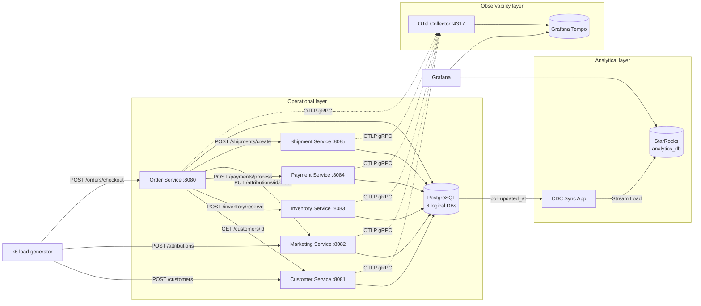

# DataStack Microservice Ecosystem

This is the architecture of DataStack's e-commerce microservice ecosystem. It replaces the earlier single-binary orchestrator design (Customer/Inventory/Sales/Invoicing over in-memory Go channels).

The ecosystem has six Go HTTP microservices and a Go CDC sync daemon. It runs on a local Kubernetes (kind) cluster. k6 generates the traffic, OpenTelemetry emits distributed traces, and the sync daemon streams operational data into StarRocks for real-time Grafana dashboards.

> **Status:** target design. The code currently in `services/backend` and `docker-compose.yml` still follows the previous design.

## Service Index

| Service | Port | Database | Tables | Role | Doc |
|---|---|---|---|---|---|
| Order Service | 8080 | `orders` | `orders` | Edge API and checkout orchestrator | [order-service.md](order-service.md) |
| Customer Service | 8081 | `customers` | `customers` | Identity, geography, loyalty tier, account state | [customer-service.md](customer-service.md) |
| Marketing Service | 8082 | `marketing` | `campaigns`, `attributions` | Top-of-funnel touchpoints and conversion attribution | [marketing-service.md](marketing-service.md) |
| Inventory Service | 8083 | `inventory` | `inventory` | Stock levels, reservations, product catalog | [inventory-service.md](inventory-service.md) |
| Payment Service | 8084 | `payments` | `payments` | Simulated card processing with injected failures | [payment-service.md](payment-service.md) |
| Shipment Service | 8085 | `shipments` | `shipments` | Simulated fulfillment with artificial packing delay | [shipment-service.md](shipment-service.md) |
| CDC Sync App | n/a | reads all six | n/a | Watermark polling into StarRocks Stream Load | [cdc-sync.md](cdc-sync.md) |

## 1. System Topology

The ecosystem has three layers:

1. **Operational layer (Go + PostgreSQL).** Six independent HTTP REST microservices. Each one owns its own logical database inside a shared PostgreSQL instance. They talk to each other synchronously over HTTP JSON APIs. No service reads another service's database.
2. **Observability layer (OpenTelemetry + Tempo).** Every Go service is instrumented with OpenTelemetry. Spans go to an OTel Collector, are stored in Grafana Tempo, and are viewed in Grafana.
3. **Analytical layer (Go CDC + StarRocks).** A Go sync daemon polls the `updated_at` watermark of every operational table and pushes micro-batches into StarRocks over HTTP Stream Load. Grafana dashboards query StarRocks.



### Call graph

The Order Service is the only service that calls other services. The other five are leaf nodes: they serve requests and write to their own database.

| Caller | Callee | Call | Critical path? |
|---|---|---|---|
| k6 | Customer | `POST /customers` | n/a |
| k6 | Marketing | `POST /attributions` | n/a |
| k6 | Order | `POST /orders/checkout` | n/a |
| Order | Customer | `GET /customers/{id}` | Yes: an invalid or suspended user rejects the checkout |
| Order | Inventory | `POST /inventory/reserve` | Yes: out of stock fails the checkout |
| Order | Payment | `POST /payments/process` | Yes: a decline fails the checkout and releases stock |
| Order | Inventory | `POST /inventory/release` | Compensation only |
| Order | Marketing | `PUT /attributions/{id}/order` | No: best-effort |
| Order | Shipment | `POST /shipments/create` | No: fire-and-forget (accepted immediately) |

## 2. End-to-End User Journey

One k6 iteration simulates one customer journey, from the ad click to the box leaving the warehouse.


See [order-service.md](order-service.md) for the exact orchestration and failure semantics.

## 3. Shared Conventions

### 3.1 Universal columns and triggers

The CDC Sync App needs three columns on every operational table:

| Column | Definition | Purpose |
|---|---|---|
| `created_at` | `TIMESTAMP DEFAULT NOW()` | Row creation time; used for latency and cohort analytics |
| `updated_at` | `TIMESTAMP DEFAULT NOW()` | CDC watermark; **must be refreshed on every UPDATE by a trigger** |
| `is_deleted` | `BOOLEAN DEFAULT FALSE` | Soft delete. Hard deletes are invisible to watermark CDC, so services never `DELETE` rows. |

Every database installs the same trigger function, and every table gets a `BEFORE UPDATE` trigger:

```sql
CREATE OR REPLACE FUNCTION set_updated_at() RETURNS TRIGGER AS $$
BEGIN
  NEW.updated_at = NOW();
  RETURN NEW;
END;
$$ LANGUAGE plpgsql;

-- one per table, for example:
CREATE TRIGGER orders_set_updated_at
  BEFORE UPDATE ON orders
  FOR EACH ROW EXECUTE FUNCTION set_updated_at();
```

Run the Postgres instance and every service connection in **UTC**. The columns are `TIMESTAMP` without time zone, so a mixed session time zone would corrupt watermarks.

### 3.2 Schema ownership

Each service applies its own schema (tables, trigger function, triggers) at startup using embedded, idempotent SQL migrations. Nothing outside the service creates or alters its tables. The Postgres Helm chart only creates the six empty logical databases.

### 3.3 HTTP API conventions

- REST over JSON, `Content-Type: application/json`.
- Error body: `{"error": "<MACHINE_CODE>", "message": "<human text>"}`. Machine codes such as `OUT_OF_STOCK` and `PAYMENT_DECLINED` are what the Order Service records as `failure_reason`.
- Every service exposes `GET /healthz` (liveness) and `GET /readyz` (readiness; checks the DB connection) for Kubernetes probes.
- Service-to-service URLs come from environment variables populated by ConfigMaps (for example `PAYMENT_URL=http://payment-service:8084`).
- Outbound HTTP clients use explicit timeouts. No call waits forever.

### 3.4 Go service layout

Each service is its own module in the repo's Go workspace (`go.work`) and its own container image. They all share the same skeleton:

```
services/<name>-service/
  main.go              # config, OTel init, DB pool, HTTP server, graceful shutdown
  internal/http/       # handlers + router, wrapped by otelhttp
  internal/store/      # SQL against the service's own DB (pgx)
  migrations/*.sql     # embedded, applied at boot
  Dockerfile
```

## 4. Telemetry (OpenTelemetry)

The goal is one trace per checkout, spanning every service it touches. This depends on the W3C `traceparent` header being propagated.

| Concern | Implementation |
|---|---|
| SDK | `go.opentelemetry.io/otel`, `go.opentelemetry.io/otel/sdk/trace` |
| Propagation | `otel.SetTextMapPropagator(propagation.TraceContext{})`. **This is required:** without it, nothing injects `traceparent` |
| Inbound spans | Wrap the mux with `otelhttp.NewHandler(mux, "<service>")` |
| Outbound spans | HTTP clients use `otelhttp.NewTransport(http.DefaultTransport)`, and requests must be built with the inbound `ctx` (`http.NewRequestWithContext`) |
| DB spans (optional) | `otelpgx` tracer on the pgx pool, so SQL time appears inside each service span |
| Exporter | OTLP gRPC to `otel-collector:4317` (`OTEL_EXPORTER_OTLP_ENDPOINT`) |
| Resource | `service.name=<name>-service`, `deployment.environment=kind` |

The collector forwards to Tempo, and Grafana uses Tempo as a datasource. In Tempo's service graph the Order Service appears as the hub, with edges to all five other services.

## 5. Analytics Pipeline

The CDC Sync App runs one polling loop per table, every 5 seconds. Each loop reads rows whose `updated_at` is newer than its watermark (oldest first, batches of up to 1000) and pushes the batch into StarRocks `analytics_db` with HTTP Stream Load. When StarRocks confirms the load, the loop advances the watermark in `watermarks.json`. Full details are in [cdc-sync.md](cdc-sync.md).

Tables synced (seven tables across six databases):

| Source DB | Table | StarRocks target |
|---|---|---|
| `customers` | `customers` | `analytics_db.customers` |
| `marketing` | `campaigns` | `analytics_db.campaigns` |
| `marketing` | `attributions` | `analytics_db.attributions` |
| `inventory` | `inventory` | `analytics_db.inventory` |
| `payments` | `payments` | `analytics_db.payments` |
| `shipments` | `shipments` | `analytics_db.shipments` |
| `orders` | `orders` | `analytics_db.orders` |

### Dashboards this enables

| Dashboard | Joins |
|---|---|
| Executive heartbeat: orders/min, revenue/hour, checkout success rate | `orders` |
| Revenue by country and loyalty tier, CLTV, cohorts | `orders` ⋈ `customers` |
| Campaign ROI, ROAS, CAC | `campaigns` ⋈ `attributions` ⋈ `payments` |
| Revenue leakage: declined payments by segment | `payments` ⋈ `orders` ⋈ `customers` |
| Stock depletion velocity and lost revenue | `inventory` ⋈ `orders` |
| Fulfillment SLA: time-to-ship, carrier mix, VIP SLA | `shipments` ⋈ `orders` ⋈ `customers` |

## 6. Deployment (kind Kubernetes)

| Component | Delivery |
|---|---|
| Six microservices, CDC Sync App, k6 runner | Images built locally and loaded with `kind load docker-image` |
| Service wiring | One Deployment + ClusterIP Service per microservice. A ConfigMap per service holds peer URLs (`CUSTOMER_URL`, `INVENTORY_URL`, `PAYMENT_URL`, `MARKETING_URL`, `SHIPMENT_URL`), `DATABASE_URL`, and `OTEL_EXPORTER_OTLP_ENDPOINT` |
| PostgreSQL | `bitnami/postgresql`: one instance, with six logical databases created by `primary.initdb.scripts` |
| Traces | `open-telemetry/opentelemetry-collector`, `grafana/tempo` |
| Dashboards | `grafana/grafana`, with Tempo and StarRocks (MySQL protocol, FE port 9030) datasources provisioned |
| Analytics | `starrocks/starrocks` (kube-starrocks), overridden to 1 FE + 1 BE with 2 GB memory limits |
| CDC Sync App | One Deployment with a single replica (the watermark file must have a single writer), plus a small PVC for `watermarks.json` |
| Load | k6 as a continuous Deployment (steady demo traffic) or a CronJob (bursts) |

Internal DNS names: `order-service`, `customer-service`, `marketing-service`, `inventory-service`, `payment-service`, `shipment-service`, `otel-collector`, `starrocks-fe`.

### Load generator (k6)

The k6 script loops through these weighted actions:

1. Register a new customer (`POST /customers`), or pick a known user ID from earlier iterations.
2. Log an ad click (`POST /attributions`) with a random `utm_source` from the seeded campaigns.
3. Check out (`POST /orders/checkout`) with a random `product_id` from the seeded catalog, carrying the `attribution_id` forward. A configurable fraction of checkouts send no attribution, to simulate organic traffic.

## 7. Open Design Questions

These are gaps between the original spec and the per-service narratives. Each service doc proposes a resolution, and they are collected here so they can be decided once:

1. **Account state column.** The Customer Service must reject suspended users, but `customers` has no status column. Proposed: add `status`. See [customer-service.md](customer-service.md).
2. **Order line data.** "Who bought what" and the lost-revenue dashboard need `product_id` and `quantity` on `orders`, and the failure dashboards need `failure_reason`. Proposed: add all three. See [order-service.md](order-service.md).
3. **Pricing source.** The checkout payload carries no amount. Proposed: `POST /inventory/reserve` returns `unit_price`, and the Order Service computes `total_amount`.
4. **Inventory release.** The checkout flow releases stock on payment failure, but no endpoint was specified. Proposed: `POST /inventory/release`.
5. **SHIPPED semantics.** The Order Service marks the order `SHIPPED` as soon as the Shipment Service accepts the request, while the shipment itself is still `PENDING`. This keeps orders simple, but it means "shipped" in `orders` means "handed to fulfillment"; use `shipments` for the actual ship time. An alternative is a `FULFILLING` order status.
6. **Campaign join key.** `attributions` stores only `utm_source`, while `campaigns` is keyed by `utm_source` + `utm_campaign`. ROAS per campaign needs `utm_campaign` on `attributions` as well.
7. **Shipment destination.** `POST /shipments/create` receives `destination_country`, but `shipments` doesn't store it. Proposed: add the column.
8. **Runtime target.** `CLAUDE.md` still describes Docker Compose, NATS, ClickHouse, and Prometheus. This design uses kind, synchronous HTTP, StarRocks, and OTel/Tempo. `CLAUDE.md` should be updated to match once this design is accepted.
