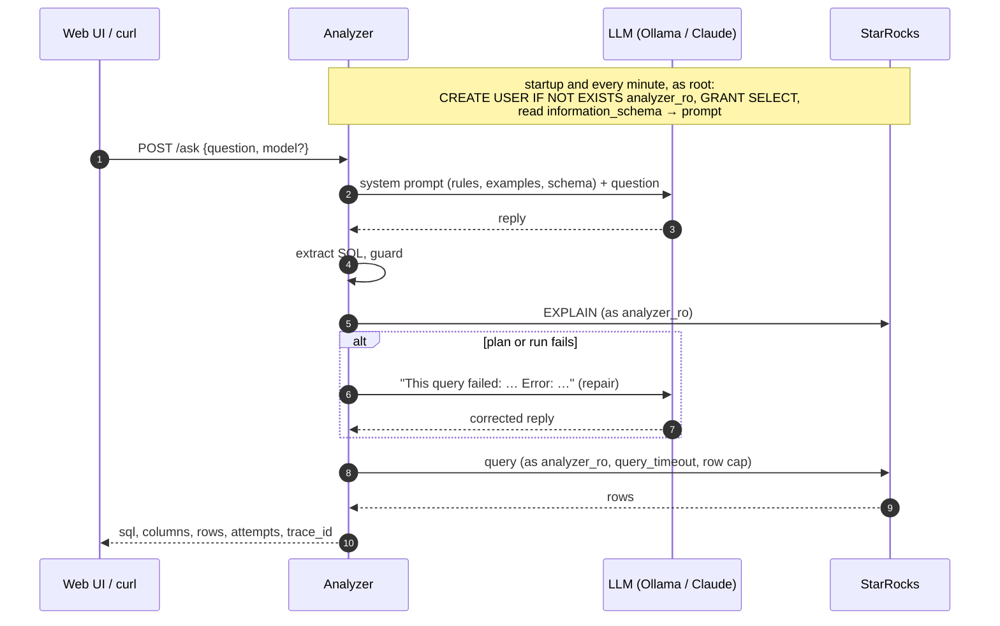

# Analyzer Service: Questions to SQL

> **Status: built.** Code is in [`services/analyzer`](../../services/analyzer). It follows the shared conventions in the [ecosystem README](README.md#3-shared-conventions), but it owns no Postgres database: it reads StarRocks `analytics_db`, which the [CDC sync daemon](cdc-sync.md) fills.

| | |
|---|---|
| Port | `8086` |
| Kubernetes service | `analyzer-service` |
| Binary | `analyzer` (`serve`, `eval`) |
| Database | none of its own; reads StarRocks `analytics_db` |
| Tables | none |
| Called by | the web UI (`apps/web`), people with `curl` |
| Calls | StarRocks (MySQL protocol, `starrocks:9030`), an LLM (Ollama on the host by default, or the Claude API) |

## Purpose

The Analyzer answers business questions in plain English ("What is the ROAS of each paid campaign?") with data. It is the payoff of the schema documentation convention ([README §3.2](README.md#32-schema-documentation-semantic-context)): every table and column comment written in the GORM models reaches StarRocks through the CDC daemon, and the Analyzer hands exactly that documentation to an LLM, which writes one SQL query. The service checks the query, runs it as a read-only user and returns the rows.

## Responsibilities

- **Schema context.** Reads table and column comments from `information_schema` on startup and every minute, parses the `[ref: table.column]` join markers into a join graph, and renders a compact prompt.
- **Generation.** Asks the LLM for one StarRocks SELECT, with the documented metric definitions spelled out, and extracts the SQL from whatever the model actually replied.
- **Repair.** When the query fails to plan or run, it sends the error back to the model once more (`--max-attempts`, default 2).
- **Safety.** A static guard, then a read-only StarRocks user that can only `SELECT` from `analytics_db`, then `EXPLAIN`, a row cap and a timeout.
- **Evaluation.** `analyzer eval` scores the whole pipeline against reference SQL.

## How It Works



### 1. Schema context

[`starrocks.go`](../../services/analyzer/internal/analyzer/starrocks.go) reads `information_schema.tables` and `information_schema.columns` for `analytics_db`. [`schema.go`](../../services/analyzer/internal/analyzer/schema.go) normalises the types (`bigint(20)` → `bigint`) and parses every column comment with the marker regex `\[ref: ([a-z_][a-z0-9_]*)\.([a-z_][a-z0-9_]*)\]` into joins such as `orders.user_id → customers.id`. [`prompt.go`](../../services/analyzer/internal/analyzer/prompt.go) renders it once per load:

```
Database analytics_db (StarRocks, MySQL-compatible SQL).

Conventions for every table:
- Timestamps are DATETIME values in UTC. NOW() is UTC too.
- Money columns are DECIMAL amounts in USD with two decimal places.
- Rows are soft-deleted: add <alias>.deleted_at IS NULL for EVERY table in the query.
- updated_at is a technical change time. Never use it as a business event time: ...

Columns every table has (not repeated below):
  id bigint: Surrogate primary key of this row, unique within this table.
  created_at datetime: When the row was created, in UTC, set by the database clock.
  ...

Tables:

TABLE orders: Checkout attempts (Order Service): one row per checkout, failed ones included. ...
  user_id bigint: Customer who checked out. ... [ref: customers.id]
  ...

Joins (the only valid join conditions):
- attributions.user_id = customers.id
- ...
```

The full system prompt puts **rules** first (one SELECT and nothing else, StarRocks functions, bare table names, join campaigns on both UTM columns, revenue is `PAID` + `SHIPPED`, cleared revenue is `payments` `SUCCESS`, ratios as decimal division, no `email`), then three **worked examples** that deliberately don't overlap the eval set, then the schema. Columns with the same name, type and comment in every table (the base model's four) are listed once rather than seven times, which cuts the prompt by about a fifth to roughly 2,600 tokens. The prompt contains nothing that changes between requests, which is what makes the warm-up below work.

The refresh runs in the background beside the HTTP server (`errgroup`). A failed refresh keeps the previous schema. **Readiness fails until the first load succeeds**, and until then the store retries every 5 seconds.

### 2. Generation and extraction

The LLM is behind a small `Generator` interface ([`llm.go`](../../services/analyzer/internal/analyzer/llm.go)) with two implementations, chosen by `--llm-provider`:

| Provider | Implementation | Notes |
|---|---|---|
| `ollama` (default) | [`ollama.go`](../../services/analyzer/internal/analyzer/ollama.go): `POST /api/chat`, non-streaming, `temperature: 0`, `think: false`, `num_ctx` from `--ollama-num-ctx`, `keep_alive` from `--ollama-keep-alive` | Ollama runs on the host Mac, not in kind; pods reach it at `http://host.docker.internal:11434`. `num_ctx` matters: Ollama's default context silently truncates the 4k-token prompt. Models come from `GET /api/tags` |
| `anthropic` | [`anthropic.go`](../../services/analyzer/internal/analyzer/anthropic.go): the official Go SDK, default model `claude-opus-5-5` | Key from `ANTHROPIC_API_KEY` (an optional Secret in the chart). Current Claude models take no temperature and think adaptively. Uses the server-side refusal fallback (`fallbacks: "default"`), and a refusal becomes `LLM_UNAVAILABLE`. Models come from the Models API |

**Local models and the prompt cache.** On a Mac without a usable GPU (the demo laptop is an Intel i7-9750H), Ollama runs on the CPU, and processing the prompt dominates: measured at 4.6 tokens/s while the kind cluster and image builds were busy, so a cold 3,250-token prompt took over 10 minutes. Ollama keeps the processed prefix of the last prompt in its KV cache (also the part it got through before a cancelled request), and the system prompt is identical for every question, so once it is cached a question only costs its own few dozen tokens plus the reply. Two settings keep it that way:

- `serve` **warms up** once the schema has loaded (`--warm-up`, on by default, Ollama only): it asks one throwaway question with the default model and discards the reply, retrying up to three times since each attempt keeps its progress. The pod is ready before the warm-up finishes; a question asked meanwhile simply waits.
- `--ollama-keep-alive` (30m) keeps the model, and with it the cache, loaded between questions. Switching models per request evicts the cache (one model is loaded at a time on a 16 GB laptop), so the next question to the default model is slow again.

The model is told to answer with bare SQL, but small models still add markdown or prose, so [`extract.go`](../../services/analyzer/internal/analyzer/extract.go) removes `<think>` blocks, takes the first ```` ``` ```` fence if there is one, skips any preamble to the first `SELECT`/`WITH` (preferring one at the start of a line), and keeps only the first statement (a `;` inside a string literal or comment doesn't count).

### 3. Repair loop

[`ask.go`](../../services/analyzer/internal/analyzer/ask.go) runs extract → guard → `EXPLAIN` → execute. On a failure at any of those steps it appends the model's reply and a repair turn ("This query failed: `<sql>` Error: `<StarRocks message>` … Reply with only the corrected SQL query") and generates again, up to `--max-attempts` in total. StarRocks' error messages ("Unknown column 'tier'") are exactly what a model needs to fix its query. An LLM failure is never retried: the provider is down or too slow, and a retry would only double the wait.

### 4. Safety

Defence in depth, from cheap to definitive:

1. **Static guard** ([`guard.go`](../../services/analyzer/internal/analyzer/guard.go)): exactly one statement, starting with `SELECT` or `WITH`, and none of `INSERT UPDATE DELETE UPSERT MERGE DROP ALTER CREATE TRUNCATE RENAME GRANT REVOKE SET USE INTO OUTFILE LOAD EXPORT SUBMIT KILL ADMIN …` outside string literals, quoted identifiers and comments. Executable comments (`/*! … */`) and hints (`/*+ SET_VAR(…) */`, which could lift the timeout) are rejected. It is deliberately blunt: a false positive only costs a repair attempt.
2. **Read-only user.** At startup, and again on every schema refresh, the admin connection (`root`) runs:
   ```sql
   CREATE USER IF NOT EXISTS 'analyzer_ro'@'%' IDENTIFIED BY '…';
   ALTER USER 'analyzer_ro'@'%' IDENTIFIED BY '…';
   SET PROPERTY FOR 'analyzer_ro' 'max_user_connections' = '16';
   GRANT SELECT ON ALL TABLES IN DATABASE analytics_db TO USER 'analyzer_ro'@'%';
   ```
   Every generated query, and its `EXPLAIN`, runs through a separate pool logged in as that user, with `analytics_db` as the default database. Verified on StarRocks 3.3.22: the `ALL TABLES IN DATABASE` grant **also covers tables created after it**, but it is bound to the database's internal id. If `analytics_db` is dropped and recreated, the grant silently disappears, and granting on a database that doesn't exist yet fails. All four statements are idempotent, so re-running them on every refresh (once a minute) heals both cases. An `INSERT` attempted as `analyzer_ro` fails with `Access denied; you need (at least one of) the INSERT privilege(s)`.
3. **`EXPLAIN` first.** Catches syntax errors, unknown columns and missing privileges without running anything.
4. **Timeout.** `--query-timeout` (15s) is both the Go context deadline and the session's `query_timeout`, set on every read-only connection, so StarRocks cancels the query itself. The session's `new_planner_optimize_timeout` gets the same budget (and 30s on the admin pool): the 3s default fails even `information_schema` reads when the FE is short of CPU, which would otherwise look like bad SQL and burn a repair attempt.
5. **Row cap.** At most `--max-rows` (500) rows are returned. The service reads one more to know whether the result was cut (`truncated: true`), then cancels, so the rest of a large result is never transferred. It doesn't rewrite the SQL with a `LIMIT`, which could change the meaning of an `ORDER BY` in a subquery.

The read-only sessions also set `time_zone = '+00:00'`, so `NOW()` agrees with the UTC timestamps.

### 5. Result encoding

Values are read over the text protocol and typed by column ([`encode.go`](../../services/analyzer/internal/analyzer/encode.go)): integers and floats become JSON numbers, `DECIMAL` stays the exact string StarRocks returned (`"31590768.70"`, so money never passes through `float64`, as in §3.4), `DATETIME` and everything else become strings, and `NULL` becomes `null`. `LARGEINT` values beyond int64 stay strings.

## API

All errors use the shared body `{"error": "<CODE>", "message": "..."}`. The contract is fixed: the web UI codes against it.

### `GET /models`

```json
{"provider": "ollama", "default": "qwen2.5-coder:latest", "models": ["qwen2.5-coder:latest", "qwen3.5:9b", "llama3:8b"]}
```

| Status | Body |
|---|---|
| `200 OK` | As above. `models` is what the provider has right now |
| `502 Bad Gateway` | `LLM_UNAVAILABLE` (Ollama unreachable, bad API key) |

### `GET /schema`

```json
{"tables": [{"name": "orders", "comment": "Checkout attempts ...",
             "columns": [{"name": "user_id", "type": "bigint", "comment": "... [ref: customers.id]"}]}],
 "joins": [{"from": "orders.user_id", "to": "customers.id"}],
 "loaded_at": "2026-10-09T13:20:00Z"}
```

| Status | Body |
|---|---|
| `200 OK` | The schema the prompt is built from, and when it was read |
| `503 Service Unavailable` | `SCHEMA_NOT_LOADED` (before the first successful load) |

### `POST /ask`

```json
{ "question": "What is the total revenue for each customer loyalty tier?", "model": "qwen3.5:9b" }
```

| Field | Rules |
|---|---|
| `question` | Required, not blank, at most 2000 characters |
| `model` | Optional. Empty means the provider's default. Must be one of `GET /models` |

```json
{"question": "What is the total revenue for each customer loyalty tier?",
 "model": "qwen2.5-coder:latest",
 "sql": "SELECT c.loyalty_tier, ROUND(SUM(o.total_amount), 2) AS revenue FROM orders o JOIN customers c ...",
 "columns": [{"name": "loyalty_tier", "type": "varchar"}, {"name": "revenue", "type": "decimal"}],
 "rows": [["BRONZE", "21974413.25"], ["GOLD", "3240172.11"], ["SILVER", "6492812.40"]],
 "row_count": 3, "truncated": false, "attempts": 1, "duration_ms": 8423,
 "trace_id": "4bf92f3577b34da6a3ce929d0e0e4736"}
```

| Status | Body |
|---|---|
| `200 OK` | As above. `trace_id` is the request's trace in Tempo |
| `400 Bad Request` | `INVALID_REQUEST` (blank or too long question, unknown model) |
| `422 Unprocessable Entity` | `UNSAFE_SQL`, `QUERY_FAILED` or `NO_SQL`, after the last attempt, with the last SQL tried: `{"error": "QUERY_FAILED", "message": "Error 1064 ...", "sql": "SELECT ..."}` (`sql` is `""` for `NO_SQL`) |
| `502 Bad Gateway` | `LLM_UNAVAILABLE` (provider down, timed out, or declined) |
| `503 Service Unavailable` | `SCHEMA_NOT_LOADED` |

A question the model can't turn into working SQL is a business outcome (422), not a server error.

### Operational endpoints

`GET /healthz`, `GET /readyz` (the schema has loaded once), `GET /metrics`.

## Evaluation

`analyzer eval` runs the same `Asker` as `POST /ask` over an embedded set of 20 questions ([`internal/eval/questions.yaml`](../../services/analyzer/internal/eval/questions.yaml)), each with a hand-written reference query that follows the catalog's semantics. For each question it generates and runs the SQL, then immediately runs the reference, and compares the two result sets:

- **Values, not names.** Every reference value must appear in the matching generated row; column order and names don't matter, and extra columns are allowed.
- **Rows** match as a multiset, or in order for questions that ask for one (`ordered: true`, the top-N questions).
- **Numbers** are equal within `--abs-tolerance` (0.01) or `--rel-tolerance` (0.5%). The relative tolerance absorbs live traffic: k6 keeps writing between the generated and the reference query. A percentage where a fraction was asked for still fails.

The questions cover revenue by loyalty tier, ROAS and CAC per campaign, conversion rate per campaign, average time to ship (overall and per tier), failure and decline reasons, top products and countries by revenue, revenue by category, out-of-stock products, orders per country, checkout success rate, carrier mix, cleared revenue by source, and a few counts.

```sh
kubectl --context kind-datastack exec deploy/analyzer-service -- /service eval
kubectl --context kind-datastack exec deploy/analyzer-service -- /service eval --eval-model qwen3.5:9b
kubectl --context kind-datastack exec deploy/analyzer-service -- /service eval --cases roas_per_campaign,cac_per_campaign
```

It prints a pass/fail table, the generated SQL and reason for every failure, and the score; it exits non-zero below `--min-score` (default 0). Results from the kind cluster are in [Eval results](#eval-results).

## Configuration

Every flag can also be set as an environment variable (`--max-rows` ↔ `MAX_ROWS`). `serve` and `eval` share all of them.

| Flag / env var | Default | Notes |
|---|---|---|
| `--http-addr` / `HTTP_ADDR` | `:8086` | `serve` only. Set by the chart from `port` |
| `--starrocks-addr` / `STARROCKS_ADDR` | `localhost:9030` | FE MySQL port. In kind: `starrocks:9030` |
| `--starrocks-db` / `STARROCKS_DB` | `analytics_db` | |
| `--starrocks-user` / `STARROCKS_USER` | `root` | Admin: reads `information_schema`, manages the read-only user |
| `--starrocks-password` / `STARROCKS_PASSWORD` | empty | |
| `--readonly-user` / `READONLY_USER` | `analyzer_ro` | Runs every generated query |
| `--readonly-password` / `READONLY_PASSWORD` | empty | Set on the user at every refresh |
| `--schema-refresh-interval` / `SCHEMA_REFRESH_INTERVAL` | `1m` | Also re-grants the read-only user |
| `--llm-provider` / `LLM_PROVIDER` | `ollama` | `ollama` or `anthropic` |
| `--model` / `MODEL` | empty | Default model. Empty: `qwen2.5-coder:latest` (ollama), `claude-opus-5-5` (anthropic) |
| `--ollama-url` / `OLLAMA_URL` | `http://host.docker.internal:11434` | |
| `--ollama-num-ctx` / `OLLAMA_NUM_CTX` | `8192` | Must fit the ~2.6k-token prompt plus repairs. Changing it reloads the model |
| `--ollama-keep-alive` / `OLLAMA_KEEP_ALIVE` | `30m` | How long the model and its cached prompt stay loaded |
| `--warm-up` / `WARM_UP` | `true` | `serve` only, Ollama only: cache the prompt at start-up |
| `--llm-timeout` / `LLM_TIMEOUT` | `60s` | Per generation. The kind values use `300s` for CPU-only Ollama |
| `--max-attempts` / `MAX_ATTEMPTS` | `2` | First generation plus repairs |
| `--max-rows` / `MAX_ROWS` | `500` | |
| `--query-timeout` / `QUERY_TIMEOUT` | `15s` | Context deadline and StarRocks `query_timeout` |
| `ANTHROPIC_API_KEY` | unset | From the optional Secret `analyzer-anthropic` (key `api-key`) |
| `--log-level`, `--log-format`, `OTEL_EXPORTER_OTLP_ENDPOINT` | | As for every service |

`eval` adds `--eval-model`, `--cases`, `--min-score`, `--abs-tolerance` and `--rel-tolerance`.

## Running It

```sh
docker build --build-arg SERVICE=analyzer -t datastack/analyzer:dev .
kind load docker-image datastack/analyzer:dev --name datastack
helm --kube-context kind-datastack upgrade --install analyzer-service deploy/charts/go-service \
  -f deploy/values/analyzer.yaml --wait
kubectl --context kind-datastack port-forward svc/analyzer-service 8086:8086

curl localhost:8086/models
curl localhost:8086/schema | jq '.joins'
curl -XPOST localhost:8086/ask -H 'content-type: application/json' \
  -d '{"question":"What is the average time to ship in seconds for each loyalty tier?"}'
```

To use Claude instead of Ollama:

```sh
kubectl --context kind-datastack create secret generic analyzer-anthropic --from-literal=api-key="$ANTHROPIC_API_KEY"
helm --kube-context kind-datastack upgrade analyzer-service deploy/charts/go-service \
  -f deploy/values/analyzer.yaml --set env.LLM_PROVIDER=anthropic
```

Locally: `go run ./services/analyzer serve --starrocks-addr localhost:9030 --ollama-url http://localhost:11434` with a port-forward to `starrocks`.

## Telemetry

- Inbound spans from `otelgin`. Under `POST /ask`, one span per step: `schema.prompt` (tables, prompt size, schema age), `llm.generate` per attempt (`llm.provider`, `llm.model`, `analyzer.attempt`, reply size; never the prompt), `sql.guard`, `sql.explain` and `sql.execute` (`db.query.text`, returned rows, `analyzer.truncated`). The Ollama call is an `otelhttp` client span. Failed steps record the error.
- `analyzer.schema_refresh` root spans from the background refresh, `analyzer.warm_up` from the start-up warm-up, and `eval.case` root spans from `analyzer eval`.
- One log line per question with the outcome, model, attempts, question and SQL.
- Prometheus domain metrics:

| Metric | Type | Labels |
|---|---|---|
| `analyzer_asks_total` | counter | `outcome` (`success`, `unsafe_sql`, `query_failed`, `no_sql`, `llm_unavailable`, `schema_not_loaded`), `model` |
| `analyzer_ask_attempts` | histogram | `outcome`. Generations per question; above 1 means repairs |
| `analyzer_llm_request_duration_seconds` | histogram | `provider`, `model`. Buckets 0.5s–180s |
| `analyzer_schema_refreshes_total` | counter | `outcome` (`success`, `failed`) |

## Analytics Impact

The Analyzer writes nothing. It reads all seven `analytics_db` tables and depends on the quality of their comments: a vague comment produces wrong SQL. When it answers a question wrongly, the usual fix is a better `comment:` tag or `TableComment()` in the owning service's model (then `make catalog`), which reaches the prompt within a minute of the CDC daemon syncing it.

## Eval Results

EVAL_RESULTS_PLACEHOLDER
