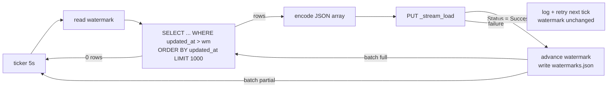

# CDC Sync App: Postgres to StarRocks

| | |
|---|---|
| Kind | Standalone Go daemon (no HTTP API; optional `/healthz`) |
| Kubernetes | Single-replica Deployment plus a small PVC for `watermarks.json` |
| Reads | All six operational databases (seven tables) |
| Writes | StarRocks `analytics_db` over HTTP Stream Load (`starrocks-fe:8030`) |

## Purpose

The CDC Sync App is the bridge from the operational layer to the analytical layer. It copies every insert and update from the microservice databases into StarRocks within seconds, so the Grafana dashboards are effectively real-time. It uses timestamp-watermark polling, not log-based CDC. That approach is simple and easy to explain, and it works because every table follows the universal-column convention (`updated_at` maintained by a trigger, soft deletes only).

## Tables

The sync runs **exactly one loop (goroutine) per table**:

| Source DB | Source table | StarRocks table |
|---|---|---|
| `customers` | `customers` | `analytics_db.customers` |
| `marketing` | `campaigns` | `analytics_db.campaigns` |
| `marketing` | `attributions` | `analytics_db.attributions` |
| `inventory` | `inventory` | `analytics_db.inventory` |
| `payments` | `payments` | `analytics_db.payments` |
| `shipments` | `shipments` | `analytics_db.shipments` |
| `orders` | `orders` | `analytics_db.orders` |

There are seven tables, because the Marketing Service owns two. The original spec says "6 tables", which counts databases rather than tables.

## Execution Loop

Every 5 seconds, per table:

1. Read the table's watermark from `watermarks.json`.
2. Query Postgres for rows changed since the watermark:

   ```sql
   SELECT * FROM orders
    WHERE updated_at > $last_watermark
    ORDER BY updated_at ASC
    LIMIT 1000;
   ```

3. Turn the rows into a JSON array: `[{"id": 1, "status": "SHIPPED", ...}, ...]`.
4. Send it to StarRocks with Stream Load:

   ```http
   PUT /api/analytics_db/orders/_stream_load HTTP/1.1
   Host: starrocks-fe:8030
   Authorization: Basic cm9vdDo=
   Expect: 100-continue
   format: json
   strip_outer_array: true
   label: orders-20261008T120501.123456-42
   ```

5. If the load succeeds, set the watermark to the highest `updated_at` in the batch and write `watermarks.json`.
6. If the batch was full (1000 rows), loop again right away instead of sleeping, to drain any backlog.



## Watermark State

`watermarks.json`:

```json
{
  "customers.customers":     {"updated_at": "2026-10-08T12:05:01.123456", "id": 4211},
  "marketing.campaigns":     {"updated_at": "2026-10-08T11:00:00.000000", "id": 6},
  "marketing.attributions":  {"updated_at": "2026-10-08T12:05:01.004410", "id": 9120},
  "inventory.inventory":     {"updated_at": "2026-10-08T12:05:00.991200", "id": 37},
  "payments.payments":       {"updated_at": "2026-10-08T12:05:01.120001", "id": 8740},
  "shipments.shipments":     {"updated_at": "2026-10-08T12:04:59.870000", "id": 8102},
  "orders.orders":           {"updated_at": "2026-10-08T12:05:01.123450", "id": 9204}
}
```

- Seven goroutines share one file, so one mutex-guarded in-memory map is the source of truth. Write it atomically: write a temp file, `fsync`, then `rename`.
- Store it on a PVC so a pod restart doesn't force a full reload. A full reload is still *safe*, since loads are idempotent upserts (see below), just slower.
- Missing entry means start from epoch `1970-01-01`, which is a full initial load.

## Correctness Notes

The spec's loop is the core design. These are the details that keep it correct under real load.

### 1. Same-timestamp rows at batch boundaries

`updated_at > wm` combined with `LIMIT 1000` can **skip rows**. If several rows share the boundary timestamp and the batch cuts between them, the next poll uses `>` and never sees the rest. Use a composite `(updated_at, id)` cursor instead. That is why the watermark above stores `id` as well:

```sql
SELECT * FROM orders
 WHERE (updated_at, id) > ($wm_ts, $wm_id)
 ORDER BY updated_at, id
 LIMIT 1000;
```

Add an index on `(updated_at, id)` in every source table so this stays an index range scan.

### 2. In-flight transactions

`updated_at` is set when the row is written, but the row only becomes visible at commit. A transaction that started earlier and commits after a poll can produce a row whose timestamp is already behind the watermark. Mitigation: only read up to a short **safety lag** behind the present (`AND updated_at < NOW() - INTERVAL '2 seconds'`). The services use short, single-statement transactions, so 1 to 2 seconds is plenty.

### 3. Idempotent target tables

Create every StarRocks table with the **Primary Key** model, keyed on `id`. A row that is re-sent (after a retry, a watermark reset, or a status update) then upserts in place instead of creating a duplicate. This is what makes at-least-once delivery safe.

```sql
CREATE TABLE analytics_db.orders (
  id INT NOT NULL,
  user_id INT,
  attribution_id INT,
  product_id VARCHAR(50),
  quantity INT,
  unit_price DECIMAL(10,2),
  total_amount DECIMAL(10,2),
  status VARCHAR(20),
  failure_reason VARCHAR(50),
  is_deleted BOOLEAN,
  created_at DATETIME,
  updated_at DATETIME
) PRIMARY KEY (id)
DISTRIBUTED BY HASH (id);
```

Dashboards filter `WHERE is_deleted = FALSE`.

### 4. Intermediate states can collapse

Polling captures the **latest** state of each row at poll time. An order that goes `PENDING → PAID → SHIPPED` within one 5-second window arrives in StarRocks as `SHIPPED` only. Snapshot dashboards (current status, revenue) are unaffected. Transition-timing questions should use explicit timestamp columns, such as `shipments.shipped_at`, rather than reconstructing history from CDC.

### 5. Stream Load success is in the body, not the status code

StarRocks can return `HTTP 200` with a failed load. Parse the JSON response and only advance the watermark when `"Status"` is `"Success"` (or `"Publish Timeout"`, which means the data was committed). Treat `"Label Already Exists"` as success too: it means a retry of a batch that already landed.

### 6. FE-to-BE redirect

The FE answers Stream Load with a `307` redirect to a BE node. Go's `http.Client` **drops the `Authorization` header** on redirects to a different host, so the redirected request fails authentication. Either send the request directly to the BE HTTP port, or set `CheckRedirect` to copy the auth header across, and use a body that can be replayed (`bytes.Reader` sets `GetBody` automatically).

### 7. Labels

Give each load a deterministic `label` derived from the table and batch cursor (for example `orders-<wm_ts>-<wm_id>`). If the process crashes after StarRocks commits but before the watermark is saved, the retry reuses the label and StarRocks rejects it as a duplicate instead of loading the batch twice.

### 8. Type mapping

| Postgres | JSON encoding | StarRocks |
|---|---|---|
| `SERIAL` / `INT` | number | `INT` |
| `VARCHAR(n)` | string | `VARCHAR(n)` |
| `DECIMAL(10,2)` | string (avoid float rounding) | `DECIMAL(10,2)` |
| `BOOLEAN` | `true`/`false` | `BOOLEAN` |
| `TIMESTAMP` | `"YYYY-MM-DD HH:MM:SS.ffffff"` | `DATETIME` |

## Configuration

| Variable | Example |
|---|---|
| `SOURCES` | `customers=postgres://.../customers,marketing=postgres://.../marketing,...` |
| `TABLES` | `customers.customers,marketing.campaigns,marketing.attributions,inventory.inventory,payments.payments,shipments.shipments,orders.orders` |
| `STARROCKS_FE_URL` | `http://starrocks-fe:8030` |
| `STARROCKS_DB` | `analytics_db` |
| `STARROCKS_USER` / `STARROCKS_PASSWORD` | `root` / `""` |
| `POLL_INTERVAL` | `5s` |
| `BATCH_SIZE` | `1000` |
| `SAFETY_LAG` | `2s` |
| `WATERMARK_FILE` | `/data/watermarks.json` |
| `OTEL_EXPORTER_OTLP_ENDPOINT` | `otel-collector:4317` |

## Telemetry

- One root span per batch (`sync.batch`), with child spans `pg.query` and `starrocks.stream_load`.
- Attributes: `sync.table`, `sync.rows`, `sync.watermark`, `sync.lag_seconds` (now minus the batch's max `updated_at`), and `starrocks.load_status`.
- Structured log line per batch: table, rows, duration, new watermark. These are readable during a live demo.

## Deployment

- **One replica only.** Two replicas would race on the watermark file and duplicate loads. Use `strategy: Recreate` so a rollout never runs two pods at once.
- Before starting the loops, the daemon creates `analytics_db` and its Primary Key tables idempotently over the FE MySQL port (`9030`), so a fresh kind cluster works without manual steps.
- Init container or readiness check: wait for both Postgres and the StarRocks FE to be reachable before starting the loops.
