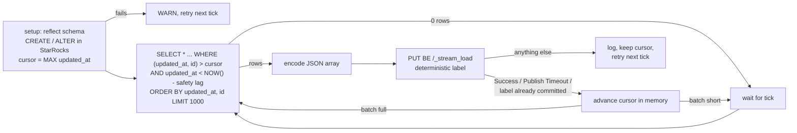

# CDC Sync App: Postgres to StarRocks

> **Status: built.** Code is in [`services/cdc-sync`](../../services/cdc-sync). It follows the shared conventions in the [ecosystem README](README.md#3-shared-conventions), but it is a daemon rather than a REST service: it owns no database, has no `migrate` command, and its only API is a read-only `/status`.

| | |
|---|---|
| Port | `8090` (`/status`, `/healthz`, `/readyz`, `/metrics`) |
| Kubernetes | Release `cdc-sync-service`: one replica, `strategy: Recreate`, no PVC |
| Binary | `cdc-sync` (`serve`) |
| Reads | Seven tables across six Postgres databases |
| Writes | StarRocks `analytics_db`: DDL over the FE MySQL port (`starrocks:9030`), rows over BE Stream Load (`starrocks:8040`) |
| State | None on disk. Each table's starting cursor is read back from StarRocks |

## Purpose

The CDC Sync App is the bridge from the operational layer to the analytical layer. It copies every insert, update and soft delete from the microservice databases into StarRocks within seconds, so the Grafana dashboards are effectively real-time.

It uses timestamp-cursor polling, not log-based CDC. That is simple and easy to explain, and it works because every table follows the universal-column convention (README §3.1): `updated_at` is maintained only by Postgres (default plus trigger), there is an `(updated_at, id)` index, and rows are soft-deleted, never `DELETE`d.

## Tables

One loop (goroutine) per table. A table's StarRocks name is its Postgres name:

| Source DB | Source table | StarRocks table |
|---|---|---|
| `customers` | `customers` | `analytics_db.customers` |
| `marketing` | `campaigns` | `analytics_db.campaigns` |
| `marketing` | `attributions` | `analytics_db.attributions` |
| `inventory` | `inventory` | `analytics_db.inventory` |
| `payments` | `payments` | `analytics_db.payments` |
| `shipments` | `shipments` | `analytics_db.shipments` |
| `orders` | `orders` | `analytics_db.orders` |

The list is configuration (`TABLES`, `<database>.<table>,...`). Two entries with the same table name are rejected, since they would land in the same StarRocks table.

## How It Works



### 1. Setup: schemas are reflected from Postgres

Before a table's first poll, its loop:

1. Reads the source's columns from `information_schema.columns`, in ordinal order. The table must have `id` and `updated_at`.
2. Runs `CREATE DATABASE IF NOT EXISTS analytics_db` and, if the target is missing, creates it as a **Primary Key** table keyed on `id`:

   ```sql
   CREATE TABLE IF NOT EXISTS `analytics_db`.`inventory` (
     `id` BIGINT NOT NULL,
     `created_at` DATETIME NULL,
     `updated_at` DATETIME NULL,
     `deleted_at` DATETIME NULL,
     `product_id` VARCHAR(200) NULL,
     `category` VARCHAR(200) NULL,
     `stock_level` BIGINT NULL,
     `price` DECIMAL(10,2) NULL,
     `auto_restock` BOOLEAN NULL
   ) PRIMARY KEY (`id`)
   DISTRIBUTED BY HASH(`id`)
   PROPERTIES ("replication_num" = "1")
   ```

   `id` always comes first (StarRocks requires key columns first). Every other column is nullable.
3. If the target exists, adds any column it lacks in **one** `ALTER TABLE ... ADD COLUMN (...)`. StarRocks runs schema changes as background jobs and refuses a second one while the first runs, so one ALTER per column would fail. Like GORM's AutoMigrate, this only ever adds columns. A dropped or retyped Postgres column is left alone (drop the StarRocks table to rebuild it).
4. Reads its starting cursor from StarRocks (see [stateless cursors](#2-stateless-cursors)).

The schema is checked again whenever a batch carries a column the loop hasn't seen, so a service that redeploys with a new field gets that column in StarRocks before the next load.

Type map ([`schema.go`](../../services/cdc-sync/internal/cdc/schema.go), a pure, unit-tested function):

| Postgres `data_type` | StarRocks | JSON value sent |
|---|---|---|
| `bigint` | `BIGINT` | number |
| `integer` | `INT` | number |
| `smallint` | `SMALLINT` | number |
| `numeric(p,s)` | `DECIMAL(p,s)` (p capped at 38) | **string**, exact digits (`"19.99"`) |
| `numeric` (unconstrained) | `DECIMAL(38,9)` | string |
| `character varying(n)` | `VARCHAR(n*4)`, capped at 65533 (StarRocks counts bytes, Postgres characters) | string |
| `text`, `character varying` without length | `STRING` | string |
| `boolean` | `BOOLEAN` | `true` / `false` |
| `timestamp with/without time zone` | `DATETIME` | `"2006-01-02 15:04:05.000000"`, converted to UTC |
| `date` | `DATE` | `"2006-01-02"` |
| `double precision` / `real` | `DOUBLE` / `FLOAT` | number (NaN/Inf become `null`) |
| anything else | `STRING` | its JSON form |

`NULL` is `null`. Numerics travel as strings so no JSON decoder can round them through `float64`.

Rows are read with pgx directly (`rows.Values()` and field descriptions), not GORM: the daemon has no model for any table and needs each row's raw values in whatever shape the table has today. The pools use pgx's describe-exec mode, because `SELECT *` changes shape when a service adds a column, and a cached prepared statement would then fail with `cached plan must not change result type`.

### 2. Stateless cursors

There is no watermark file and no PVC. Each table's cursor is `(updated_at, id)`, kept in memory, and derived at startup from StarRocks itself:

```sql
SELECT MAX(updated_at) FROM analytics_db.<table>;
```

The cursor starts at `(max_updated_at, 0)`, so rows sharing the newest loaded timestamp are sent again. That is harmless: the Primary Key model upserts them in place. An empty or new target starts at the epoch, which is a full initial load. After each successful load the cursor moves to the last row of the batch.

Why: the data already in StarRocks *is* the record of how far the sync got, so a separate watermark file could only disagree with it. Without the file there is no PVC to provision, no atomic-write dance, and a fresh StarRocks (or a dropped table) is re-filled automatically on the next restart.

### 3. The cursor query

```sql
SELECT * FROM "orders"
 WHERE (updated_at, id) > ($1, $2)
   AND updated_at < NOW() - $3::bigint * INTERVAL '1 microsecond'   -- safety lag
 ORDER BY updated_at, id
 LIMIT $4;                                                            -- batch size
```

- The row-value comparison on `(updated_at, id)` never skips rows that share a timestamp at a batch boundary (see [correctness notes](#correctness-notes)), and it is an index range scan on `idx_<table>_cdc_cursor`.
- **`deleted_at` is deliberately not filtered.** A soft delete is an `UPDATE` that moves `updated_at`, so it flows to StarRocks like any other change. Dashboards filter `WHERE deleted_at IS NULL`.
- Identifiers are quoted with `pgx.Identifier`. Table names must be plain identifiers to be accepted at all.
- If a batch comes back full, the loop polls again immediately to drain a backlog. Otherwise it waits for the next tick (`POLL_INTERVAL`).

### 4. Stream Load and its success semantics

Each batch is one JSON array, `PUT` to the **BE**:

```http
PUT /api/analytics_db/orders/_stream_load HTTP/1.1
Host: starrocks:8040
Authorization: Basic cm9vdDo=
Expect: 100-continue
format: json
strip_outer_array: true
label: cdc_orders_orders_1791460800000000_0_1791460801000500_9204
```

**Success is in the response body, not the HTTP status.** StarRocks answers `200 OK` for failed loads too. The cursor advances only when:

| Body | Outcome |
|---|---|
| `"Status": "Success"` | loaded |
| `"Status": "Publish Timeout"` | loaded (committed, not yet visible) |
| `"Status": "Label Already Exists"` with `ExistingJobStatus` `FINISHED` (or committed) | already loaded: a retried batch that had landed before |
| anything else, including `"Status": "Fail"`, a label held by a still-running job, or an unreadable body | failed: logged, recorded in `/status`, cursor unchanged, retried next tick |

### 5. Straight to the BE

Loads go directly to the BE HTTP port (`STARROCKS_LOAD_URL=http://starrocks:8040`), not to the FE. The FE answers Stream Load with a `307` to a BE address it advertises, and in the all-in-one image that address is usually `127.0.0.1`, which from the sync pod is the sync pod itself. As a belt-and-braces measure the HTTP client still survives a redirect: its `CheckRedirect` re-applies basic auth (Go drops `Authorization` when a redirect changes host), and the body is a `bytes.Reader`, so it can be replayed. A unit test covers exactly that redirect.

### 6. Tolerating missing sources

Services are deployed one at a time, so the daemon starts happily with nothing to read from:

- A missing database or table, or StarRocks still starting, fails only that table's setup. The loop logs a **WARN** (once per distinct error, not every tick), shows the error in `/status`, and retries setup on the next tick. Other tables carry on.
- If a source disappears after setup (`undefined_table` / `invalid_catalog_name`), the loop goes back through setup.
- `/readyz` reports ready once StarRocks answers on the MySQL port. It never blocks the process from starting.

## Configuration

Every flag can also be set as an environment variable (`--batch-size` ↔ `BATCH_SIZE`).

| Flag / env var | Default | Notes |
|---|---|---|
| `--http-addr` / `HTTP_ADDR` | `:8090` | Set by the chart from `port` |
| `--postgres-url` / `POSTGRES_URL` | `postgres://localhost:5433/?sslmode=disable` | Base URL **without** a database; each table's database is set on the parsed config. In kind: `postgres://datastack-pg-rw:5432/?sslmode=require`, with `PGUSER`/`PGPASSWORD` from the CNPG secret |
| `--tables` / `TABLES` | the seven tables above | `<database>.<table>,...` |
| `--starrocks-mysql-addr` / `STARROCKS_MYSQL_ADDR` | `localhost:9030` | FE MySQL protocol, for DDL and starting cursors |
| `--starrocks-load-url` / `STARROCKS_LOAD_URL` | `http://localhost:8040` | BE HTTP, for Stream Load |
| `--starrocks-db` / `STARROCKS_DB` | `analytics_db` | Created if missing |
| `--starrocks-user` / `STARROCKS_USER` | `root` | |
| `--starrocks-password` / `STARROCKS_PASSWORD` | empty | |
| `--poll-interval` / `POLL_INTERVAL` | `5s` | Time between polls of a caught-up table |
| `--batch-size` / `BATCH_SIZE` | `1000` | Rows per batch |
| `--safety-lag` / `SAFETY_LAG` | `2s` | Rows changed more recently wait for a later poll |
| `--log-level`, `--log-format`, `OTEL_EXPORTER_OTLP_ENDPOINT` | | As for every service |

## Running It

In kind (after `make kind-up infra` and whichever services you want synced, in any order):

```sh
kubectl --context kind-datastack apply -f deploy/infra/starrocks.yaml
kubectl --context kind-datastack rollout status statefulset/starrocks --timeout=5m   # ~1 minute
make deploy-cdc-sync              # release cdc-sync-service, values in deploy/values/cdc-sync.yaml
kubectl --context kind-datastack port-forward svc/cdc-sync-service 8090:8090
curl -s localhost:8090/status | jq
```

StarRocks is one `starrocks/allin1-ubuntu:3.3-latest` pod (FE and BE in one container, 2–3 GiB of memory, a 5 GiB PVC) behind a Service named `starrocks` exposing 8030 (FE HTTP), 9030 (FE MySQL) and 8040 (BE HTTP). Query it with any MySQL client:

```sh
kubectl --context kind-datastack port-forward svc/starrocks 9030:9030
mysql -h 127.0.0.1 -P 9030 -u root -e 'SELECT status, COUNT(*) FROM analytics_db.orders GROUP BY status'
```

Locally, against the docker compose Postgres:

```sh
make up                                    # Postgres on localhost:5433 (user demo/demo)
docker run -d --name starrocks -p 8030:8030 -p 9030:9030 -p 8040:8040 starrocks/allin1-ubuntu:3.3-latest
PGUSER=demo PGPASSWORD=demo LOG_FORMAT=text go run ./services/cdc-sync serve
```

The defaults already point at `localhost:5433`, `localhost:9030` and `localhost:8040`. With port 8040 published, the BE is reachable from the host directly.

## Telemetry

- One root span per non-empty batch, `cdc.batch`, with children `cdc.pg_query` and `cdc.stream_load`, and attributes `cdc.table` and `cdc.rows`. Idle polls create no spans: the root span is started only once rows are found, back-dated to the start of the query, so seven idle tables don't flood Tempo.
- A log line per batch: table, rows, outcome, duration, new cursor. Readable during a live demo.
- Prometheus metrics:

| Metric | Type | Labels |
|---|---|---|
| `cdc_rows_synced_total` | counter | `table` (`<database>.<table>`) |
| `cdc_batches_total` | counter | `table`, `outcome` = `loaded` / `already_loaded` / `failed` |
| `cdc_batch_duration_seconds` | histogram | `table` |
| `cdc_lag_seconds` | gauge | `table`: newest source `updated_at` minus the cursor, `0` when caught up |

Lag is measured every tick with `SELECT MAX(updated_at)` on the source. With continuous writes it hovers around the safety lag plus the poll interval.

## The `/status` Endpoint

`GET /status` returns one entry per table, in configuration order, for the UI and for the demo:

```json
[
  {
    "table": "orders.orders",
    "cursor_updated_at": "2026-10-08T12:05:01.12345Z",
    "cursor_id": 9204,
    "rows_synced": 18342,
    "last_success_at": "2026-10-08T12:05:03.2Z",
    "last_error": "",
    "lag_seconds": 2.4
  },
  {
    "table": "shipments.shipments",
    "cursor_updated_at": "0001-01-01T00:00:00Z",
    "cursor_id": 0,
    "rows_synced": 0,
    "last_success_at": null,
    "last_error": "reading columns of shipments.shipments: failed to connect to `user=app database=shipments`: ... database \"shipments\" does not exist",
    "lag_seconds": 0
  }
]
```

`rows_synced` counts rows since this process started (re-sent boundary rows included). `last_error` clears on the next success.

## Deployment Notes

- **One replica, `strategy: Recreate`.** Two copies wouldn't corrupt anything (loads are idempotent upserts), but they would load every batch twice and report confusing progress.
- No init container and no wait for dependencies: each table loop retries its own setup, and `/readyz` flips once StarRocks answers.
- The chart's DB-less mode applies: `postgres.database: ""` and `migrations.enabled: false` mean no CNPG `Database` and no `migrate` initContainer, while `PGUSER`/`PGPASSWORD` are still injected.

## Correctness Notes

### 1. Same-timestamp rows at batch boundaries

`updated_at > wm` combined with `LIMIT` can **skip rows**: if several rows share the boundary timestamp and the batch cuts between them, the next poll never sees the rest. The composite `(updated_at, id)` cursor fixes that. A multi-row `INSERT` gives every row the same `NOW()`, so this happens in practice; an integration test inserts five rows in one statement and syncs them with a batch size of 2.

### 2. In-flight transactions (safety lag)

`updated_at` is set when the row is written, but the row only becomes visible at commit. A transaction that started earlier and commits after a poll can produce a row whose timestamp is already behind the cursor. The query therefore only reads up to `SAFETY_LAG` (2 s) behind the database clock. The services use short, single-statement transactions, so that is plenty. The lag is measured against Postgres' `NOW()`, the same clock that sets `updated_at`.

### 3. Idempotent target tables

Every StarRocks table is a Primary Key table keyed on `id`. A row that is re-sent (after a retry, a restart, or a later update) upserts in place instead of duplicating. That is what makes at-least-once delivery, and the stateless restart, safe.

### 4. Intermediate states can collapse

Polling captures the **latest** state of each row at poll time. An order that goes `PENDING → PAID → SHIPPED` within one 5-second window arrives in StarRocks as `SHIPPED` only. Snapshot dashboards (current status, revenue) are unaffected. Transition-timing questions should use explicit timestamp columns, such as `shipments.shipped_at`, rather than reconstructing history from CDC.

### 5. Labels

Each load's `label` is derived from the table and the batch's start and end cursors (`cdc_<db>_<table>_<from_ts_us>_<from_id>_<to_ts_us>_<to_id>`, only `[-_A-Za-z0-9]`, at most 128 characters; the table prefix is shortened if needed). A batch retried after a failed load reuses its label. If StarRocks had in fact committed it (say the response was lost), the retry gets `Label Already Exists` and is counted as `already_loaded` instead of being loaded twice. Including the start cursor means a batch with different contents never collides with an earlier label.

### 6. Hard deletes are invisible

Watermark CDC can't see a row that no longer exists. That is why the services soft-delete (README §3.1). A row hard-deleted by hand stays in StarRocks.

### 7. New columns during a schema change

A column added with `ALTER TABLE` becomes loadable when StarRocks finishes the background schema change. Rows loaded in the meantime arrive without that column's value (Stream Load ignores unknown JSON keys) and are filled in the next time the row changes. For a demo this window is seconds.
