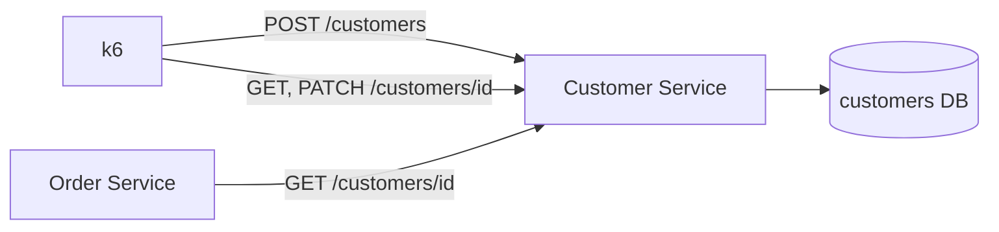

# Customer Service: Identity and Segmentation

> **Status: built.** Code is in [`services/customer`](../../services/customer). This is the reference implementation for the shared conventions in the [ecosystem README](README.md#3-shared-conventions).

| | |
|---|---|
| Port | `8081` |
| Kubernetes service | `customer-service` |
| Binary | `customer` (`serve`, `migrate`) |
| Database | `customers` |
| Tables | `customers` |
| Called by | k6, Order Service |
| Calls | none (leaf node) |

## Purpose

The Customer Service is the source of truth for **who** is interacting with the business. It deliberately knows nothing about transactions, products, or campaigns. It only knows the person behind the screen: where they are, what loyalty tier they're in, and whether their account is in good standing.

## Responsibilities

- **Profile management.** Stores baseline identity (email) and geography (country) for every simulated user.
- **Loyalty and segmentation.** Holds the tier (`BRONZE`, `SILVER`, `GOLD`) for each user. Downstream analytics use it to test business rules, for example whether Gold members generate more revenue or whether Bronze members fail checkouts more often.
- **Account state.** Tracks whether a user is active, suspended, or pending deletion. The Order Service uses this to accept or reject checkouts.

## Data Model

The schema is the GORM model in [`internal/customer/model.go`](../../services/customer/internal/customer/model.go), and `customer migrate` applies it with `AutoMigrate`:

```go
type Customer struct {
	database.Model // id BIGSERIAL, created_at/updated_at TIMESTAMPTZ (DB clock), deleted_at, (updated_at, id) index
	Email       string      `gorm:"size:255;not null;uniqueIndex:,where:deleted_at IS NULL"`
	Country     string      `gorm:"size:2;not null"` // ISO 3166-1 alpha-2
	LoyaltyTier LoyaltyTier `gorm:"size:20;not null;check:chk_customers_loyalty_tier,loyalty_tier IN ('BRONZE','SILVER','GOLD')"`
	Status      Status      `gorm:"size:20;not null;check:chk_customers_status,status IN ('ACTIVE','SUSPENDED','PENDING_DELETION')"`
}
```

This produces the `customers` table with the partial unique index `idx_customers_email`, the CDC index `idx_customers_cdc_cursor`, both named CHECKs, and the `customers_set_updated_at` trigger.

Changes from the original spec:

- **`status` added** to support the account-state responsibility.
- **`deleted_at` replaces `is_deleted`.** `deleted_at` is GORM's soft-delete column, and it means the row is logically gone. `status = 'PENDING_DELETION'` is different: it's a business state where the user has asked for deletion but the row is still live and visible to analytics.
- **Email uniqueness covers live rows only**, so a deleted customer's email can register again.
- Emails are stored lower-cased. `country` must be an upper-case ISO 3166-1 alpha-2 code.

## API

All errors use the shared body `{"error": "<CODE>", "message": "..."}`.

### `POST /customers`

Registers a new user. k6 calls this to simulate sign-up.

```json
{ "email": "ada@example.com", "country": "US", "loyalty_tier": "BRONZE" }
```

- `email` is required, must be a valid email, and must be unique among live customers. k6 should generate unique emails (for example with the VU ID plus the iteration number).
- `country` is required (ISO 3166-1 alpha-2, upper case).
- `loyalty_tier` is optional. If it's omitted, the service assigns one at random using `TIER_WEIGHTS` (default 70% `BRONZE`, 22% `SILVER`, 8% `GOLD`).

| Status | Body |
|---|---|
| `201 Created` | `{"id": 1234, "email": "...", "country": "US", "loyalty_tier": "BRONZE", "status": "ACTIVE", "created_at": "...", "updated_at": "..."}` |
| `400 Bad Request` | `INVALID_REQUEST` |
| `409 Conflict` | `EMAIL_EXISTS` |

### `GET /customers/{id}`

Returns one user. k6 calls it to "fetch" an existing user before starting a session. The Order Service calls it to validate the buyer during checkout.

| Status | Body |
|---|---|
| `200 OK` | the customer, same shape as the create response |
| `400 Bad Request` | `INVALID_REQUEST`: the ID isn't a positive integer |
| `404 Not Found` | `CUSTOMER_NOT_FOUND`, also returned for soft-deleted customers |

The service reports `status` as-is and doesn't decide whether a checkout is allowed. The Order Service treats anything other than `ACTIVE` as a rejection.

### `PATCH /customers/{id}`

Lifecycle simulation: tier upgrades, suspensions, and deletion requests. k6 can call it so segment and account-state analytics change over time.

```json
{ "loyalty_tier": "GOLD", "status": "SUSPENDED" }
```

Both fields are optional, but at least one is required.

| Status | Body |
|---|---|
| `200 OK` | the updated customer |
| `400 Bad Request` | `INVALID_REQUEST` |
| `404 Not Found` | `CUSTOMER_NOT_FOUND` |

### `DELETE /customers/{id}`

Soft-deletes the customer by setting `deleted_at`. The trigger moves `updated_at`, so the CDC sync carries the delete to StarRocks.

| Status | Body |
|---|---|
| `204 No Content` | |
| `404 Not Found` | `CUSTOMER_NOT_FOUND` |

### Operational endpoints

`GET /healthz`, `GET /readyz` (pings Postgres), `GET /metrics` (Prometheus).

## Interactions



- **Upstream, k6:** registration, session-start lookups, and lifecycle changes.
- **Upstream, Order Service:** a synchronous validation call in the checkout critical path. The Order Service uses the result to accept or reject the checkout, and it reads `country` to use as the shipment destination.

Because this call sits in the checkout critical path, `GET /customers/{id}` is a single primary-key lookup with no joins.

## Configuration

Every flag can also be set as an environment variable (`--tier-weights` ↔ `TIER_WEIGHTS`).

| Flag / env var | Default | Notes |
|---|---|---|
| `--http-addr` / `HTTP_ADDR` | `:8081` | Set by the chart from `port` |
| `--database-url` / `DATABASE_URL` | none | In kind: `postgres://datastack-pg-rw:5432/customers?sslmode=require`, with `PGUSER`/`PGPASSWORD` from the CNPG secret |
| `--tier-weights` / `TIER_WEIGHTS` | `BRONZE=70,SILVER=22,GOLD=8` | Relative weights. They needn't sum to 100 |
| `--log-level` / `LOG_LEVEL` | `info` | |
| `--log-format` / `LOG_FORMAT` | `json` | `text` for local dev |
| `OTEL_EXPORTER_OTLP_ENDPOINT` | unset | For example `http://otel-collector:4317`. Unset means spans aren't exported |

## Running It

```sh
# Local: Postgres in docker compose, service via go run
make up
make run-customer                 # migrate, then serve on :8081

# kind
make kind-up infra                # once
make deploy-customer              # build, load, helm upgrade --install customer-service
make forward-customer             # localhost:8081

curl -XPOST localhost:8081/customers -H 'content-type: application/json' \
  -d '{"email":"ada@example.com","country":"GB"}'
```

## Telemetry

- Inbound spans come from `otelgin`. During checkout, `GET /customers/{id}` appears as a child of the Order Service span.
- Span attributes: `customer.id`, `customer.loyalty_tier`, `customer.status`.
- GORM query spans (no query parameters, so no PII in traces).
- Request logs include `trace_id`/`span_id`. 4xx responses log at WARN and 5xx at ERROR.

## Analytics Impact

Once synced to StarRocks, `customers` is the main **dimension table**. It answers "who" and "where" for every other dataset:

- Revenue by country and by loyalty tier (`orders ⋈ customers`).
- Customer lifetime value (CLTV) and cohort retention, by `created_at` month.
- Payment declines by segment (`payments ⋈ orders ⋈ customers`).
- VIP SLA: GOLD vs BRONZE time-to-ship (`shipments ⋈ orders ⋈ customers`).
