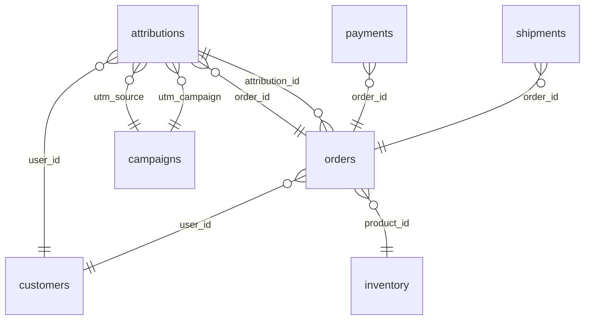

# DataStack Data Catalog

> **Generated** by `make catalog` from the table and column comments in the services' databases. **Do not edit by hand:** change the `comment:` tag or `TableComment()` in the service's GORM model, then regenerate. `make catalog-check` fails when this file is stale.

The same comments are copied into StarRocks (`analytics_db`) by the CDC sync daemon, so a text-to-SQL analyzer reads exactly this documentation from `information_schema.tables.TABLE_COMMENT` and `information_schema.columns.COLUMN_COMMENT`.

**Join markers.** A column that references another table ends its comment with `[ref: <table>.<column>]`. These references are logical: the tables live in different services' databases, so nothing enforces them. In StarRocks every table sits in one `analytics_db`, so the joins work directly. To build a join graph, parse the markers with `\[ref: ([a-z_]+)\.([a-z_]+)\]`.

**Conventions for every table.**
- Timestamps are UTC.
- Money is USD with two decimal places.
- Rows are soft-deleted: filter `deleted_at IS NULL` unless you are analysing deletions.
- `updated_at` is a technical change time, not a business event time.

## Relationships

| From | To |
|---|---|
| `attributions.user_id` | `customers.id` |
| `attributions.utm_source` | `campaigns.utm_source` |
| `attributions.utm_campaign` | `campaigns.utm_campaign` |
| `attributions.order_id` | `orders.id` |
| `payments.order_id` | `orders.id` |
| `shipments.order_id` | `orders.id` |
| `orders.user_id` | `customers.id` |
| `orders.attribution_id` | `attributions.id` |
| `orders.product_id` | `inventory.product_id` |

## Tables

| Table | Database | What one row is |
|---|---|---|
| [`customers`](#customers) | `customers` | Customers (Customer Service): one row per registered user. |
| [`attributions`](#attributions) | `marketing` | Ad clicks and their conversions (Marketing Service): one row per tracked visit from a campaign. |
| [`campaigns`](#campaigns) | `marketing` | Marketing campaigns (Marketing Service): one row per campaign, identified by the pair (utm_source, utm_campaign), with its total ad spend. |
| [`inventory`](#inventory) | `inventory` | Product catalog and current stock (Inventory Service): one row per product (SKU). |
| [`payments`](#payments) | `payments` | Payment attempts (Payment Service): one row per charge attempt, declined attempts included. |
| [`shipments`](#shipments) | `shipments` | Shipments (Shipment Service): one row per paid order handed to fulfillment, created right after payment succeeds. |
| [`orders`](#orders) | `orders` | Checkout attempts (Order Service): one row per checkout, failed ones included. |

### customers

Database `customers`. Customers (Customer Service): one row per registered user. The main who and where dimension: orders.user_id and attributions.user_id join to customers.id. created_at is the sign-up time, which makes it the cohort date. loyalty_tier and status hold current values only, not their history.

| Column | Type | Null | Description |
|---|---|---|---|
| `id` | `bigint` |  | Surrogate primary key of this row, unique within this table. |
| `created_at` | `timestamp with time zone` |  | When the row was created, in UTC, set by the database clock. |
| `updated_at` | `timestamp with time zone` |  | When the row last changed, in UTC, set by the database clock on every update. Not a business event time. |
| `deleted_at` | `timestamp with time zone` | yes | When the row was soft-deleted, in UTC. NULL for live rows. Filter on deleted_at IS NULL unless analysing deletions. |
| `email` | `character varying(255)` |  | Login email, lower-cased, unique among live customers. Personal data: avoid returning it in analytical results. |
| `country` | `character varying(2)` |  | Country the customer lives in, as an ISO 3166-1 alpha-2 code such as US, GB or DE. Also the destination of their shipments. |
| `loyalty_tier` | `character varying(20)` |  | Current loyalty tier: BRONZE (most customers), SILVER or GOLD. Customers can be upgraded later, so this is the tier today, not at the time of a past order. |
| `status` | `character varying(20)` |  | Account state: ACTIVE, SUSPENDED (checkouts are rejected with orders.failure_reason CUSTOMER_SUSPENDED) or PENDING_DELETION (the user asked for the account to be deleted). |

### attributions

Database `marketing`. Ad clicks and their conversions (Marketing Service): one row per tracked visit from a campaign. order_id, order_amount and converted_at are filled in when the visit leads to a paid order. Join campaigns on both utm_source and utm_campaign, customers via user_id, and orders and payments via order_id. Conversion rate is converted rows (order_id IS NOT NULL) divided by all rows.

| Column | Type | Null | Description |
|---|---|---|---|
| `id` | `bigint` |  | Surrogate primary key of this row, unique within this table. |
| `created_at` | `timestamp with time zone` |  | When the row was created, in UTC, set by the database clock. |
| `updated_at` | `timestamp with time zone` |  | When the row last changed, in UTC, set by the database clock on every update. Not a business event time. |
| `deleted_at` | `timestamp with time zone` | yes | When the row was soft-deleted, in UTC. NULL for live rows. Filter on deleted_at IS NULL unless analysing deletions. |
| `user_id` | `bigint` |  | Customer who clicked. [ref: customers.id] |
| `utm_source` | `character varying(100)` |  | Traffic source of the click. Join to campaigns together with utm_campaign. [ref: campaigns.utm_source] |
| `utm_campaign` | `character varying(100)` |  | Campaign of the click. Join to campaigns together with utm_source. [ref: campaigns.utm_campaign] |
| `order_id` | `bigint` | yes | Paid order this click converted into. NULL until, and unless, it converts. [ref: orders.id] |
| `order_amount` | `numeric(10,2)` | yes | Value of the converted order in USD as reported at conversion time, NULL until converted. For cleared revenue prefer payments.amount where status is SUCCESS. |
| `converted_at` | `timestamp with time zone` | yes | When the conversion was recorded, in UTC, NULL until converted. converted_at minus created_at is the click-to-purchase time. |

### campaigns

Database `marketing`. Marketing campaigns (Marketing Service): one row per campaign, identified by the pair (utm_source, utm_campaign), with its total ad spend. Join attributions on both utm_source and utm_campaign. ROAS for a campaign is the cleared revenue of its converted attributions divided by ad_spend, and CAC is ad_spend divided by the number of distinct converted customers. Both divide by ad_spend, which is a column rather than an aggregate, so group by utm_source, utm_campaign AND ad_spend. The organic/none row represents traffic that arrived without an ad.

| Column | Type | Null | Description |
|---|---|---|---|
| `id` | `bigint` |  | Surrogate primary key of this row, unique within this table. |
| `created_at` | `timestamp with time zone` |  | When the row was created, in UTC, set by the database clock. |
| `updated_at` | `timestamp with time zone` |  | When the row last changed, in UTC, set by the database clock on every update. Not a business event time. |
| `deleted_at` | `timestamp with time zone` | yes | When the row was soft-deleted, in UTC. NULL for live rows. Filter on deleted_at IS NULL unless analysing deletions. |
| `utm_source` | `character varying(100)` |  | Traffic source, the utm_source URL parameter: google, facebook, instagram, tiktok, email or organic. |
| `utm_campaign` | `character varying(100)` |  | Campaign name, the utm_campaign URL parameter, such as summer_sale. Unique together with utm_source. |
| `ad_spend` | `numeric(10,2)` |  | Total spend on this campaign so far, in USD. A lifetime total, not a daily amount. 0.00 for unpaid channels (email, organic). A paid campaign is a row with ad_spend > 0: restrict to those for any question about paid campaigns, ROAS or acquisition cost, because the unpaid channels have no spend to divide by. |

### inventory

Database `inventory`. Product catalog and current stock (Inventory Service): one row per product (SKU). Other tables reference products by product_id, not id: join orders.product_id to inventory.product_id. stock_level is the live level after every reservation, release and restock. price is the current list price, while orders.unit_price holds the price actually charged.

| Column | Type | Null | Description |
|---|---|---|---|
| `id` | `bigint` |  | Surrogate primary key of this row, unique within this table. |
| `created_at` | `timestamp with time zone` |  | When the row was created, in UTC, set by the database clock. |
| `updated_at` | `timestamp with time zone` |  | When the row last changed, in UTC, set by the database clock on every update. Not a business event time. |
| `deleted_at` | `timestamp with time zone` | yes | When the row was soft-deleted, in UTC. NULL for live rows. Filter on deleted_at IS NULL unless analysing deletions. |
| `product_id` | `character varying(50)` |  | Business key of the product, such as PROD_0001. Other tables reference products by this value, not by id. |
| `category` | `character varying(50)` |  | Product category: ELECTRONICS, APPAREL, HOME, BEAUTY or SPORTS. |
| `stock_level` | `bigint` |  | Units available to sell right now. A checkout reserves (subtracts) units, a declined payment releases them back, and restocks add units. Never negative. |
| `price` | `numeric(10,2)` |  | Current unit list price in USD. The price charged at checkout is copied to orders.unit_price. |
| `auto_restock` | `boolean` |  | true if the background restock tops this product up when stock_level falls below the restock threshold. false marks deliberately scarce products that stay out of stock once sold out. |

### payments

Database `payments`. Payment attempts (Payment Service): one row per charge attempt, declined attempts included. An order has at most one SUCCESS payment and may have several DECLINED ones. Join payments.order_id to orders.id. Cleared revenue is the sum of amount where status is SUCCESS. Declined amount is revenue lost to payment failures.

| Column | Type | Null | Description |
|---|---|---|---|
| `id` | `bigint` |  | Surrogate primary key of this row, unique within this table. |
| `created_at` | `timestamp with time zone` |  | When the row was created, in UTC, set by the database clock. |
| `updated_at` | `timestamp with time zone` |  | When the row last changed, in UTC, set by the database clock on every update. Not a business event time. |
| `deleted_at` | `timestamp with time zone` | yes | When the row was soft-deleted, in UTC. NULL for live rows. Filter on deleted_at IS NULL unless analysing deletions. |
| `order_id` | `bigint` |  | Order being paid for. [ref: orders.id] |
| `amount` | `numeric(10,2)` |  | Amount charged or attempted, in USD. Equals the total_amount of the order. |
| `method` | `character varying(20)` |  | Payment method: CREDIT_CARD or PAYPAL. |
| `status` | `character varying(20)` |  | Outcome: SUCCESS (money captured), DECLINED (see decline_reason) or REFUNDED (a previously successful payment that was refunded). |
| `decline_reason` | `character varying(50)` | yes | Why the payment was declined, set only when status is DECLINED: CARD_DECLINED, INSUFFICIENT_FUNDS or FRAUD_SUSPECTED. NULL otherwise. |

### shipments

Database `shipments`. Shipments (Shipment Service): one row per paid order handed to fulfillment, created right after payment succeeds. Join shipments.order_id to orders.id, one to one. Time to ship is shipped_at minus created_at. Rows with status PENDING are the fulfillment backlog.

| Column | Type | Null | Description |
|---|---|---|---|
| `id` | `bigint` |  | Surrogate primary key of this row, unique within this table. |
| `created_at` | `timestamp with time zone` |  | When the row was created, in UTC, set by the database clock. |
| `updated_at` | `timestamp with time zone` |  | When the row last changed, in UTC, set by the database clock on every update. Not a business event time. |
| `deleted_at` | `timestamp with time zone` | yes | When the row was soft-deleted, in UTC. NULL for live rows. Filter on deleted_at IS NULL unless analysing deletions. |
| `order_id` | `bigint` |  | Order being shipped. At most one shipment per order. [ref: orders.id] |
| `carrier` | `character varying(20)` |  | Shipping carrier: FEDEX, UPS or DHL. US destinations mostly use UPS and FedEx, other countries mostly DHL. |
| `tracking_number` | `character varying(100)` |  | Carrier tracking number, in the format of the carrier. |
| `status` | `character varying(20)` |  | PENDING (label printed, box being packed) or SHIPPED (handed to the carrier, shipped_at is set). |
| `destination_country` | `character varying(2)` |  | Destination country as an ISO 3166-1 alpha-2 code, taken from the country of the customer at checkout. |
| `packing_delay_ms` | `bigint` |  | Simulated packing time assigned when the shipment was created, in milliseconds. GOLD customers get shorter delays. Actual time to ship can be longer when the warehouse is backlogged. |
| `shipped_at` | `timestamp with time zone` | yes | When the box left the warehouse, in UTC. NULL while PENDING. Time to ship is shipped_at minus created_at, never updated_at. |

### orders

Database `orders`. Checkout attempts (Order Service): one row per checkout, failed ones included. The central fact table: user_id joins customers.id, product_id joins inventory.product_id, attribution_id joins attributions.id, and payments.order_id and shipments.order_id join back to orders.id. created_at is when the checkout happened. Revenue is the sum of total_amount over orders with status PAID or SHIPPED. Checkout success rate is SHIPPED orders divided by all orders.

| Column | Type | Null | Description |
|---|---|---|---|
| `id` | `bigint` |  | Surrogate primary key of this row, unique within this table. |
| `created_at` | `timestamp with time zone` |  | When the row was created, in UTC, set by the database clock. |
| `updated_at` | `timestamp with time zone` |  | When the row last changed, in UTC, set by the database clock on every update. Not a business event time. |
| `deleted_at` | `timestamp with time zone` | yes | When the row was soft-deleted, in UTC. NULL for live rows. Filter on deleted_at IS NULL unless analysing deletions. |
| `user_id` | `bigint` |  | Customer who checked out. A logical reference into the Customer Service, not an enforced foreign key. [ref: customers.id] |
| `attribution_id` | `bigint` | yes | Ad click that led to this checkout. NULL for organic traffic that arrived without an ad click. [ref: attributions.id] |
| `product_id` | `character varying(50)` |  | Product bought. Every order is for exactly one product. [ref: inventory.product_id] |
| `quantity` | `bigint` |  | Number of units bought, 1 or more. |
| `unit_price` | `numeric(10,2)` | yes | Price per unit in USD charged at checkout, copied from inventory.price. NULL if the checkout failed before stock was reserved. |
| `total_amount` | `numeric(10,2)` | yes | Order value in USD: unit_price times quantity. NULL if the checkout failed before stock was reserved. Counts as revenue only when status is PAID or SHIPPED. |
| `status` | `character varying(20)` |  | Lifecycle state: PENDING (checkout in progress), PAID (charged, shipment not yet requested), SHIPPED (charged and handed to fulfillment, see shipments.shipped_at for when the box left) or FAILED (see failure_reason). A successful order is one that was charged, so status IN ('PAID', 'SHIPPED'): use that pair for success, revenue and order value. FAILED is the only unsuccessful end state and PENDING is still in flight. |
| `failure_reason` | `character varying(50)` | yes | Why a FAILED checkout failed, NULL otherwise: CUSTOMER_INVALID (unknown customer), CUSTOMER_SUSPENDED, OUT_OF_STOCK, PRODUCT_NOT_FOUND, PAYMENT_DECLINED (see payments.decline_reason) or UPSTREAM_ERROR (a dependency was unavailable). |
