# Inventory Service: Stock Keeper

> **Status: built.** Code is in [`services/inventory`](../../services/inventory). It follows the shared conventions in the [ecosystem README](README.md#3-shared-conventions) and introduced several of them: money handling, concurrency through SQL, background workers, seed data, and domain metrics.

| | |
|---|---|
| Port | `8083` |
| Kubernetes service | `inventory-service` |
| Binary | `inventory` (`serve`, `migrate`) |
| Database | `inventory` |
| Tables | `inventory` |
| Called by | Order Service (k6 optionally, for restocks) |
| Calls | none (leaf node) |

## Purpose

The Inventory Service checks the storefront against physical reality. It is the source of truth for product availability and catalog metadata, and it makes sure the business never sells stock it doesn't have.

## Responsibilities

- **Stock management.** Maintains the available quantity for every SKU.
- **Concurrency-safe reservations.** If two checkouts race for the last unit, exactly one wins. The reservation is a single atomic conditional update, so it is correct under any number of concurrent requests and replicas.
- **Product metadata.** Stores each product's category and unit price. The Order Service gets its price from here.
- **Restock simulation.** Replenishes stock periodically so a long k6 run doesn't drain everything to zero.

## Data Model

The schema is the GORM model in [`internal/inventory/model.go`](../../services/inventory/internal/inventory/model.go), and `inventory migrate` applies it with `AutoMigrate`:

```go
type Product struct {          // table "inventory"
	database.Model // id BIGSERIAL, created_at/updated_at TIMESTAMPTZ (DB clock), deleted_at, (updated_at, id) index
	ProductID   string          `gorm:"size:50;not null;uniqueIndex:,where:deleted_at IS NULL"`
	Category    string          `gorm:"size:50;not null"`
	StockLevel  int             `gorm:"not null;check:chk_inventory_stock_level,stock_level >= 0"`
	Price       decimal.Decimal `gorm:"type:decimal(10,2);not null;check:chk_inventory_price,price > 0"`
	AutoRestock bool            `gorm:"not null"` // deliberately no default (GORM zero-value trap)
}
```

Changes from the original spec:

- The conventions from the README: `BIGSERIAL`, `TIMESTAMPTZ`, `deleted_at`, and `product_id` unique among live rows only.
- `stock_level >= 0` and `price > 0` are enforced as `CHECK` constraints.
- **`auto_restock` added.** SKUs with `false` are left out of the background restock, so they stay chronically scarce and the lost-revenue dashboard has something to show. Keeping this on the product row means no separate configured list of SKUs to maintain.

In Go the row is `inventory.Product`, and `price` is a `decimal.Decimal`.

### Seed catalog

[`seed.go`](../../services/inventory/internal/inventory/seed.go) is called by `Migrate`, so the `migrate` initContainer loads it. It inserts only when the table has never held products (soft-deleted rows count), so redeploys never re-seed or reset stock. It's deterministic, so every environment has the same catalog:

| | |
|---|---|
| Product IDs | `PROD_0001` … `PROD_0100`. k6 can use this range directly or call `GET /inventory` |
| Categories | `ELECTRONICS`, `APPAREL`, `HOME`, `BEAUTY`, `SPORTS`, rotating |
| Prices | A realistic band per category (ELECTRONICS $99.99–$891.99 … BEAUTY $9.99–$108.99), all ending in .99 |
| Starting stock | 40–199 units |
| Low stock | Every 20th SKU (`PROD_0020`, `0040`, …) starts with **3** units, so `OUT_OF_STOCK` failures appear within minutes |
| Never restocked | Every 25th SKU (`PROD_0025`, `0050`, `0075`, `0100`) has `auto_restock = false`. `PROD_0100` is both: it sells out fast and stays out |

## API

All errors use the shared body `{"error": "<CODE>", "message": "..."}`. Prices are decimal strings with two places (`"49.99"`).

### `POST /inventory/reserve`

Takes stock out if enough is available. This call is on the checkout critical path.

```json
{ "product_id": "PROD_0001", "quantity": 1 }
```

`quantity` is required, between 1 and 10000.

The check and the decrement are one statement. Postgres locks the row, and under READ COMMITTED a concurrent reserve re-checks the `WHERE` clause against the new stock level:

```sql
UPDATE inventory
   SET stock_level = stock_level - $2
 WHERE product_id = $1
   AND stock_level >= $2
   AND deleted_at IS NULL
RETURNING *;
```

If no row was updated, a follow-up lookup tells an unknown product apart from too little stock. An integration test runs 50 concurrent reserves against 20 units and checks that exactly 20 succeed.

| Status | Body |
|---|---|
| `200 OK` | `{"product_id": "PROD_0001", "quantity": 1, "unit_price": "251.99", "category": "ELECTRONICS", "remaining_stock": 76}` |
| `400 Bad Request` | `INVALID_REQUEST` |
| `404 Not Found` | `PRODUCT_NOT_FOUND` |
| `409 Conflict` | `OUT_OF_STOCK` (the spec said 400; changed so 400 only ever means bad input) |

`unit_price` is how the Order Service prices the order, since the checkout payload has no amount.

### `POST /inventory/release`

The compensating action. The Order Service calls it when payment fails after a successful reservation.

```json
{ "product_id": "PROD_0001", "quantity": 1 }
```

| Status | Body |
|---|---|
| `200 OK` | `{"product_id": "PROD_0001", "quantity": 1, "remaining_stock": 77}` |
| `400` / `404` | `INVALID_REQUEST` / `PRODUCT_NOT_FOUND` |

> A reservation is an immediate decrement, not a held reservation with an expiry. That keeps the design simple and reliable for the demo, but neither reserve nor release is idempotent, so **callers must not retry them blindly**. If the Order Service crashes between reserving and releasing, the stock leaks, and the restock loop hides this over time.

### `POST /inventory/restock`

Manual replenishment, so k6 can trigger restock bursts on top of the background loop. It takes the same body and returns the same response as release. It works on any product, including those with `auto_restock = false`.

### `GET /inventory` and `GET /inventory/{product_id}`

Catalog reads for k6 discovery, debugging, and the UI. The list endpoint returns every live product ordered by `product_id`. The catalog is a fixed demo set, so it isn't paginated.

```json
{ "product_id": "PROD_0001", "category": "ELECTRONICS", "stock_level": 77, "price": "251.99",
  "auto_restock": true, "created_at": "...", "updated_at": "..." }
```

### Operational endpoints

`GET /healthz`, `GET /readyz` (pings Postgres), `GET /metrics`.

## Background Restock Loop

[`restocker.go`](../../services/inventory/internal/inventory/restocker.go) runs beside the HTTP server under an `errgroup`. A shutdown signal stops both, and the database closes only after the last restock query.

Every `RESTOCK_INTERVAL` it runs one statement:

```sql
UPDATE inventory SET stock_level = stock_level + :quantity
 WHERE auto_restock AND stock_level < :threshold AND deleted_at IS NULL;
```

- **Safe with several replicas, without leader election.** The service refuses to start unless `RESTOCK_QUANTITY >= RESTOCK_THRESHOLD`. That way one run lifts every product it touches to at least the threshold, and a concurrent run from another replica re-checks the `WHERE` clause and finds nothing left to do (covered by a test).
- Each run is its own root span (`inventory.restock`) and logs the number of products and units restocked. A failed run is logged and the loop carries on.
- Restocks are `UPDATE`s, so they move `updated_at`, and replenishment shows up in StarRocks as upward steps.
- `RESTOCK_INTERVAL=0` disables the loop. The `restock_paused` chaos knob skips runs at runtime (see [Chaos](#chaos)).

## Chaos

Runtime failure injection for live demos, from the shared [`pkgs/chaos`](../../pkgs/chaos) package:

- `GET /admin/chaos` returns `{"service": "<name>", "knobs": [{"name", "description", "value", "default", "min", "max"}, ...]}`, `latency_ms` first.
- `PUT /admin/chaos` with a partial object such as `{"latency_ms": 500}` changes those knobs and returns the same body. It is all-or-nothing: an unknown knob or a value outside `[min, max]` (or a fraction for a whole-number knob) is `400 INVALID_REQUEST`, and nothing changes.
- `DELETE /admin/chaos` resets every knob to its default.

The `/admin` routes are traced, logged and metered like the API, but never delayed by `latency_ms`. Every change is logged at INFO with the old and new value, and the gauge `chaos_knob_value{knob}` shows the current values. **Values live in the pod's memory**: a restart resets every knob to its default, and with several replicas each pod has its own values (every service runs one replica in kind).

| Knob | Range | Default | Effect |
|---|---|---|---|
| `latency_ms` | 0 to 5000, whole | `0` | Delay before every API request is handled (not `/admin`, probes or `/metrics`). It ends early if the caller gives up (`503 REQUEST_CANCELLED`), and shows on the request span as the attribute `chaos.latency_ms` plus `chaos.latency.start`/`chaos.latency.end` events |
| `restock_paused` | 0 or 1 | `0` | `1` makes the background restock skip its runs (the `inventory.restock` span gets `chaos.restock_paused=true`), so stock runs out |

`POST /admin/chaos/drain-stock` with `{"products": 20}` (1 to 100) sets `stock_level = 0` on that many randomly chosen live products that still have stock, and returns `{"drained": 20, "product_ids": ["PROD_0007", ...]}` (fewer if fewer have stock). It is one statement, so it can't race a reservation into negative stock:

```sql
UPDATE inventory SET stock_level = 0
 WHERE id IN (SELECT id FROM inventory WHERE stock_level > 0 AND deleted_at IS NULL
              ORDER BY random() LIMIT :products)
   AND deleted_at IS NULL
RETURNING product_id;
```

Drained auto-restock products come back on the next restock run (unless `restock_paused` is 1); scarce ones (`auto_restock = false`) stay sold out. It is an `UPDATE`, so the CDC daemon sees every drained row.

## Interactions

```mermaid
sequenceDiagram
  participant O as Order
  participant I as Inventory
  participant P as Payment
  O->>I: POST /inventory/reserve {PROD_0001, 1}
  alt stock available
    I-->>O: 200 {unit_price: "251.99"}
    O->>P: POST /payments/process
    alt declined
      O->>I: POST /inventory/release {PROD_0001, 1}
    end
  else out of stock
    I-->>O: 409 OUT_OF_STOCK
    Note over O: order FAILED, payment never attempted
  end
```



## Configuration

Every flag can also be set as an environment variable (`--restock-interval` ↔ `RESTOCK_INTERVAL`).

| Flag / env var | Default | Notes |
|---|---|---|
| `--http-addr` / `HTTP_ADDR` | `:8083` | Set by the chart from `port` |
| `--database-url` / `DATABASE_URL` | none | In kind: `postgres://datastack-pg-rw:5432/inventory?sslmode=require`, with `PGUSER`/`PGPASSWORD` from the CNPG secret |
| `--restock-interval` / `RESTOCK_INTERVAL` | `2m` | Go duration. `0` disables. The kind values use `30s`: at two minutes a product that sells out stays out until the next run, which made `OUT_OF_STOCK` the dominant checkout failure even with every chaos knob at its default |
| `--restock-threshold` / `RESTOCK_THRESHOLD` | `10` | Restock products with fewer units than this |
| `--restock-quantity` / `RESTOCK_QUANTITY` | `50` | Units added per product. Must be at least the threshold |
| `--log-level`, `--log-format`, `OTEL_EXPORTER_OTLP_ENDPOINT` | | As for every service |

## Running It

```sh
make up && make run-inventory     # local Postgres + go run on :8083
make deploy-inventory             # kind (after make kind-up infra)
make forward-inventory            # localhost:8083

curl -XPOST localhost:8083/inventory/reserve -H 'content-type: application/json' \
  -d '{"product_id":"PROD_0100","quantity":1}'
```

## Telemetry

- Inbound spans from `otelgin`, with attributes `product.id`, `inventory.quantity`, `inventory.remaining_stock`, and `inventory.outcome` (`reserved`, `out_of_stock`, `product_not_found`). Out-of-stock is a business outcome, not an error, so it doesn't set the span's error status. The Order Service marks its own checkout span as failed.
- `inventory.restock` root spans from the background loop.
- Prometheus domain metrics:

| Metric | Labels |
|---|---|
| `inventory_reservations_total` | `outcome` |
| `inventory_units_reserved_total` | |
| `inventory_units_released_total` | |
| `inventory_units_restocked_total` | `source` = `auto` / `manual` |

## Analytics Impact

For supply chain and operations, this is the most important table in StarRocks:

- **Stock depletion velocity:** the rate at which `stock_level` falls per SKU and category, from the stream of `updated_at` changes.
- **Lost revenue:** `orders WHERE failure_reason = 'OUT_OF_STOCK'` joined to `inventory.price`. This is how much the business would have made if popular items had stayed in stock. `PROD_0100` and the other `auto_restock = false` SKUs guarantee this is never empty.
- **Category mix:** revenue by `category` (`orders ⋈ inventory`).
