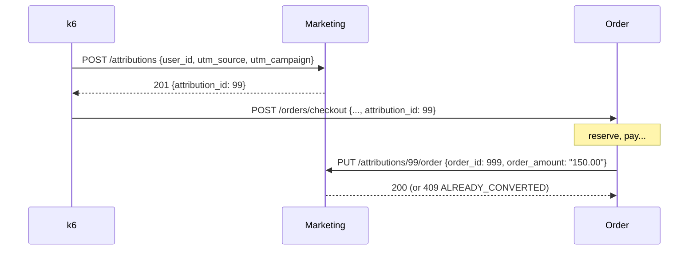

# Marketing Service: Top-of-Funnel Attribution

> **Status: built.** Code is in [`services/marketing`](../../services/marketing). It follows the shared conventions in the [ecosystem README](README.md#3-shared-conventions), and it is the first service with two tables in one database.

| | |
|---|---|
| Port | `8082` |
| Kubernetes service | `marketing-service` |
| Binary | `marketing` (`serve`, `migrate`) |
| Database | `marketing` |
| Tables | `campaigns`, `attributions` |
| Called by | k6, Order Service |
| Calls | none (leaf node) |

## Purpose

The Marketing Service sits at the very edge of the architecture. It connects anonymous traffic to paying customers by recording where a visitor came from, before they add anything to a cart. Later it links that click to the purchase it produced.

## Responsibilities

- **Touchpoint logging.** Records each visit's traffic source (`utm_source=facebook`, `utm_campaign=summer_sale`) and issues a unique `attribution_id` for it.
- **Campaign catalog.** Keeps the campaigns and their ad spend. This is the cost baseline for ROAS and CAC.
- **Conversion handshake.** When the Order Service reports a paid checkout, the service attaches the `order_id` and amount to the original attribution, closing the loop from click to purchase. Exactly one order can ever convert an attribution, and retries are safe.

## Data Model

The schema is the GORM models in [`internal/marketing/model.go`](../../services/marketing/internal/marketing/model.go). `marketing migrate` applies both with one `database.AutoMigrate(ctx, db, &Campaign{}, &Attribution{})`, so each table gets the base model's `(updated_at, id)` CDC index and its own `updated_at` trigger:

```go
type Campaign struct {         // table "campaigns"
	database.Model // id BIGSERIAL, created_at/updated_at TIMESTAMPTZ (DB clock), deleted_at, (updated_at, id) index
	UTMSource   string          `gorm:"size:100;not null;uniqueIndex:idx_campaigns_source_campaign,priority:1,where:deleted_at IS NULL"`
	UTMCampaign string          `gorm:"size:100;not null;uniqueIndex:idx_campaigns_source_campaign,priority:2,where:deleted_at IS NULL"`
	AdSpend     decimal.Decimal `gorm:"type:decimal(10,2);not null;check:chk_campaigns_ad_spend,ad_spend >= 0"` // no default (zero-value trap)
}

type Attribution struct {      // table "attributions"
	database.Model
	UserID      uint64           `gorm:"not null;check:chk_attributions_user_id,user_id > 0"`
	UTMSource   string           `gorm:"size:100;not null"`
	UTMCampaign string           `gorm:"size:100;not null"`
	OrderID     *uint64          `gorm:"check:chk_attributions_order_id,order_id > 0"`
	OrderAmount *decimal.Decimal `gorm:"type:decimal(10,2);check:chk_attributions_order_amount,order_amount > 0"`
	ConvertedAt *time.Time       `gorm:"check:chk_attributions_conversion,(order_id IS NULL) = (converted_at IS NULL) AND (order_id IS NULL) = (order_amount IS NULL)"`
}
```

The generated composite partial index is `CREATE UNIQUE INDEX idx_campaigns_source_campaign ON campaigns (utm_source, utm_campaign) WHERE (deleted_at IS NULL)`; an integration test reads it back from `pg_indexes`.

`user_id` and `order_id` are logical references to the Customer and Order services. They are **not** foreign keys, because those rows live in other databases, and the service never calls the Customer Service to check `user_id`.

Changes from the original spec:

- The conventions from the README: `BIGSERIAL`, `TIMESTAMPTZ`, `deleted_at` instead of `is_deleted`, every column `NOT NULL` except the conversion fields, and `(utm_source, utm_campaign)` unique among live campaigns.
- **The three proposed columns are in:** `attributions.utm_campaign` (so ROAS works per campaign, not just per source; resolves README open question 6), `order_amount`, and `converted_at`.
- `converted_at` is set with `NOW()` in the conversion `UPDATE`. Postgres is the only clock, as for `created_at`/`updated_at`.
- Named `CHECK`s: `ad_spend >= 0`, `user_id > 0`, `order_id > 0`, `order_amount > 0`, and `chk_attributions_conversion`, which makes the three conversion fields all-NULL or all-set. The application never writes them separately; the CHECK is the backstop.

### Seed campaigns

[`seed.go`](../../services/marketing/internal/marketing/seed.go) is called by `Migrate`, so the `migrate` initContainer loads it. It inserts only when `campaigns` has never held rows (soft-deleted rows count), so redeploys never re-seed or reset ad spend. It's deterministic, so every environment has the same IDs:

| campaign_id | utm_source | utm_campaign | ad_spend |
|---|---|---|---|
| 1 | `google` | `search_brand` | 1200.00 |
| 2 | `facebook` | `summer_sale` | 800.00 |
| 3 | `instagram` | `influencer_q3` | 650.00 |
| 4 | `tiktok` | `viral_launch` | 400.00 |
| 5 | `email` | `newsletter` | 0.00 |
| 6 | `organic` | `none` | 0.00 |

The spec said "upserts at startup" behind a `SEED_CAMPAIGNS` flag. Seeding in `migrate`, only into an empty table, follows the Inventory Service pattern and needs no flag. There is no ad-spend accrual job yet; spend is static.

## API

All errors use the shared body `{"error": "<CODE>", "message": "..."}`. Money is a decimal string with two places (`"800.00"`).

### `GET /campaigns`

Every live campaign, ordered by `campaign_id`. k6 can use it to discover the valid `(utm_source, utm_campaign)` pairs.

```json
[{ "campaign_id": 2, "utm_source": "facebook", "utm_campaign": "summer_sale", "ad_spend": "800.00",
   "created_at": "...", "updated_at": "..." }]
```

### `POST /attributions`

Logs an ad click or visit. k6 calls this at the start of each user journey and carries the returned ID into checkout.

```json
{ "user_id": 1234, "utm_source": "facebook", "utm_campaign": "summer_sale" }
```

`user_id` is required and at least 1. `utm_source` and `utm_campaign` are required, at most 100 characters, and must name a live campaign.

| Status | Body |
|---|---|
| `201 Created` | `{"attribution_id": 99, "user_id": 1234, "utm_source": "facebook", "utm_campaign": "summer_sale", "created_at": "..."}` |
| `400 Bad Request` | `INVALID_REQUEST` (missing or invalid field) |
| `404 Not Found` | `CAMPAIGN_NOT_FOUND`: no live campaign has this `utm_source` + `utm_campaign` |

Changes from the spec: `utm_campaign` is required (the spec only required `utm_source`), and the pair must exist. Rejecting unknown campaigns keeps the `utm_source` metric label low-cardinality and guarantees every attribution joins to a campaign in StarRocks. `404` for an unknown entity named in the body follows the Inventory Service's `PRODUCT_NOT_FOUND`.

### `GET /attributions/{id}`

| Status | Body |
|---|---|
| `200 OK` | The attribution object (below) |
| `400 Bad Request` | `INVALID_REQUEST` (id not a positive integer) |
| `404 Not Found` | `ATTRIBUTION_NOT_FOUND` |

```json
{ "attribution_id": 99, "user_id": 1234, "utm_source": "facebook", "utm_campaign": "summer_sale",
  "order_id": 999, "order_amount": "150.00", "converted_at": "...",
  "created_at": "...", "updated_at": "..." }
```

`order_id`, `order_amount` and `converted_at` are `null` until the attribution converts.

### `PUT /attributions/{id}/order`

The conversion handshake. The Order Service calls it after payment succeeds.

```json
{ "order_id": 999, "order_amount": "150.00" }
```

`order_id` is required and at least 1. `order_amount` is required, as a JSON string or number, greater than 0, with at most two decimal places (`"10.500"` is fine, `"10.005"` is not), and at most `99999999.99`.

The check and the write are one statement that only matches an unconverted attribution:

```sql
UPDATE attributions
   SET order_id = $2, order_amount = $3, converted_at = NOW()
 WHERE id = $1
   AND order_id IS NULL
   AND deleted_at IS NULL
RETURNING *;
```

Postgres locks the row, and under READ COMMITTED a concurrent conversion re-checks `order_id IS NULL` against the winner's row, so exactly one order wins. If no row was updated, a follow-up lookup decides the response: unknown ID → `404`; already converted to the **same** `order_id` → `200` with the stored row (idempotent retry); a **different** `order_id` → `409`.

| Status | Body |
|---|---|
| `200 OK` | The attribution object, converted |
| `400 Bad Request` | `INVALID_REQUEST` |
| `404 Not Found` | `ATTRIBUTION_NOT_FOUND` |
| `409 Conflict` | `ALREADY_CONVERTED`: the attribution already belongs to a different `order_id` |

**Idempotency: first write wins.** A re-send with the same `order_id` returns `200` and the values from the first conversion; a different `order_amount` in the retry is ignored. A retry writes nothing, so `updated_at` doesn't move and the sync daemon sees no change. (The guard is `order_id IS NULL`, not `order_id IS NULL OR order_id = $2` as first sketched, precisely so a retry can't rewrite the amount or `converted_at`.) Integration tests race 30 different orders against one attribution (exactly one wins, 29 get `ALREADY_CONVERTED`) and 30 retries of the same order (exactly one first conversion, 29 idempotent `200`s).

The spec's `200` body was `{"attribution_id", "order_id"}`. It now returns the full attribution object, a superset.

### Operational endpoints

`GET /healthz`, `GET /readyz` (pings Postgres), `GET /metrics`.

## Chaos

Runtime failure injection for live demos, from the shared [`pkgs/chaos`](../../pkgs/chaos) package:

- `GET /admin/chaos` returns `{"service": "<name>", "knobs": [{"name", "description", "value", "default", "min", "max"}, ...]}`, `latency_ms` first.
- `PUT /admin/chaos` with a partial object such as `{"latency_ms": 500}` changes those knobs and returns the same body. It is all-or-nothing: an unknown knob or a value outside `[min, max]` (or a fraction for a whole-number knob) is `400 INVALID_REQUEST`, and nothing changes.
- `DELETE /admin/chaos` resets every knob to its default.

The `/admin` routes are traced, logged and metered like the API, but never delayed by `latency_ms`. Every change is logged at INFO with the old and new value, and the gauge `chaos_knob_value{knob}` shows the current values. **Values live in the pod's memory**: a restart resets every knob to its default, and with several replicas each pod has its own values (every service runs one replica in kind).

| Knob | Range | Default | Effect |
|---|---|---|---|
| `latency_ms` | 0 to 5000, whole | `0` | Delay before every API request is handled (not `/admin`, probes or `/metrics`). It ends early if the caller gives up (`503 REQUEST_CANCELLED`), and shows on the request span as the attribute `chaos.latency_ms` plus `chaos.latency.start`/`chaos.latency.end` events |

## Interactions



- **Upstream, k6:** creates touchpoints, using the seeded campaign pairs.
- **Upstream, Order Service:** reports conversions. This is **not** on the checkout critical path: if the Marketing Service is down or slow, the checkout still succeeds and the attribution stays unconverted. The Order Service calls it best-effort with a short timeout, and may retry because the call is idempotent.

## Configuration

Every flag can also be set as an environment variable (`--http-addr` ↔ `HTTP_ADDR`). There is no background worker.

| Flag / env var | Default | Notes |
|---|---|---|
| `--http-addr` / `HTTP_ADDR` | `:8082` | Set by the chart from `port` |
| `--database-url` / `DATABASE_URL` | none | In kind: `postgres://datastack-pg-rw:5432/marketing?sslmode=require`, with `PGUSER`/`PGPASSWORD` from the CNPG secret |
| `--log-level`, `--log-format`, `OTEL_EXPORTER_OTLP_ENDPOINT` | | As for every service |

Helm values: [`deploy/values/marketing.yaml`](../../deploy/values/marketing.yaml).

## Running It

```sh
make up && make run-marketing     # local Postgres + go run on :8082
make deploy-marketing             # kind (after make kind-up infra)
make forward-marketing            # localhost:8082

curl -XPOST localhost:8082/attributions -H 'content-type: application/json' \
  -d '{"user_id":1234,"utm_source":"facebook","utm_campaign":"summer_sale"}'
curl -XPUT localhost:8082/attributions/1/order -H 'content-type: application/json' \
  -d '{"order_id":999,"order_amount":"150.00"}'
```

The `*-marketing` targets are the Makefile's generic `run-%`/`deploy-%`/`forward-%` rules. They need `marketing:marketing` in `SERVICE_DATABASES` and `marketing:8082` in `SERVICE_PORTS` (plus a local `marketing` database for `make up`).

## Telemetry

- Inbound spans from `otelgin`, with attributes `attribution.id`, `attribution.utm_source`, `attribution.utm_campaign`, `user.id`, and `order.id` (once converted).
- Prometheus domain metrics. A conversion is counted only the first time, never on an idempotent retry or a `409`:

| Metric | Labels | Meaning |
|---|---|---|
| `marketing_attributions_total` | `utm_source` | Touchpoints logged |
| `marketing_conversions_total` | `utm_source` | Attributions converted into a paid order |
| `marketing_conversion_revenue_total` | `utm_source` | Converted order amount, in dollars (float; the exact figure is the `DECIMAL` in Postgres/StarRocks) |

`utm_source` is a safe label because attributions can only be created for seeded campaigns.

## Analytics Impact

This service makes Grafana useful to a CMO. Joining attributions to campaigns and cleared payments shows that, say, $6,000 of today's $10,000 came from Facebook at $800 of spend, and $4,000 came from the newsletter at $0.

**ROAS per campaign** (uses `utm_campaign` on both tables; `payments` is the authoritative cleared amount, `attributions.order_amount` the amount reported at conversion):

```sql
SELECT c.utm_source, c.utm_campaign, c.ad_spend,
       SUM(p.amount)                          AS revenue,
       SUM(p.amount) / NULLIF(c.ad_spend, 0)  AS roas      -- NULL for $0 campaigns
  FROM campaigns c
  JOIN attributions a ON a.utm_source = c.utm_source AND a.utm_campaign = c.utm_campaign
  JOIN payments p     ON p.order_id = a.order_id AND p.status = 'SUCCESS'
 WHERE c.deleted_at IS NULL AND a.deleted_at IS NULL
 GROUP BY c.utm_source, c.utm_campaign, c.ad_spend;
```

**CAC per campaign:**

```sql
SELECT c.utm_source, c.utm_campaign,
       c.ad_spend / NULLIF(COUNT(DISTINCT a.user_id), 0) AS cac
  FROM campaigns c
  JOIN attributions a ON a.utm_source = c.utm_source AND a.utm_campaign = c.utm_campaign
 WHERE a.order_id IS NOT NULL
 GROUP BY c.utm_source, c.utm_campaign, c.ad_spend;
```

These two keep every campaign and let the ratio go NULL where `ad_spend` is `0.00`, which is what a dashboard wants. A question specifically about *paid* campaigns is different: `campaigns.ad_spend` tells the analyzer to filter to `ad_spend > 0`, so the email and organic rows drop out instead of appearing as NULL. Both are correct for their own question; the `GROUP BY ... , c.ad_spend` is required either way, because `ad_spend` is a column and not an aggregate.

- **Conversion rate:** `COUNT(order_id) / COUNT(*)` over `attributions`, per source or campaign.
- **Click-to-purchase latency:** `converted_at - created_at`, both from the database clock.
- **Real-time view:** `rate(marketing_conversion_revenue_total[5m])` by `utm_source` in Prometheus, before the CDC data lands in StarRocks.
