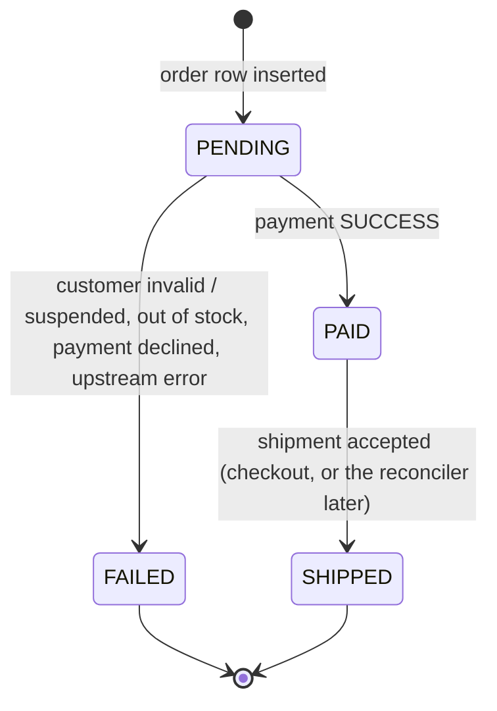
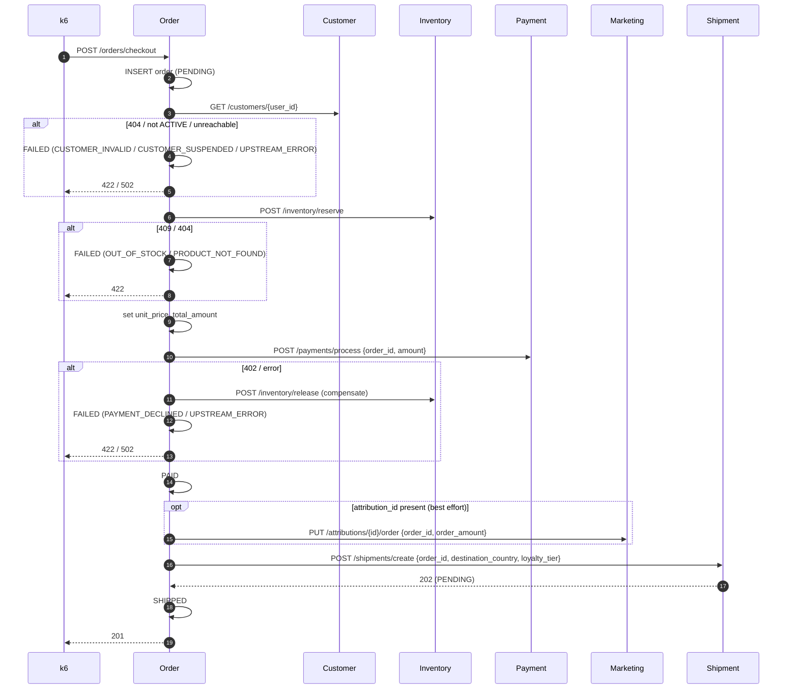

# Order Service: Checkout Orchestrator

> **Status: built.** Code is in [`services/order`](../../services/order). It's the only service that calls others, and it introduced the shared service-to-service client ([`pkgs/httpclient`](../../pkgs/httpclient)).

| | |
|---|---|
| Port | `8080` |
| Kubernetes service | `order-service` |
| Binary | `order` (`serve`, `migrate`) |
| Database | `orders` |
| Tables | `orders` |
| Called by | k6 (the edge API) |
| Calls | Customer, Inventory, Payment, Marketing, Shipment |

## Purpose

The Order Service is the central nervous system of the ecosystem. Every other service cares only about its own domain. The Order Service conducts the checkout so that the pieces come together into one coherent transaction: no charging for stock that doesn't exist, and no shipping when the payment was declined. In the Tempo service graph it's the hub, with edges to every other service.

## Responsibilities

- **Transaction state.** Records every checkout attempt and tracks its lifecycle: `PENDING` → `PAID` → `SHIPPED`, or `FAILED` at any step.
- **Distributed orchestration.** Runs the checkout as an ordered sequence of synchronous calls, releasing reserved stock when payment fails.
- **Financial record.** Who bought what, when, and for exactly how much (GMV). It also records *why* a failed order failed.
- **Recovery.** A background reconciler finishes orders that were paid but whose shipment request didn't go through.

## Data Model

The schema is the GORM model in [`internal/order/model.go`](../../services/order/internal/order/model.go), applied by `order migrate`:

```go
type Order struct {
	database.Model // id, created_at/updated_at (DB clock), deleted_at, (updated_at, id) index
	UserID        uint64  `gorm:"not null"`
	AttributionID *uint64 // nil for organic traffic
	ProductID     string  `gorm:"size:50;not null"`
	Quantity      int     `gorm:"not null;check:chk_orders_quantity,quantity >= 1"`
	UnitPrice     *decimal.Decimal `gorm:"type:decimal(10,2)"` // set once inventory reserves
	TotalAmount   *decimal.Decimal `gorm:"type:decimal(10,2)"`
	Status        Status          `gorm:"size:20;not null;index;check:chk_orders_status,..."`
	FailureReason *FailureReason  `gorm:"size:50;check:chk_orders_failure_reason,..."`
}
```

Changes from the original spec: `product_id`, `quantity`, `unit_price` and `failure_reason` were added (they were the proposed additions), and the shared conventions apply. `user_id` and `attribution_id` are logical references to other services' databases, not foreign keys.

**Failure reasons** are the peers' own error codes: `CUSTOMER_INVALID`, `CUSTOMER_SUSPENDED`, `OUT_OF_STOCK`, `PRODUCT_NOT_FOUND`, `PAYMENT_DECLINED`, `UPSTREAM_ERROR`.

### Status lifecycle



Every transition is one **guarded UPDATE** (`Repository.Apply`: `WHERE id = ? AND status = <from> RETURNING *`), so the checkout and the reconciler (or two replicas) can never both move the same order. A test races 20 goroutines on one transition and exactly one wins.

## API

### `POST /orders/checkout`

```json
{ "user_id": 1, "product_id": "PROD_0001", "attribution_id": 99, "quantity": 1 }
```

`user_id` and `product_id` are required. `attribution_id` is optional (organic traffic has none). `quantity` is optional, defaults to 1, max 100.

| Status | Body |
|---|---|
| `201 Created` | The order, `status` `SHIPPED`, with `tracking_number`. Also `201` with `status` `PAID` if the shipment request failed; the reconciler finishes it |
| `422 Unprocessable Entity` | Business failure: `{"error": "OUT_OF_STOCK", "message": "...", "order": {...FAILED order...}}`. Same for `CUSTOMER_INVALID`, `CUSTOMER_SUSPENDED`, `PRODUCT_NOT_FOUND`, `PAYMENT_DECLINED` |
| `502 Bad Gateway` | `UPSTREAM_ERROR`: a critical dependency was unreachable, timed out, or answered unexpectedly. Same body shape |
| `400 Bad Request` | `INVALID_REQUEST`. No order is created |
| `500` | The Order Service's own database failed |

Business failures are deliberately not 5xx, so k6's server-error rate means "the system is broken", not "a card was declined". The failure body carries the FAILED order, so callers still learn its ID.

Order response fields: `order_id`, `user_id`, `attribution_id`, `product_id`, `quantity`, `unit_price`, `total_amount` (money as fixed two-decimal strings, `null` until priced), `status`, `failure_reason`, `tracking_number` (checkout only), `created_at`, `updated_at`.

### `GET /orders/{id}`

`200` with the order, or `404 ORDER_NOT_FOUND`.

## Orchestration Flow

[`checkout.go`](../../services/order/internal/order/checkout.go):



### Failure semantics

| Failure point | Order status | `failure_reason` | Compensation |
|---|---|---|---|
| Customer 404 | `FAILED` | `CUSTOMER_INVALID` | none |
| Customer not `ACTIVE` | `FAILED` | `CUSTOMER_SUSPENDED` | none |
| Inventory 409 / 404 | `FAILED` | `OUT_OF_STOCK` / `PRODUCT_NOT_FOUND` | none |
| Payment 402 | `FAILED` | `PAYMENT_DECLINED` | release stock |
| Payment `409 ALREADY_PAID` | continues as paid | n/a | none. The order already has a successful charge, and Payment's guard is what prevents paying twice |
| Customer/Inventory/Payment unreachable | `FAILED` | `UPSTREAM_ERROR` | release stock if it was reserved |
| Marketing fails | unaffected | n/a | none. The click stays unconverted (logged at WARN) |
| Shipment fails | stays `PAID` | n/a | the reconciler retries it |

**A started checkout always finishes.** It runs on `context.WithoutCancel` of the request context (keeping the trace), so a caller that disconnects mid-checkout (a k6 pod being replaced, a client timeout) can't strand the order in PENDING with stock reserved. Each peer call keeps its own timeout, so a checkout still can't hang. Load testing on kind found this: restarting k6 cancelled in-flight checkouts halfway.

If releasing stock fails, it's logged at ERROR, and the Inventory restock loop eventually covers the leak. The service isn't a durable saga engine: if the process dies mid-checkout, an order can stay `PENDING` with stock reserved. That's acceptable for the demo.

### Reconciler

[`reconciler.go`](../../services/order/internal/order/reconciler.go) runs beside the HTTP server under the `errgroup`, like Inventory's restocker. Every `RECONCILE_INTERVAL` it loads up to 50 orders that have been `PAID` for longer than `RECONCILE_AFTER` (age measured with the database clock), re-reads each customer, and retries the shipment. Retrying is safe because the Shipment Service creates at most one shipment per order, and `PAID → SHIPPED` is guarded, which also makes it safe with several replicas. It never charges again.

## Service-to-Service Calls

[`clients.go`](../../services/order/internal/order/clients.go) wraps one [`httpclient.Client`](../../pkgs/httpclient/client.go) per peer:

- `otelhttp` transport, and every request built from the inbound context, so the whole checkout is **one trace**.
- A timeout per peer. Critical calls (customer, inventory, payment) default to 2s, marketing to 500ms, shipment to 1s.
- Error responses become `*httpclient.APIError` carrying the peer's error code. The typed clients turn the codes they branch on into sentinel errors (`ErrOutOfStock`, `ErrPaymentDeclined`, ...). Anything else is `UPSTREAM_ERROR`.
- Money is sent as fixed two-decimal strings.
- **No automatic retries.** Reserve, release and charge aren't idempotent per request.
- `clients_test.go` replays response bodies copied from each peer's real handler, pinning the contract.

## Configuration

| Flag / env var | Default |
|---|---|
| `--http-addr` / `HTTP_ADDR` | `:8080` |
| `--database-url` / `DATABASE_URL` | none |
| `--customer-url` / `CUSTOMER_URL` | `http://localhost:8081` (kind: `http://customer-service:8081`) |
| `--marketing-url` / `MARKETING_URL` | `http://localhost:8082` |
| `--inventory-url` / `INVENTORY_URL` | `http://localhost:8083` |
| `--payment-url` / `PAYMENT_URL` | `http://localhost:8084` |
| `--shipment-url` / `SHIPMENT_URL` | `http://localhost:8085` |
| `--critical-timeout` / `CRITICAL_TIMEOUT` | `2s` |
| `--marketing-timeout` / `MARKETING_TIMEOUT` | `500ms` |
| `--shipment-timeout` / `SHIPMENT_TIMEOUT` | `1s` |
| `--reconcile-interval` / `RECONCILE_INTERVAL` | `30s` (`0` disables) |
| `--reconcile-after` / `RECONCILE_AFTER` | `30s` |

## Running It

```sh
make deploy-all          # every service, leaf services first
make forward-order       # localhost:8080
curl -XPOST localhost:8080/orders/checkout -H 'content-type: application/json' \
  -d '{"user_id":1,"product_id":"PROD_0001"}'
make load RATE=10        # continuous k6 journeys inside the cluster
```

## Telemetry

- The checkout server span from `otelgin`, plus one client span per downstream call (`POST inventory-service`, ...). On `FAILED` the server span's status is set to error with the reason, so failed checkouts can be filtered in Tempo.
- Span attributes: `order.id`, `order.status`, `order.total_amount`, `order.failure_reason`, `customer.id`, `product.id`, `attribution.id`.
- `order.reconcile` root spans from the reconciler.

| Metric | Labels | |
|---|---|---|
| `orders_checkouts_total` | `status`, `reason` | Final outcome of each checkout |
| `orders_revenue_total` | | Dollars of successfully paid orders |
| `orders_reconciled_total` | `outcome` | Stuck orders retried (`shipped` / `failed`) |
| `http_client_requests_total` | `peer`, `method`, `status` | From `pkgs/httpclient`. `status="error"` means a transport failure or timeout |
| `http_client_request_duration_seconds` | `peer`, `method` | Latency of each downstream call as the Order Service sees it |

## Analytics Impact

This table drives the executive dashboards:

- **Heartbeat:** orders per minute, revenue per hour (`SUM(total_amount) WHERE status IN ('PAID','SHIPPED')`).
- **Checkout success rate:** shipped divided by all orders. Every attempt is a row, so the denominator is honest.
- **Failure breakdown:** count and dollar value by `failure_reason`, showing exactly where the business is losing money.
- **Join hub:** `orders` links customers (`user_id`), marketing (`attribution_id`), inventory (`product_id`), payments and shipments (`order_id`).
