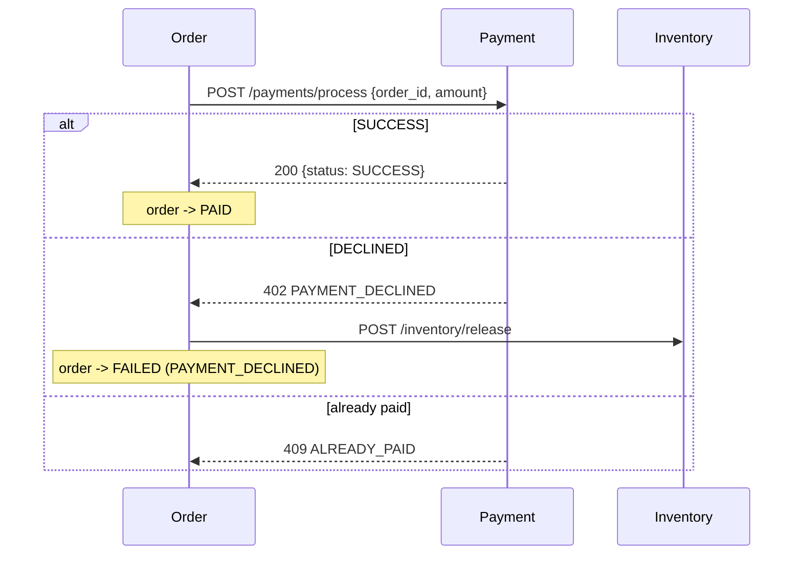

# Payment Service: Cash Register

> **Status: built.** Code is in [`services/payment`](../../services/payment). It follows the shared conventions in the [ecosystem README](README.md#3-shared-conventions), and adds one pattern of its own: a **partial unique index as the double-charge guard**.

| | |
|---|---|
| Port | `8084` |
| Kubernetes service | `payment-service` |
| Binary | `payment` (`serve`, `migrate`) |
| Database | `payments` |
| Tables | `payments` |
| Called by | Order Service |
| Calls | none (leaf node) |

## Purpose

The Payment Service stands in for a third-party gateway such as Stripe or PayPal. It processes charges and, just as importantly, **fails some of them on purpose**. If every payment succeeded, the demo analytics would have nothing interesting to show.

## Responsibilities

- **Transaction processing.** Takes an order amount and a payment method, decides an outcome, and records the transaction.
- **Simulated failures.** Declines a configurable share of charges (5% by default) with a random reason: declined card, insufficient funds, or suspected fraud.
- **No double charges.** An order can have any number of declined attempts but at most one successful payment, even when requests race. Postgres enforces this, not the application.
- **Payment state.** Records the money's state: `SUCCESS` or `DECLINED`, and `REFUNDED` when a return is simulated.

## Data Model

The schema is the GORM model in [`internal/payment/model.go`](../../services/payment/internal/payment/model.go), and `payment migrate` applies it with `AutoMigrate`:

```go
type Payment struct {          // table "payments"
	database.Model // id BIGSERIAL, created_at/updated_at TIMESTAMPTZ (DB clock), deleted_at, (updated_at, id) index
	OrderID       uint64          `gorm:"not null;uniqueIndex:idx_payments_order_id_success,where:status = 'SUCCESS' AND deleted_at IS NULL"`
	Amount        decimal.Decimal `gorm:"type:decimal(10,2);not null;check:chk_payments_amount,amount > 0"`
	Method        Method          `gorm:"size:20;not null;check:chk_payments_method,method IN ('CREDIT_CARD','PAYPAL')"`
	Status        Status          `gorm:"size:20;not null;check:chk_payments_status,status IN ('SUCCESS','DECLINED','REFUNDED')"`
	DeclineReason *DeclineReason  `gorm:"size:50;check:chk_payments_decline_reason,(decline_reason IS NOT NULL) = (status = 'DECLINED') AND (decline_reason IS NULL OR decline_reason IN ('CARD_DECLINED','INSUFFICIENT_FUNDS','FRAUD_SUSPECTED'))"`
}
```

Every attempt is recorded, including declines. A declined row is a real fact that the analytics depend on.

### The double-charge guard

```sql
CREATE UNIQUE INDEX idx_payments_order_id_success ON payments (order_id)
 WHERE status = 'SUCCESS' AND deleted_at IS NULL;
```

The index only covers successful payments, so declined attempts never collide with each other or with the eventual success. A second `SUCCESS` for the same order fails the `INSERT` with a unique violation, which the service returns as `409 ALREADY_PAID`. Because the database enforces it, this holds under any number of concurrent requests and replicas: an integration test fires 30 concurrent successful charges at one order and checks that exactly one is stored. Another test reads the index back from `pg_indexes`, since GORM's parsing of `where:` in index tags is easy to get wrong.

A `REFUNDED` payment drops out of the index, so a refunded order can be charged again.

Changes from the original spec:

- The conventions from the README: `BIGSERIAL`, `TIMESTAMPTZ`, `deleted_at` instead of `is_deleted`, enums as `VARCHAR` with named `CHECK`s.
- **`order_id` is `BIGINT NOT NULL`** (it was a nullable `INT`), and `amount` is `NOT NULL` with `CHECK (amount > 0)`.
- **`method` is `VARCHAR(20)`** (it was `VARCHAR(50)`), like every other enum column.
- **`decline_reason` added**, as the spec proposed. A `CHECK` allows only the three known reasons and requires the reason to be set exactly when the status is `DECLINED`.
- **`REFUNDED` status added**, with a refund endpoint (it was optional in the spec).
- **The partial unique index added** (not in the spec).

In Go the row is `payment.Payment`, and `amount` is a `decimal.Decimal`.

## API

All errors use the shared body `{"error": "<CODE>", "message": "..."}`. Amounts are decimal strings with two places (`"99.99"`).

The payment object returned by every endpoint:

```json
{ "payment_id": 5001, "order_id": 123, "amount": "99.99", "method": "CREDIT_CARD", "status": "SUCCESS",
  "created_at": "...", "updated_at": "..." }
```

`decline_reason` is added when the status is `DECLINED`.

### `POST /payments/process`

Charges an order. This call is on the checkout critical path.

```json
{ "order_id": 123, "amount": "99.99", "method": "CREDIT_CARD" }
```

- `order_id` is required, at least 1.
- `amount` is required: greater than 0, at most two decimal places (`"9.90"` and `"9.900"` are fine, `"9.999"` is not), and at most `99999999.99` (the `DECIMAL(10,2)` limit). It may be a JSON string or number; a string is recommended so the client can't round it.
- `method` is optional, `CREDIT_CARD` or `PAYPAL`. If it's omitted, the service picks one by `METHOD_WEIGHTS` (75% `CREDIT_CARD`, 25% `PAYPAL` by default).

Processing:

1. Validate the input.
2. Sleep for a uniformly random time between `LATENCY_MIN` and `LATENCY_MAX`, to mimic the gateway round trip so the step is visible in traces. If the caller gives up (the request context is cancelled), processing stops and nothing is recorded.
3. Draw a random number. If it is below `FAILURE_RATE`, the outcome is `DECLINED` with a uniformly random `decline_reason`. Otherwise it is `SUCCESS`.
4. `INSERT` the payment row and return it.

| Status | Body |
|---|---|
| `200 OK` | The payment object, `"status": "SUCCESS"` |
| `402 Payment Required` | `{"error": "PAYMENT_DECLINED", "message": "payment declined: INSUFFICIENT_FUNDS", "payment": {..., "status": "DECLINED", "decline_reason": "INSUFFICIENT_FUNDS"}}` |
| `409 Conflict` | `ALREADY_PAID`: the order already has a `SUCCESS` payment (nothing is recorded) |
| `400 Bad Request` | `INVALID_REQUEST` |

`402` is the documented exception to the README's status-code rule: a decline is neither bad input nor a state conflict. The body is the shared error shape extended with the recorded payment, so the caller gets the reason and the `payment_id` of the failed attempt.

The Order Service treats any non-`200` response, a timeout, or a transport error as a failed payment. It then releases the inventory and fails the order.

> **Retries.** If the Order Service retries a charge whose first response was lost, a retry that would succeed gets `409 ALREADY_PAID` instead of charging twice. A retry can still record an extra `DECLINED` row, which is harmless for the analytics. The `409` body doesn't include the existing payment, so a caller that wants to treat `ALREADY_PAID` as success has to look it up itself.

### `GET /payments/{id}`

| Status | Body |
|---|---|
| `200 OK` | The payment object |
| `400 Bad Request` | `INVALID_REQUEST` (ID not a positive integer) |
| `404 Not Found` | `PAYMENT_NOT_FOUND` |

### `POST /payments/{id}/refund`

Simulates a return: `SUCCESS` becomes `REFUNDED`. No body. The status check and the change are one statement, so two concurrent refunds can't both succeed:

```sql
UPDATE payments SET status = 'REFUNDED'
 WHERE id = $1 AND status = 'SUCCESS' AND deleted_at IS NULL
RETURNING *;
```

If no row was updated, a follow-up lookup tells an unknown payment apart from one that isn't refundable. It's an `UPDATE`, so it moves `updated_at` and the CDC sync picks the refund up.

| Status | Body |
|---|---|
| `200 OK` | The payment object, `"status": "REFUNDED"` |
| `400 Bad Request` | `INVALID_REQUEST` |
| `404 Not Found` | `PAYMENT_NOT_FOUND` |
| `409 Conflict` | `NOT_REFUNDABLE`: the payment is `DECLINED` or already `REFUNDED` |

### Operational endpoints

`GET /healthz`, `GET /readyz` (pings Postgres), `GET /metrics`.

## Failure Injection

The gateway ([`gateway.go`](../../services/payment/internal/payment/gateway.go)) takes its random numbers from replaceable functions, so tests choose the outcome, the decline reason and the latency exactly.

| Setting | Default | Effect |
|---|---|---|
| `FAILURE_RATE` | `0.05` | Share of charges declined. `0` never declines, `1` always does |
| `LATENCY_MIN` / `LATENCY_MAX` | `20ms` / `150ms` | Simulated gateway latency. `LATENCY_MAX=0` disables it |
| `METHOD_WEIGHTS` | `CREDIT_CARD=75,PAYPAL=25` | Method mix for charges sent without one |

Changes from the original spec:

- **Latency is configured as Go durations** (`LATENCY_MIN=20ms`) instead of `LATENCY_MIN_MS=20`, like `RESTOCK_INTERVAL` in the Inventory Service.
- **`FAILURE_RATE_BY_METHOD` is not implemented.** One rate is enough for the demo dashboards. It can be added later without changing the API.
- **`RANDOM_SEED` is not implemented.** The process uses Go's auto-seeded generator. Repeatability is what the unit tests need, and they get it by injecting the random functions.

## Interactions



The Payment Service is the final financial gatekeeper. It never calls another service, and it isn't responsible for compensation; that is the Order Service's job.

## Configuration

Every flag can also be set as an environment variable (`--failure-rate` ↔ `FAILURE_RATE`).

| Flag / env var | Default | Notes |
|---|---|---|
| `--http-addr` / `HTTP_ADDR` | `:8084` | Set by the chart from `port` |
| `--database-url` / `DATABASE_URL` | none | In kind: `postgres://datastack-pg-rw:5432/payments?sslmode=require`, with `PGUSER`/`PGPASSWORD` from the CNPG secret |
| `--failure-rate` / `FAILURE_RATE` | `0.05` | Between 0 and 1, otherwise the service refuses to start |
| `--latency-min` / `LATENCY_MIN` | `20ms` | Go duration. Must not exceed the max |
| `--latency-max` / `LATENCY_MAX` | `150ms` | Go duration. `0` disables simulated latency |
| `--method-weights` / `METHOD_WEIGHTS` | `CREDIT_CARD=75,PAYPAL=25` | Relative weights, need not sum to 100 |
| `--log-level`, `--log-format`, `OTEL_EXPORTER_OTLP_ENDPOINT` | | As for every service |

## Running It

```sh
make up && make run-payment     # local Postgres + go run on :8084
make deploy-payment             # kind (after make kind-up infra)
make forward-payment            # localhost:8084

curl -XPOST localhost:8084/payments/process -H 'content-type: application/json' \
  -d '{"order_id":123,"amount":"99.99"}'
```

## Telemetry

- Inbound spans from `otelgin`, with attributes `payment.id`, `order.id`, `payment.amount`, `payment.method`, `payment.status`, and `payment.decline_reason` (on declines).
- **Declines don't set the span's error status.** The spec asked for it, but a decline is a business outcome, not a fault in this service, and the Inventory Service treats `OUT_OF_STOCK` the same way. The Order Service marks its own checkout span as failed, and `payment.status = DECLINED` is still searchable in Tempo.
- The gateway latency is part of the request span; DB spans come from the GORM plugin.
- Prometheus domain metrics:

| Metric | Labels |
|---|---|
| `payments_total` | `status`, `method`. A refund counts once more, as `REFUNDED` |
| `payment_declines_total` | `reason` |
| `payments_amount_total` | `status`. Dollars, as a float (fine for a rate graph; StarRocks has the exact amounts) |

## Analytics Impact

`payments` is the bedrock of finance and revenue-assurance dashboards:

- **Processed vs attempted revenue:** `SUM(amount) WHERE status='SUCCESS'` vs `SUM(amount)`. Because retries can add extra `DECLINED` rows for one order, "attempted" is best counted per distinct `order_id`.
- **Revenue leakage:** declined dollars per day, by `decline_reason`, by payment method, and by customer segment (`payments ⋈ orders ⋈ customers`).
- **Refunds:** refunded dollars over time, from `status='REFUNDED'` rows and their `updated_at`.
- **ROAS denominator:** cleared payments joined through `attributions` give the true revenue per campaign.
