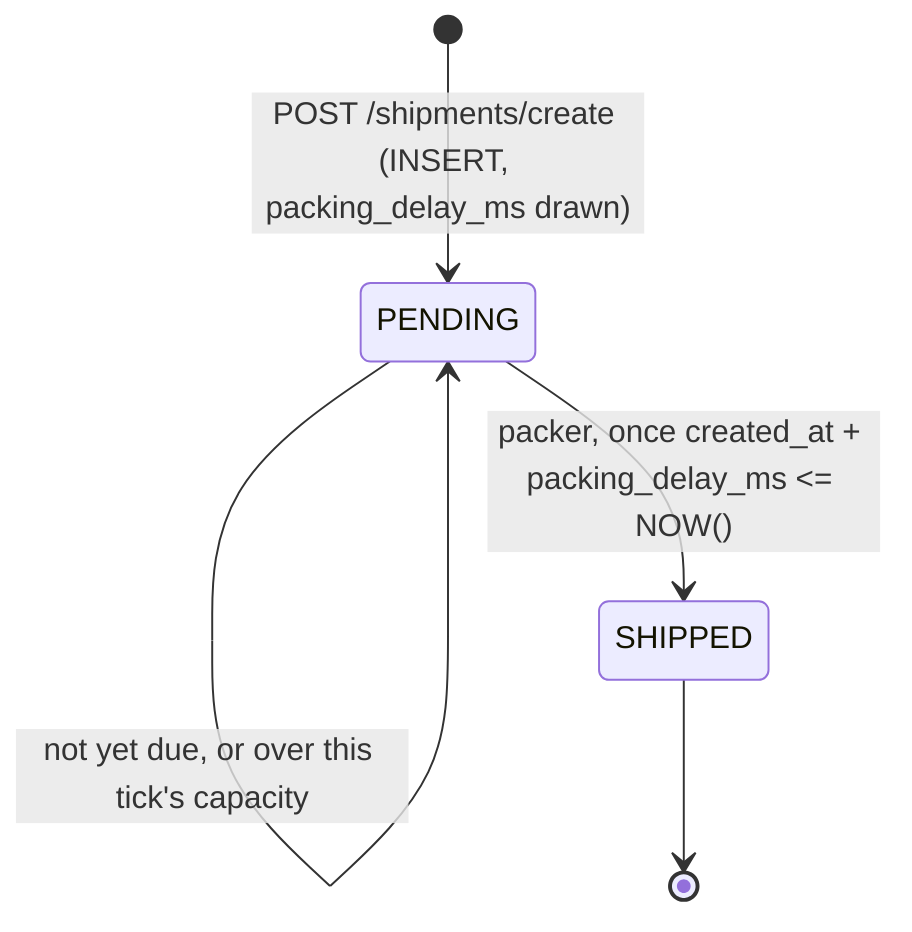
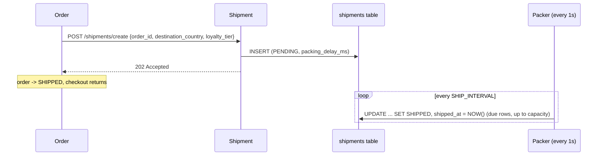

# Shipment Service: Fulfillment Engine

> **Status: built.** Code is in [`services/shipment`](../../services/shipment). It follows the shared conventions in the [ecosystem README](README.md#3-shared-conventions). Its packing worker is the first one that is driven entirely by database state: it replaces the in-memory queue from the original spec (see [Why not an in-memory queue](#why-not-an-in-memory-queue)).

| | |
|---|---|
| Port | `8085` |
| Kubernetes service | `shipment-service` |
| Binary | `shipment` (`serve`, `migrate`) |
| Database | `shipments` |
| Tables | `shipments` |
| Called by | Order Service |
| Calls | none (leaf node) |

## Purpose

The Shipment Service represents putting boxes on trucks. It is the asynchronous tail of checkout: it turns a completed digital transaction into a physical logistics workflow that takes real (simulated) time.

## Responsibilities

- **Logistics tracking.** Assigns a carrier (`FEDEX`, `UPS`, `DHL`) based on the destination and generates a tracking number in that carrier's real-world shape.
- **Simulated real-world delay.** Packing a box isn't instantaneous. Each shipment gets a random packing delay, shorter for GOLD customers, and a background worker ships it once that delay has passed.
- **Load-sensitive fulfillment.** The worker ships a fixed number of boxes per tick, so during k6 bursts a backlog builds up and time-to-ship grows.
- **Fulfillment state.** Moves each shipment from `PENDING` (label printed) to `SHIPPED` (box on the truck) and records `shipped_at`.

## Data Model

The schema is the GORM model in [`internal/shipment/model.go`](../../services/shipment/internal/shipment/model.go), and `shipment migrate` applies it with `AutoMigrate`. There is no seed data: every shipment comes from a checkout.

```go
type Shipment struct {          // table "shipments"
	database.Model // id BIGSERIAL, created_at/updated_at TIMESTAMPTZ (DB clock), deleted_at, (updated_at, id) index
	OrderID            uint64     `gorm:"not null;uniqueIndex:,where:deleted_at IS NULL"`
	Carrier            Carrier    `gorm:"size:20;not null;check:chk_shipments_carrier,carrier IN ('FEDEX','UPS','DHL')"`
	TrackingNumber     string     `gorm:"size:100;not null"`
	Status             Status     `gorm:"size:20;not null;check:chk_shipments_status,status IN ('PENDING','SHIPPED');index:idx_shipments_pending,expression:created_at,where:status = 'PENDING' AND deleted_at IS NULL"`
	DestinationCountry string     `gorm:"size:2;not null"` // ISO 3166-1 alpha-2
	PackingDelayMS     int        `gorm:"not null;check:chk_shipments_packing_delay_ms,packing_delay_ms >= 0"`
	ShippedAt          *time.Time // set by the packer from NOW()
}
```

Indexes, all checked by an integration test against `pg_indexes`:

| Index | Definition | Serves |
|---|---|---|
| `idx_shipments_order_id` | `UNIQUE (order_id) WHERE deleted_at IS NULL` | One shipment per order, which makes create idempotent |
| `idx_shipments_pending` | `(created_at) WHERE status = 'PENDING' AND deleted_at IS NULL` | The packer's oldest-first scan and the backlog count. It stays small: only unshipped rows are in it |
| `idx_shipments_cdc_cursor` | `(updated_at, id)` | The CDC sync daemon (from `database.Model`) |

Changes from the original spec:

- The conventions from the README: `BIGSERIAL`, `TIMESTAMPTZ`, `deleted_at`, the `updated_at` trigger, and named `CHECK`s on `carrier`, `status` and `packing_delay_ms`.
- **`destination_country` added** (open question 7). It's received in the create payload and drives the carrier mix, so the carrier-by-country dashboard needs it.
- **`shipped_at` added.** `updated_at` is overwritten by every later update, such as a future `DELIVERED` status, so it can't be the source for "time to ship". Time-to-ship is always `shipped_at - created_at`, and both come from the database clock.
- **`packing_delay_ms` added.** It is what lets the worker decide in SQL which rows are due (see below), and it makes the simulated delay visible in analytics: queueing time is `shipped_at - created_at - packing_delay_ms`.
- **`order_id` is unique among live rows**, as the original spec proposed.

## API

All errors use the shared body `{"error": "<CODE>", "message": "..."}`.

### `POST /shipments/create`

Accepts a paid order for fulfillment and answers immediately. The Order Service calls it as the last step of checkout and doesn't wait for packing.

```json
{ "order_id": 123, "destination_country": "US", "loyalty_tier": "GOLD" }
```

| Field | Rules |
|---|---|
| `order_id` | Required, at least 1 |
| `destination_country` | Required, ISO 3166-1 alpha-2 (upper case, as the Customer Service stores it) |
| `loyalty_tier` | Optional, `BRONZE`, `SILVER` or `GOLD`. Not stored: it only shortens the packing delay for GOLD. The Order Service already has it from `GET /customers/{id}` |

What happens ([`planner.go`](../../services/shipment/internal/shipment/planner.go)):

1. **Carrier**, weighted by destination:

   | Destination | UPS | FEDEX | DHL |
   |---|---|---|---|
   | `US` | 45% | 40% | 15% |
   | anywhere else | 15% | 25% | 60% |

2. **Tracking number** in the carrier's shape: UPS `1Z` + 16 upper-case alphanumerics, FedEx 12 digits, DHL 10 digits.
3. **Packing delay**, uniform in `[PACKING_DELAY_MIN, PACKING_DELAY_MAX]` (millisecond resolution), multiplied by `GOLD_DELAY_FACTOR` for GOLD customers, so the VIP SLA dashboard shows a difference.
4. `INSERT` a `PENDING` row. If the order already has a live shipment, the unique index rejects the insert (`gorm.ErrDuplicatedKey`) and the existing shipment is returned unchanged, with whatever status it has by now. Concurrent creates for one order race on the index, and every caller gets the winner's row (covered by a test).
5. Respond **202 Accepted**. Nothing is handed to a worker: the row itself is the job.

| Status | Body |
|---|---|
| `202 Accepted` | `{"shipment_id": 777, "order_id": 123, "carrier": "UPS", "tracking_number": "1Z4F7Q...", "status": "PENDING", "destination_country": "US"}` (also for a repeat of an existing order) |
| `400 Bad Request` | `INVALID_REQUEST` |

### `GET /shipments/{order_id}`

Drill-down read for debugging and the demo. Looks the shipment up by **order**, since that's the ID callers have.

```json
{ "shipment_id": 777, "order_id": 123, "carrier": "UPS", "tracking_number": "1Z4F7Q...",
  "status": "SHIPPED", "destination_country": "US", "packing_delay_ms": 6120,
  "created_at": "...", "shipped_at": "...", "updated_at": "..." }
```

`shipped_at` is omitted while the shipment is `PENDING`.

| Status | Body |
|---|---|
| `200 OK` | The shipment, as above |
| `400 Bad Request` | `INVALID_REQUEST` (`order_id` not a positive integer) |
| `404 Not Found` | `SHIPMENT_NOT_FOUND` |

### Operational endpoints

`GET /healthz`, `GET /readyz` (pings Postgres), `GET /metrics`.

## Background Packing Worker



[`packer.go`](../../services/shipment/internal/shipment/packer.go) runs beside the HTTP server under an `errgroup`, like the Inventory Service's restocker. A shutdown signal stops both, and the database closes only after the last packing query.

Every `SHIP_INTERVAL` it runs one statement ([`repository.go`](../../services/shipment/internal/shipment/repository.go)):

```sql
WITH due AS MATERIALIZED (
    SELECT id
      FROM shipments
     WHERE status = 'PENDING'
       AND deleted_at IS NULL
       AND created_at + packing_delay_ms * INTERVAL '1 millisecond' <= NOW()
     ORDER BY created_at, id
     LIMIT :ship_capacity
       FOR UPDATE SKIP LOCKED
)
UPDATE shipments
   SET status = 'SHIPPED', shipped_at = NOW()
  FROM due
 WHERE shipments.id = due.id
RETURNING shipments.*;
```

- **Postgres is the only clock.** Whether a row is due is decided in SQL against `NOW()`, the same clock that set `created_at`, and `shipped_at` is `NOW()` too. The pod never computes a time, so clock skew can't ship a box early, late, or with a negative time-to-ship.
- **Load-sensitive latency.** At most `SHIP_CAPACITY` boxes ship per tick, per replica, oldest first (the live `ship_capacity` chaos knob, whose default is `SHIP_CAPACITY`; `0` pauses shipping, see [Chaos](#chaos)). Under a k6 burst, due rows queue up and time-to-ship grows beyond the packing delay. That's what makes "is fulfillment slowing down under load?" show up in the dashboards. Scaling the Deployment adds warehouse capacity.
- **Safe with several replicas, without leader election.** `FOR UPDATE SKIP LOCKED` means a replica skips rows another one is shipping instead of waiting for them, and a row already shipped fails the `status = 'PENDING'` re-check. An integration test runs 8 concurrent packers over 60 due rows and checks every row is shipped exactly once.
- **Why a CTE, and why raw SQL.** The selection is a `MATERIALIZED` CTE so it runs exactly once. With `WHERE id IN (SELECT ... LIMIT ... FOR UPDATE)` the planner may rescan the subquery and lock (and ship) more than the capacity. GORM has no builder for an `UPDATE` driven by a locking CTE, so this one statement is `db.Raw`. Everything else goes through GORM.
- **Backlog gauge.** Each tick also counts the `PENDING` rows (served by the small partial index `idx_shipments_pending`) into `shipments_pending`.
- **Tracing.** Each run is its own root span, `shipment.pack`, with `shipment.shipped` and `shipment.pending` attributes and one `shipment.shipped` event per box (carrying `order.id`, `shipment.id`, `shipment.carrier`, `shipment.packing_delay_ms`). It isn't linked to the checkout trace: nothing about the request is stored, and the box ships seconds after that trace ended. Search Tempo by `order.id` to connect them.
- A failed run is logged and the loop carries on. `SHIP_INTERVAL=0` disables the loop (shipments then stay `PENDING`).

### Why not an in-memory queue

The original spec had `POST /shipments/create` push the shipment ID onto a buffered channel, a fixed pool of goroutines sleep through the delay, and a sweeper re-enqueue rows stranded by a restart. The database-driven worker replaces all of that:

| | In-memory queue + sweeper | DB-driven packer |
|---|---|---|
| Restart or crash | Queue lost; a sweeper must find and re-enqueue stranded rows | Nothing to lose: the row is the job |
| Several replicas | Each holds its own queue; the sweeper can double-enqueue | One guarded statement, safe across replicas |
| Clock | Delay timed by the pod | Delay evaluated by Postgres |
| Load sensitivity | Fixed worker pool | Fixed capacity per tick |
| Moving parts | Channel, pool, queue size, sweeper | One ticker, one query |

The cost is up to one `SHIP_INTERVAL` of extra latency per box (1s by default), which is noise next to 2–30s of packing.

## Chaos

Runtime failure injection for live demos, from the shared [`pkgs/chaos`](../../pkgs/chaos) package:

- `GET /admin/chaos` returns `{"service": "<name>", "knobs": [{"name", "description", "value", "default", "min", "max"}, ...]}`, `latency_ms` first.
- `PUT /admin/chaos` with a partial object such as `{"latency_ms": 500}` changes those knobs and returns the same body. It is all-or-nothing: an unknown knob or a value outside `[min, max]` (or a fraction for a whole-number knob) is `400 INVALID_REQUEST`, and nothing changes.
- `DELETE /admin/chaos` resets every knob to its default.

The `/admin` routes are traced, logged and metered like the API, but never delayed by `latency_ms`. Every change is logged at INFO with the old and new value, and the gauge `chaos_knob_value{knob}` shows the current values. **Values live in the pod's memory**: a restart resets every knob to its default, and with several replicas each pod has its own values (every service runs one replica in kind).

| Knob | Range | Default | Effect |
|---|---|---|---|
| `latency_ms` | 0 to 5000, whole | `0` | Delay before every API request is handled (not `/admin`, probes or `/metrics`). It ends early if the caller gives up (`503 REQUEST_CANCELLED`), and shows on the request span as the attribute `chaos.latency_ms` plus `chaos.latency.start`/`chaos.latency.end` events |
| `packing_delay_factor` | 1 to 20 | `1` | Multiplies the packing delay drawn for **new** shipments (after the GOLD discount). Shipments already created keep their delay |
| `ship_capacity` | 0 to 1000, whole | `SHIP_CAPACITY` | Boxes shipped per packer run, read live. `0` pauses shipping: the backlog (`shipments_pending`) keeps growing and is still measured |

## Interactions



The order is marked `SHIPPED` once this service accepts the request; the real ship time lives in `shipments.shipped_at`. See open question 5 in the [ecosystem README](README.md#7-open-design-questions).

## Configuration

Every flag can also be set as an environment variable (`--ship-capacity` ↔ `SHIP_CAPACITY`). The service refuses to start with an invalid combination.

| Flag / env var | Default | Notes |
|---|---|---|
| `--http-addr` / `HTTP_ADDR` | `:8085` | Set by the chart from `port` |
| `--database-url` / `DATABASE_URL` | none | In kind: `postgres://datastack-pg-rw:5432/shipments?sslmode=require`, with `PGUSER`/`PGPASSWORD` from the CNPG secret |
| `--packing-delay-min` / `PACKING_DELAY_MIN` | `2s` | Go duration, at least 0 |
| `--packing-delay-max` / `PACKING_DELAY_MAX` | `30s` | Must be at least the min |
| `--gold-delay-factor` / `GOLD_DELAY_FACTOR` | `0.5` | In (0, 1]. `1` turns VIP priority off |
| `--ship-interval` / `SHIP_INTERVAL` | `1s` | Go duration. `0` disables the packer |
| `--ship-capacity` / `SHIP_CAPACITY` | `10` | Boxes shipped per tick, per replica. At least 1 (and at most 1000, the knob's range). Default of the `ship_capacity` chaos knob |
| `--log-level`, `--log-format`, `OTEL_EXPORTER_OTLP_ENDPOINT` | | As for every service |

The original spec's `PACKING_WORKERS`, `PACKING_QUEUE_SIZE` and `GOLD_PRIORITY` are gone: capacity replaces the worker pool, there is no queue, and GOLD priority is always on (set the factor to `1` to disable it).

## Running It

```sh
make compose-up && make run-shipment      # local Postgres + go run on :8085
make deploy-shipment              # kind (after make kind-up infra)
make forward-shipment             # localhost:8085

curl -XPOST localhost:8085/shipments/create -H 'content-type: application/json' \
  -d '{"order_id":123,"destination_country":"US","loyalty_tier":"GOLD"}'
curl localhost:8085/shipments/123  # SHIPPED within ~1-15s
```

## Telemetry

- Inbound spans from `otelgin`, with attributes `order.id`, `shipment.id`, `shipment.carrier`, `shipment.packing_delay_ms`, and on create `shipment.created` (`false` for an idempotent repeat).
- `shipment.pack` root spans from the background packer, as described above.
- Prometheus domain metrics:

| Metric | Type | Labels |
|---|---|---|
| `shipments_created_total` | counter | `carrier`. Idempotent repeats aren't counted |
| `shipments_shipped_total` | counter | `carrier` |
| `shipment_time_to_ship_seconds` | histogram | Buckets 1s–300s. `shipped_at - created_at`, both from the DB clock |
| `shipments_pending` | gauge | The backlog, as of the last packer run |

## Analytics Impact

This is the main data source for operations and supply-chain dashboards:

- **Fulfillment latency:** `shipped_at - created_at` (or `- orders.created_at` for checkout-to-truck), as percentiles over time. Does it get slower during load tests? Subtracting `packing_delay_ms` isolates the queueing the capacity cap adds.
- **Carrier distribution:** share of volume by `carrier`, and by `destination_country`.
- **VIP SLA compliance:** time-to-ship by `customers.loyalty_tier` (`shipments ⋈ orders ⋈ customers`). GOLD boxes pack in half the time by default.
- **Backlog:** count of `PENDING` shipments over time (also live in Prometheus as `shipments_pending`).
